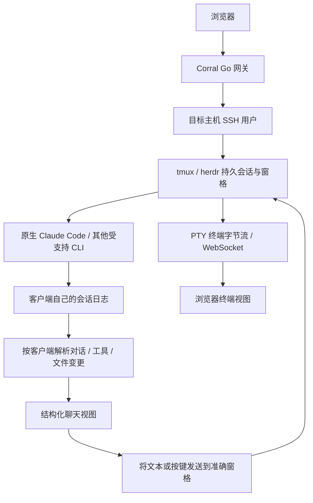

# 产品化智能体工作台、流式会话与后台 Skill 设计

日期：2026-11-23。状态：**技能后台与正文流式首批实现，原生终端与本机 Bridge 待实现**。本文补充并修订 [Skill 功能入口设计](SKILL-PLACEMENT-DESIGN.md)，现状仍以 [当前状态](STATUS.md) 和源码为准。实现边界及验证记录见本文末尾；其余章节保留目标设计，不能据此推断全部交付。

## 1. 目标与职责

将智能体对话建设为完整的 Claude Code Web 工作台：持续原生会话、实时回答与工具过程、图片和文件、可配置模型与额度、自定义 Skill、MCP、权限交互、停止和恢复。平台负责材料、账号、配置、产物和展示；研究与处理交给真实智能体执行。

避免以固定按钮、静态提示词和普遍的小额度包装全部能力。普通对话允许自然回答与多步工具执行；结构化导读、前沿候选等在保存相应产物时校验契约，不要求所有回答都套同一种格式。

“完整体验”是产品目标，不直接宣称所有 CLI 功能已经可用。按实际部署的 CLI/网关版本建立能力清单，逐项接入与验证；不支持的能力提供具体原因和配置入口。账号、工作区、文件和凭据隔离仍由平台执行。

## 2. 改造前的输出链路与差距

代码核对：Runner 以 stream-json 读取 Claude Code，内部 SSE 转发进度；_subset 截断文本，Web API 存最近进度快照；浏览器端已有事件 URL，但 ChatPanel.watchRun 仍每两秒轮询，完整 answer 主要在结束时写入。CLI 参数未显式启用细粒度部分消息，Runner 也未处理文本 delta 事件。

因此当前为“进度更新 + 最终回答”，还不是完整的逐段回答流。现有 Vue/FastAPI/私有 Runner 架构可以继续使用，无需为流式输出更换技术栈。

## 3. 完整流式设计

### 事件与状态

按 CLI 实际协议归一化事件：run.started、message.started、text.delta、message.completed、tool.started、tool.progress、tool.completed、permission.required、run.completed、run.failed、run.cancelled、heartbeat。

每条事件包含 run_id、单调递增 seq、类型、消息/工具标识、时间和 payload；SSE id 使用 run_id 与 seq。正文只在 delta 中追加一次，最终结果执行一致性收敛，不能把已显示全文再次拼接。工具输出和正文分开，不将内部推理、密钥或原始敏感环境当作普通文本广播。

拟新增 agent_run_events 与可恢复的消息快照，Run 保留原任务/会话映射。高频 delta 在内存按短时间窗合并，约 300–500ms 批量持久化；前端约 50–100ms 合并显示更新，避免每个 token 写数据库或重渲染整段 Markdown。精确频率以测试结果调整。

### 订阅、断线和回放

浏览器实际消费 SSE，接收终态后停止订阅。断线通过 Last-Event-ID 或受限 after_seq 补读事件，按序号去重；游标过旧返回明确的快照恢复指示。补连只恢复同一 Run 的显示，不重发创建任务、不隐式付费重跑。

切换标签只停止当前订阅，后台任务继续；重新进入加载快照并补流。账号失效或撤销后关闭长连接；事件和快照均按所属工作区及会话授权。保留单原生会话的并发锁，防止两个任务争用同一 native session。

### 展示与失败

正文逐步出现；工具活动用紧凑状态/折叠过程展示。Markdown 中未闭合代码、公式和表格容错渲染，仍使用净化层。用户停留底部时跟随，上翻阅读时不强制跳动。停止后保留已产生内容并明确其部分结果状态，失败保留可解释原因。

CLI 未产生增量、网关不支持或代理缓冲时，要显示实际执行状态，不能将完整回答事后打字模拟成真实流式。生产验证需要核对 CLI 版本、部分消息参数/事件形状、网关和公网代理链路；声明支持不等于已通过实测。

## 4. Claude Code 工作台能力与配置

| 能力 | 目标交互及边界 |
| --- | --- |
| 连续对话 | 保持原生会话、历史与材料关联，允许在兼容会话中按轮次调用不同 Skill |
| 文件与代码 | 在明确授权的账号工作区内读取、编辑、运行任务并查看结果；论文原件与生成文件分开管理 |
| 原生工具与 MCP | 按执行环境和权限配置启用；不继续用全局空工具参数封闭所有工作模式 |
| 图片与资料 | 真实传递附件和材料引用；模型不支持图片时在发送前提供可操作错误 |
| 权限交互 | 展示待批准操作、目标和范围，允许批准/拒绝；会话或工作区授权不得扩展到宿主其他用户环境 |
| 停止与延续 | 停止真实进程，保存部分结果；继续是显式的新轮次，不自动重跑已失败付费请求 |
| 模型与额度 | Web 配置、有效参数预览与实际结果一致；按方案/任务可调整，不普遍套用固定 $0.20、4 次工具或 6 页限制 |
| 调试与产物 | 可查看实际模型、版本、工具状态、错误、文件变更与产物；默认主界面保持紧凑 |

设计两类可配置执行环境：现有研究工具环境，以及隔离工作区中的通用 Claude Code 环境。后者可接入文件/代码工具与权限请求桥接。不得仅删除 --restricted/--tools 参数就在共享宿主环境开放运行；需先具备工作区挂载、凭据隔离、工具适配及可取消进程管理。

已有宿主 Claude Code 的全局配置继续服务其他场景，Firework 使用独立配置与会话目录。自定义 API、Skill 和 MCP 的变更不写入宿主用户的全局配置。单次输出、时长、并发和工具限制统一来源于实际配置；关闭金额估价守卫不代表模型网关或基础设施没有上限。

后台可配置权限模式，但 UI 必须基于实际支持能力给出有效选项；不能展示 CLI 尚未适配的虚假“全功能”开关。

## 5. Skill 可在后台直接设计

### 管理页面

技能库增加“新建 Skill”，同时保留导入 ZIP、复制现有技能两条路径。后台页面包含：

- 基本资料：显示名、稳定标识、简介、分类、标签；支持中文显示名与搜索。
- 指令编辑器：直接编辑 SKILL.md/Markdown、预览、查看差异。
- 资源管理：管理 references、模板和允许的资源；路径、类型和大小校验复用包管理。编辑器不执行上传代码。
- 适用功能：阅读对话、独立对话、比较、审查、前沿、导读等可见性/可用范围。
- 执行适配：所需工具、原生工具需求、MCP、图片/材料要求、可选结构化产物契约。
- 测试与发布：结构校验、明确触发的试运行、结果与证据查看、发布版本、默认版本和启停。

流程：新建/复制/导入 → 保存草稿 → 编辑指令与资源 → 配置显示名、范围和适配 → 校验 → 按需试运行 → 发布不可变版本 → 在配置入口选择并执行。

保存草稿、改名、预览和校验不调用模型。试运行才创建可见的真实任务，测试材料、模型和限额明确可查，不自动带入全部私有资料。

### 显示名与稳定身份

现有 SkillUpdate.name 已支持名称修改，应复用为显示名语义，完善前后台入口和一致性；不把改名伪装成新增 Skill。skill_id/slug 是稳定技术身份，display_name/name 是可更改的界面名称。

改名影响技能库、选择器、主题配置和方案显示，不修改 ID、历史版本哈希、模板关联或会话映射。允许重名时以分类/简介/稳定标识辅助区分，不能按显示名执行。历史 Run 保存执行时名称快照，同时可查看当前名称。

### 草稿与发布模型

拟新增 skill_drafts（skill_id、draft_revision、entry、资源清单和元数据）及原子发布流程。内容寻址的版本包复用现有 skills/skill_versions、哈希与资源存储；新增 source=editor 需兼容现有 builtin/zip 枚举、前端筛选和备份。

元数据与功能范围有各自修订；修改草稿不影响正在运行的版本，发布并选择默认版本后才影响后续选择。内置技能可改当前账号显示名与范围；修改其共享指令时使用“复制为自定义技能”，避免改掉其他账号的内置资源。

Web、ZIP 导入与导出应走同一验证/发布服务，导出的包可以再导入。脚本和依赖只有在执行环境明确支持并获得所需权限后才运行；不能把“编辑器支持上传脚本”错误理解为“服务器自动执行脚本”。

## 6. 自定义 Skill 的运行与会话

普通对话支持自定义指令与允许的原生/MCP 工具，不要求自定义技能先伪装成内置 paper_read。单轮至少记录主 Skill 的固定版本，后续可扩展明确选中的辅助技能，保留各自版本和调用关系。模板属于具体 Skill 或被明确标记为通用要求。

修订前一份入口设计的规则：**技能绑定以 Run/轮次为粒度；兼容的技能切换默认延续同一会话。** 会话固定的是执行环境和信任边界，不永久锁死为一种研究提示词。

切换前预检工具权限、资料范围、版本、模型/方案及输出契约；若需要扩权，显示并处理权限请求，不静默扩大执行方案。角色和指令变化按真实 CLI 语义传递并保存，不能只改按钮名称。适配器无法支持同原生会话切换时，说明原因并明确创建分支/新会话，保留旧历史。

结构化任务依旧通过对应适配器发布产物：前沿报告验证引用、去重与批准；导读验证文件版本和定位证据。这些约束施加于产物提交接口，普通聊天可以自然输出，不因没有生成批注 JSON 就报错。

## 7. 清理无效说明与静态限制文案

清理包括导读确认区目前仍存在的固定说明，例如“本次调用现有智能体，预算上限 $0.20。部分材料会如实标注，当前不看图、不读代码。相同结果优先复用”。其中金额、视觉和材料能力可能与当前配置不一致，不能继续作为普遍事实展示。

| 内容 | 处理方式 |
| --- | --- |
| 固定预算、固定页数、固定工具次数说明 | 从普通操作界面移除；需要查看时在配置详情展示实际生效参数 |
| “当前不看图、不读代码”等通用能力否定 | 移除硬编码说明；所选环境/模型确实缺能力时给出针对当前操作的阻塞原因 |
| 反复强调“调用现有智能体”“确认才收费” | 从菜单和正常输入流程清除冗余段落；需要决策时显示实际权限或模型变更 |
| 大块保存成功、空闲原生会话和重复帮助 | 保持紧凑，仅对保存失败、等待批准、异常和真实执行状态提供反馈 |
| 研究结果的证据与覆盖 | 保留真实材料、页码、未知项和部分结果标识，避免让简化界面造成研究误解 |
| 权限、不可恢复操作与错误 | 保留与当前操作有关的有效提示，不以“去说明文字”为由隐藏真实风险或失败 |

不是只把文字删掉：同时检查实际行为和配置来源。仍有固定金额守卫或材料上限时先参数化，不能删去提示后假称能力已开放。用量数据继续记录，默认对话不铺陈费用说明，检查页按需查看。

## 8. 拟议接口与实施顺序

以下为原始接口建议。已实现接口以 [注册路由](API-ROUTES.md) 与本文实现记录为准，其余仍为设计。

| 接口领域 | 拟议契约 |
| --- | --- |
| 技能草稿 | POST /api/skills/drafts；GET/PATCH /api/skills/{id}/draft，携带 expected_draft_revision |
| 资源编辑 | 仅按允许的相对资源路径编辑，受类型/体积/版本校验；无任意服务器路径 |
| 发布与预检 | POST /api/skills/{id}/publish；复用现有验证任务，发布不等于模型试运行 |
| 入口范围 | 使用功能入口设计中的 placements/available 规划 |
| 会话执行 | 新 Run 固定主/辅助 Skill 版本与上下文；执行环境/权限边界由后端解析 |
| 事件订阅 | 扩展现有 GET /api/agent/runs/{id}/events，携带有序增量、终态与恢复快照 |
| 权限答复 | 拟新增 Run 内权限请求答复接口，绑定请求 ID、账号、期限与真实 CLI 请求，写入需 CSRF |

交付顺序：

1. 清理无效文案与配置源，补齐版本/模型能力检查；不虚报已经开放的工具。
2. 交付后台 Skill 创建编辑、显示名、资源、范围和版本发布，以及真实 Skill 选择器。
3. 完成 CLI 增量适配、事件存储、SSE 订阅与断线恢复，让正文、工具活动和终态一致。
4. 支持兼容会话内的逐轮自定义 Skill 切换，并完成方案/权限预检。
5. 引入隔离工作区中的文件/代码工具与权限交互；逐项扩大原生 Claude Code 能力。
6. 接入前沿、比较、导读的真实自定义 Skill 适配与产物管理，完善检查器和运行质量。

## 9. 验收

- 后台新建并发布一个自定义 Skill，改显示名后可在指定入口找到并真实运行；未配置入口不出现，重名不混用 ID。
- 编辑草稿、预览、改名不产生模型任务；历史版本与已运行结果不被覆盖；ZIP 与编辑器版本可互通。
- 正文在任务完成前持续增量出现，工具过程单独显示；不以事后打字动画代替真实流式。
- 断线/切标签后恢复同一 Run，无重复文本、无第二次模型执行；账号失效不能继续接收事件。
- 停止保留部分结果；Markdown、长答案、代码块、表格和图片不会破坏阅读滚动。
- 在同一兼容会话先用自定义阅读 Skill，再用审查 Skill；Run 各自保存真实版本与材料，无静默扩权。
- 文件/代码能力在隔离工作区内完成真实最小任务，其他账号与宿主 Claude 全局配置不受影响。
- 不再显示失效的 $0.20、通用“不看图/不读代码”等说明；实际配置变化后 UI 与运行限制一致。
- 最小真实验证分别覆盖文本、工具、图片和自定义 API；仅能通过模拟测试的能力明确标记为未实测。

## 10. Corral 原生智能体机制核对与 Firework 接入决策

核对日期：2026-11-23。实际获取的 Corral main 提交为 `2e5ef74765f05dd2359195489a4445516d8f42e5`；此前参考的 `d9c88d3` 是旧时点，不作为本节当前机制的版本依据。本文为代码核对和独立设计参考，没有复制 Corral 实现。

### 实际链路

Corral 的“本机”是它通过 SSH 连接的目标主机；浏览器本身不能扫描访问者电脑的程序、进程或 Claude 配置。目标 SSH 用户原有的 CLI、终端会话及会话文件是主要数据源。已知客户端使用专门适配器，不是自动识别任意本机程序。

| 环节 | 已核对的 Corral 机制 | 关键源码 |
| --- | --- | --- |
| 原生会话发现 | 目标机上匹配进程、窗格环境和 TTY；Claude 使用 ~/.claude/sessions/<pid>.json 对应到 session，再定位 ~/.claude/projects 下 JSONL。结合进程启动时间等信息避免误认会话 | [conversation.go](https://github.com/ihainan/corral/blob/2e5ef74765f05dd2359195489a4445516d8f42e5/internal/web/conversation.go) |
| 新建与恢复 | 通过 herdr 或独立 tmux 会话，在指定目录启动已知 CLI；使用客户端各自的恢复/分支参数，Claude 为 --resume 等；登录 shell 提供程序路径和用户环境 | [agents_new.go](https://github.com/ihainan/corral/blob/2e5ef74765f05dd2359195489a4445516d8f42e5/internal/web/agents_new.go) |
| 聊天呈现 | 读取客户端原生日志，解析用户消息、回答、工具调用及关联结果；前端按 gen/rev/seq 增量合并，支持读取更早记录 | [claude.go](https://github.com/ihainan/corral/blob/2e5ef74765f05dd2359195489a4445516d8f42e5/internal/convo/claude.go)、[conversation.ts](https://github.com/ihainan/corral/blob/2e5ef74765f05dd2359195489a4445516d8f42e5/web/src/terminal/conversation.ts) |
| 消息与权限交互 | 将网页文本/命令发送到明确的原生窗格，使用 paste/send-keys 等路径；发送前校验会话、进程、窗格和当前输入状态，权限问题使用对应客户端的真实交互路径 | [conversation.go](https://github.com/ihainan/corral/blob/2e5ef74765f05dd2359195489a4445516d8f42e5/internal/web/conversation.go)、[askhook](https://github.com/ihainan/corral/tree/2e5ef74765f05dd2359195489a4445516d8f42e5/internal/askhook) |
| 实时终端 | WebSocket 转发 PTY 的输入、输出、窗口大小和流控；持久会话由 tmux/herdr 维护，浏览器离开不等于结束智能体 | [api_pane_ws.go](https://github.com/ihainan/corral/blob/2e5ef74765f05dd2359195489a4445516d8f42e5/internal/web/api_pane_ws.go) |
| 技能与命令 | 扫描当前用户和项目的 .claude/commands、.claude/skills，以及 Codex/OpenCode 对应目录，形成真实命令补全；不是把几个通用提问伪装成已安装技能 | [complete.go](https://github.com/ihainan/corral/blob/2e5ef74765f05dd2359195489a4445516d8f42e5/internal/web/complete.go) |

### 流式与兼容性的重要区别

Corral 终端画面通过 WebSocket 实时传递；结构化聊天视图使用 API 轮询增量读取原生日志，并非所有模型文本都走 token delta。日志何时落下正文决定结构化视图能显示多细，不能把“读取 JSONL”直接承诺为逐 token 回答。

其原生进程识别代码包含 Linux /proc 路径和终端/屏幕适配，且多种 CLI 的日志、命令和交互各不相同。Firework 若接本地 macOS 或其他系统，需要独立的 OS/客户端适配与测试，不能照搬 Linux 进程扫描后宣称跨平台完成。

### Firework 的接入决策

以“原生会话优先、研究管理复用”为目标，补充原生交互适配层，而不是只给当前 --print 任务换一个漂亮聊天窗口。

1. **Provider/Host 注册**：登记本机或远端运行环境、已知 CLI 类型、版本、可执行路径、配置根、工作区和真实能力。安装检测与运行会话发现分开；命令存在不等于已登录或支持所需功能。
2. **NativeSession 映射**：保存 account_id、host_id、provider、native_session_id、工作目录、进程/窗格标识与生命周期；读取、控制、恢复必须校验这些稳定绑定，不按标题猜会话。
3. **双视图**：结构化对话作为日常研究界面；提供原生终端/权限交互作为完整功能入口。后台研究任务继续支持已有可观测 Runner。两条执行路径不能同时争写同一原生会话。
4. **统一事件适配**：有稳定事件 API/SDK 的客户端优先接真实事件；原生日志用于回放和补全；PTY/屏幕用于原生交互及必要回退。SSE 负责浏览器的结构化事件推送，WebSocket 负责终端双向字节流。更换传输协议本身不会生成上游不存在的 token 增量。
5. **会话内命令与 Skill**：读取授权配置根和项目里的真实技能作为候选，标注来源、稳定标识与版本。后台编辑的 Skill 可发布到 Firework 管理的独立配置根；显示名只用于界面，实际调用仍使用稳定命令/ID。导入宿主技能需用户选择，不扫描后自动执行或修改宿主全局目录。
6. **保留 Firework 研究层**：论文、分类、文件版本、批注、前沿候选、审批和知识数据仍在平台管理。原生能力与研究工具通过受控接口连接，产物提交复用现有证据与版本校验，不以截图或终端文本代替可靠入库。

### 服务器已有 Claude 与用户本机 Claude

现有服务器 Claude Code 由服务器侧 Runner/适配器连接。用户自己 Mac 上的 Claude 不会因为打开 Firework 网站就自动可见；设计需要显式连接的本地 Bridge 或用户授权的 SSH 通道。

本地 Bridge 仅发布用户选择的 CLI 配置根、会话/工作区和能力，配对后绑定账号与设备，可撤销；默认不上传整个 ~/.claude、完整历史或模型密钥。后台多账号不能因共享一个宿主 SSH 用户就共同访问所有会话。连接来源、共享范围和凭据使用方式需在页面明确显示，避免把 Corral 的 SSH 用户边界误当作 Firework 已具备的租户隔离。

优先顺序：先接现有服务器上的隔离原生 Claude Code 会话，再补用户本机 Bridge；其他 Provider 分别适配。独立的 Skill 后台设计、显示名和入口范围应先收敛成统一注册表，不能直接暴露任意宿主目录作为公共技能库。

### 增补验收

- 发现一个真实的授权 Claude 原生会话，显示完整历史并准确发送到该会话；错误窗格或进程复用时拒绝发送。
- 从 Web 创建和恢复原生会话，关闭/重连浏览器后任务仍在，恢复时没有重复进程或重复消息。
- 在网页读取真实命令/Skill 候选，后台编辑发布的技能在独立配置根可被实际调用，改显示名不会改调用 ID。
- 原生权限请求能被正确呈现与答复；终端、结构化视图和任务锁一致，拒绝/取消状态能回传。
- 回放来源是客户端日志或事件，不能把屏幕中的任意文字当作可信系统状态；CLI 升级导致解析失效时有明确退化路径。
- 本地 Bridge、服务器 Provider 和账号之间不混用凭据、历史、文件或原生会话；结构化逐段流式以实际客户端输出验证。

## 11. 2026-11-23 首批实现记录

本批实现迁移 0023、Runner 协议 9，包含以下链路：

- 后台“技能库 → 新建 Skill / 配置与设计”：编辑指令、Markdown 预览、文本资源、工具清单、显示名和功能范围；保存草稿与发布分离。已发布版本不可修改，已有会话继续使用固定版本。内置指令以副本方式编辑。
- 功能范围为阅读对话、研究对话、比较、审查、前沿、导读。范围控制不会扩大资料或工具权限；前沿与导读另检查结构化工具契约。未配置范围的旧 ZIP 只有符合导读/前沿工具契约时恢复相应入口，其余需手动配置。
- 新建任务可指定技能版本；对话输入区展示注册技能，提示词模板置于其后，选中技能不立即运行。同一原生会话允许逐轮切换兼容技能，实际 Run 记录技能和版本；固定执行方案会话更换技能仍需新建会话。
- 前沿主题保存所选技能与版本；导读复用同一范围配置。普通对话不接受需要专用任务上下文的工具契约。
- Claude CLI 启用 `--include-partial-messages`。Runner 合并可见文本 delta，排除思考和子任务内容，经密钥脱敏后推送；应用持久化累计正文及修订，浏览器使用 SSE 替换累计快照。断线重新订阅读取最新快照，失败时回退状态轮询，不重复提交任务。
- 这是累计快照恢复，不是完整事件账本或逐事件重放。最终回答以 CLI 终态为准；没有上游增量时不伪造流式文本。
- 草稿、范围和元数据具有修订冲突检查；发布事务复用 ZIP 校验/安装/版本/审计。编辑器资源只允许 references/、templates/ 下文本，总计250KB；上传脚本不会被执行。数据库沿用 source=zip，manifest.authoring_source=editor 标记后台来源。

本批仍使用现有受控 `--print` Runner。PTY 终端、原生权限交互、读取其他宿主会话、Provider 发现和本机 Bridge 尚未实现；不能宣称已成为功能完整的原生 Claude Code。宿主工具限制暂保留，待账号工作区隔离后再扩展。既有 ZIP 和内置技能额度未被批量取消，后台编写技能复用账号额度配置。

验证：后端323项通过、5项因环境缺少sqlite3命令行跳过；前端259项通过，类型检查/构建通过。包含Runner正文先于终态、SSE累计快照替换/不重发任务、技能发布/旧修订拒绝/账号隔离、同一原生会话切换技能保留论文。未执行付费模型请求，真实服务商输出质量不在本轮验证范围。

上线补充：应用镜像显式包含内置skills资源；缺失入口时返回明确错误，避免复制空指令。Runner失败或取消而未提供最终正文时保留已持久化的流式正文。补充31项相关回归通过。
