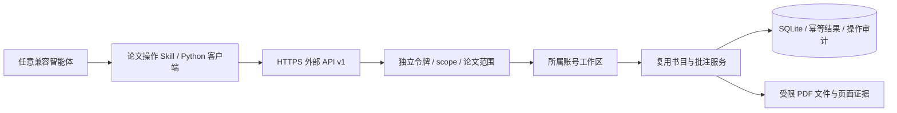

# 外部智能体论文接口与通用 Skill

更新：2026-11-22。本文区分当前交付与后续设计。实现依赖业务迁移 0021、身份 schema 3；模型执行方案另见 [Runner 配置](RUNNER-CONFIGURATION.md)。

## 1. 目标与职责

外部智能体负责理解用户需求、研究和组织操作；Firework 负责论文、文件、批注、版本、权限与持久化。调用方不需要复用服务器的 Claude Code，也不需要获得 Firework 管理员密码。支持读取 Skill、运行 Python 或发出 HTTPS 请求的智能体可接入；不同宿主的技能安装约定仍需遵守。

## 2. 当前交付

Web：`/#/settings/integrations`。当前账号可创建带用途名称、操作范围、有效期和可选论文白名单的授权；完整密钥只在创建响应显示一次，不存浏览器本地存储。页面支持查看和撤销授权，默认只读。

| 操作 | 路径（前缀 `/api/external/v1`） | scope |
| --- | --- | --- |
| 能力与授权范围 | `GET /capabilities` | 有效令牌 |
| 搜索与分页 | `GET /papers` | papers:read |
| 分类树 | `GET /collections` | 不限论文的 papers:read |
| 论文详情 | `GET /papers/{pid}` | papers:read |
| 创建书目记录 | `POST /papers` | 不限论文的 papers:write |
| 更新书目与分类归属 | `PATCH /papers/{pid}` | papers:write |
| PDF 信息、页文本 | `GET /papers/{pid}/document`、`/pages/{page}` | papers:read |
| 当前 PDF 下载 | `GET /papers/{pid}/file` | files:read |
| 批注列表 | `GET /papers/{pid}/annotations` | annotations:read |
| 新建批注 | `POST /papers/{pid}/annotations` | annotations:write |
| 编辑、软删除或恢复批注 | `PATCH /papers/{pid}/annotations/{ident}` | annotations:write |

元数据更新支持题名、作者、单位、简要摘要及分类列表，复用现有校验与 `metadata_version`。创建书目不会自动下载 PDF、解析、索引或启动智能体。现阶段不开放论文永久删除、PDF 上传、任意 URL 抓取、模型任务和外部 MCP 注册。

请求字段与示例见 [Skill 接口参考](../plugins/agent-skill/firework-paper-ops/references/api.md)，完整路由见 [路由清单](API-ROUTES.md)。读写 scope 独立；需要先读后改时应同时授予相应读取权限。

## 3. 安全与鉴权

- 浏览器管理接口仍使用登录 Cookie + CSRF；外部接口只接受 `Authorization: Bearer fw_…`，不接受网页登录作为替代。外部令牌不能访问浏览器、管理员、内部工具、Runner 接口。
- 密钥使用高熵随机数，仅将 SHA-256 哈希存入集中身份库；查询授权列表不返回原文或哈希。每个授权固定所属账号，通过可信工作区映射访问该账号数据库和文件。
- 检查过期、撤销、账号是否允许登录及 `session_version`；密码重置或会话版本变化使旧令牌失效。当前主管理员登录策略仍适用。
- 每个令牌每分钟最多 60 次请求，JSON 请求体最多 64 KiB，兼顾 Content-Length 和分块请求；搜索页大小为 1–100。拒绝浏览器跨站请求，不新增宽松 CORS。
- 可限定最多 200 个已有论文 ID；在查询分页前限制结果。受限授权不能新建论文或枚举完整分类树。论文 ID 不是跨账号全局授权标识。
- PDF 只按论文 ID 解析到工作区 `papers/` 内的实际文件，不接受服务器路径。输出不包含 `pdf_path`。客户端要求 HTTPS、拒绝携带凭据的 URL，拒绝重定向以防转发 Bearer。
- 论文、摘要与批注均是待处理材料，不能作为更换账号、导出其他资料或执行命令的指令。Skill 明确要求先读授权及原文，再按用户目标写入。

## 4. 一致性、冲突与审计

写入必须包含 `Idempotency-Key`（1–80 字符）。按授权 ID 与键保存请求 method、path、body 摘要及结果；同键同请求返回既有结果，同键不同内容返回 409。使用独立 SQLite 连接和事务，领域写入、幂等结果、操作审计同时提交或回滚，避免重试产生重复条目。

书目编辑要求当前 `metadata_version`；过期返回 409。批注编辑要求当前记录 `etag`，响应返回新 ETag；原始 AI 批注不可被直接改写内容。新批注必须绑定当前 PDF 哈希、页码、有效引文和坐标；普通便笺可不带高亮框，但不能伪造文件版本或超出页码。

业务库 `external_operations` 存成功结果，`external_audit` 存授权 ID、method、目标和时间；身份库 `auth_audit` 存授权创建与撤销。每个授权记录最后使用时间。不将完整 Key 写入这些记录。当前未提供独立审计浏览器或自动清理策略；备份和保留期限需结合研究数据策略另行配置。

错误：401 为凭据无效，403 为权限不足，404 为不可见或不存在，409 为版本/证据/幂等冲突，422 为字段无效，429 为限流。冲突需要刷新并协调，不自动改用新键强行覆盖。

## 5. 数据模型与接口复用

| 数据 | 位置 | 用途 |
| --- | --- | --- |
| external_tokens | 集中身份库 | account_id、哈希、scope、论文范围、版本、到期、撤销、限流与最后访问 |
| external_operations | 各账号业务库 | token_id + request_key 唯一，保存请求摘要和成功结果 |
| external_audit | 各账号业务库 | 变更目标、动作与时间 |
| papers / 分类关联 | 原有业务库 | 继续使用 metadata_version 与来源归属规则 |
| reader_annotations / document_versions | 原有业务库 | 继续保留批注文件版本和原文证据 |

代码入口：[鉴权](../app/external/auth.py)、[API](../app/external/router.py)、[中间件](../app/auth/middleware.py)。API 复用书目、批注与 PDF 服务，不复制一套独立论文模型。归属来自授权账号，客户端不能指定 account_id/workspace/path。

## 6. Skill 分发与使用

源码：[SKILL.md](../plugins/agent-skill/firework-paper-ops/SKILL.md)。部署下载：`/downloads/firework-paper-ops.zip`。由 [构建脚本](../scripts/build_agent_skill.py) 生成确定性 ZIP，只打包 Markdown 和 Python 源码，不包含密钥、运行缓存或用户资料。

1. 在当前账号设置页签发最小授权，保存到本地权限 600 的私有文件。
2. 按智能体宿主规则安装 Skill，设置 `FIREWORK_URL` 与 `FIREWORK_TOKEN_FILE`。不把 Key 放进提示词或命令参数。
3. 调用 `capabilities`、`search`、`show`；书目修改从详情取版本；批注从 document/page 获取证据。
4. 生成 JSON 输入文件，写入时指定稳定请求键，成功后核对返回 ID 与字段。
5. 不再使用时在 Web 撤销授权。Skill 只读取既有环境，不修改宿主模型配置或服务器 Claude 全局配置。

客户端仅依赖 Python 标准库。JSON 命令不会自动下载 PDF；有 files:read 的调用方可使用直接下载端点。批量操作仍逐项受限流与版本校验，不是事务性批量修改。

## 7. 后续分期设计

| 批次 | 规划 | 验收边界 |
| --- | --- | --- |
| A（本次） | 授权管理、书目增改查、批注证据、只读 PDF、可移植 Skill | 跨账号与范围拒绝；重复写入不重复；过期版本不覆盖 |
| B | 文件上传与版本接入、分类创建/移动、可恢复论文回收站 | 新增独立 scope、上传类型/大小校验、版本与来源保护；不直接永久删除 |
| C | 受控材料导出与研究产物回流、独立审计页、授权轮换与保留策略 | 导出范围明确、可追溯来源、脱敏、不泄露会话与连接密钥 |
| D | 外部智能体或 MCP 适配器 | REST 为稳定底层；协议适配不能扩大账号/scope/论文范围；工具发现不等于授权 |

首批不为多样化接入重建模型执行器。外部智能体直接使用数据 API；部署内研究任务继续走现有 Runner。两者共享论文事实和版本约束，分别授权、计量和排查。
