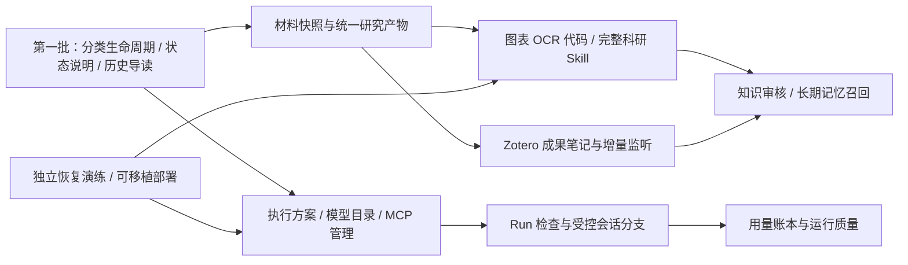

# 未完成能力的实施计划与交付批次

日期：2026-11-22。基于 [需求总览](PROJECT-AUDIT.md)；当前批次在既有 Vue/FastAPI/Runner 上增量实现，不替换会话、文件和账号模型。下文明确区分本批落地与后续目标；未来资源名称不代表已经注册的 API。

## 1. 交付顺序与依赖

第一批优先解决每天使用时的整理与查阅问题。后续执行配置和材料质量可分线推进；跨任务知识必须建立在来源清楚的研究产物之上。运行隔离、账号边界和成本验证贯穿所有批次。

## 2. 第一批：本次实现

### 2.1 分类生命周期

**范围**：个人分类重命名、移动、整棵子树移入分类回收站与恢复；管理对话框和回收站入口。

**数据**：迁移 `0020_collection_lifecycle.sql` 新增 `revision`、`deleted_at`、`deletion_group`；有效同级分类保持名称唯一。论文/项目与分类的关联保留。已单独删除的子分类不随后续父分类恢复而复活。

**接口**：

| 接口 | 契约 |
| --- | --- |
| `GET /api/library/collections?trashed=true` | 查询回收站；`restore_root` 表示可恢复的删除批次根节点 |
| `PATCH /api/library/collections/{id}` | 完整提交 name、parent_id、expected_revision；原子校验后更新 |
| `DELETE /api/library/collections/{id}` | 请求体 expected_revision；整棵有效子树软删除，保留归属 |
| `POST /api/library/collections/{id}/restore` | 请求体 expected_revision；从批次根整体恢复 |

**约束**：禁止自身/后代作为父分类；同级重名、陈旧修订、已删除父分类和恢复冲突返回 409。活动导入引用分类时阻止删除。所有写入复用账号工作区和 CSRF。删除不删除论文、项目、PDF、会话或批注，也不传播远端删除。

**来源目录**：Zotero 当前以设备来源根和分类路径建立映射，网页直接改名/移动会造成下一次推送重建目录。首批将 `Zotero · ` 来源根下的树作为同步维护目录，禁改名/移动/删除及添加个人子分类；个人分类另行创建。一篇论文仍可同时归入来源分类和个人分类。后续若需要双端移动，必须先增加稳定的来源分类键映射和冲突协议，不能只修改显示名称。

**验收**：父类筛选/数量正确；删除后进入未分类视图仍可找到论文；改论文其他属性不擦除已删除分类的恢复信息；恢复后 ID、子类与归属不变；跨账号 ID、无 CSRF、循环移动和重复提交均受保护。Zotero 书目/PDF 交换和前沿审批回归保持通过。

### 2.2 认证说明与核对纠错

上一轮总览仅根据 `profile_view()` 的本机默认值作了错误判断。真实请求经 `account_profile()` 已将 auth 置为 True，认证机制无需重写。本批增加明确的 `login_policy` 响应和 UI 说明，将“账号隔离已启用”与“仅主管理员可登录/管理员启用的账号可登录”分别呈现。注册仍关闭，登录权限不扩大。

验收使用真实认证中间件调用 `/api/me`，不能只测关闭认证的本机 fixture。

### 2.3 历史导读

复用已有 `GET /api/reader/papers/{pid}/guides`，增加只读历史选择器、摘要/路线/重点解释/引文查看和 Markdown 导出，保留 Skill、Run 和 PDF 版本来源。首批展示最近 30 条。

历史查看不修改当前导读或 AI 图层，不调用模型。只有文件哈希与当前版本一致时允许原文定位；旧 PDF 版本只读展示，不错误叠加批注。失败记录保留状态与错误，不冒充有效成果。

## 3. 第二批：材料快照与研究产物

- 复用 document_versions、Run、导读和报告；新增不可变材料清单及统一产物修订关系。每份产物记录论文、文件版本、页段、会话/Run、Skill 版本、覆盖和结果状态。
- Run 提交前冻结材料身份；执行时逐步记录实际读取材料，区分“授权可读”和“已经读取”。默认 PDF 变化不重写旧 Run 的材料证据。
- 前端文件/版本页显示索引状态、相关会话及成果；历史产物不自动切成当前正文。
- 验收：同论文两版 PDF 可追溯；旧引文可访问原文件；失败/部分覆盖有明确状态；不自动迁移人工批注。

先完成契约与数据迁移，再替换各模块分散的成果导出，禁止直接将既有 answer 字符串全部当作可信知识。

## 4. 第三批：Zotero 研究成果桥

依赖第二批的产物修订和稳定来源标识。

1. **子笔记回流**：只发送用户选定导读/比较/报告；笔记包含摘要、证据页码、PDF 哈希、Run/Skill 和 Firework 回链。以成果 ID 映射 Zotero note key，重试更新同一笔记，保留用户本地修改冲突提示。
2. **选定分类监听**：插件仅监听用户勾选分类，复用官方 Connector 已保存条目；本地事件去重后排队，支持暂停、恢复与候选审批。不接管浏览器抓取权限。
3. **原生批注/阅读状态**：另建按 PDF 哈希绑定的 annotation key 映射，先单向再双向；坐标转换、类型、删除标记及用户修改冲突分别验证。不同版本不得套用坐标。

验收：重复推送不无限新增笔记；两个账号/库的标识不混用；离线队列可重试；外部用户改动不会被静默覆盖；插件重启凭据与映射仍在。

## 5. 第四批：执行方案、模型与 MCP 管理（基础版已交付）

已实现：配置模型目录、版本化执行方案、补充角色、内置 MCP 清单及工具权限收窄、会话绑定与 Run 快照。模型仍按连接登记，专用任务不走通用方案；外部服务与真实能力验证仍按下述规划。详见 [Runner 配置](RUNNER-CONFIGURATION.md#10-执行方案与内置-mcp本次交付)。

- **Web 页面**：连接 → 模型/能力 → 角色 → Skills/工具 → 额度 → 有效执行方案预览。保存与预检不调用模型；真实最小探测单独确认目标、材料及上限。
- **模型能力**：声明/实测/未知分开。一个连接可登记多个准确模型；视觉和长上下文不可仅凭名称判定。
- **MCP**：先增加只读内置工具目录与授权预览，再增加受管外部服务。凭据按账号保存，发现工具不自动授权；工具清单变更使既有方案修订失配，不能扩权续跑旧任务。
- **执行隔离**：固定 CLI/服务镜像，独立配置目录与可控网络；外部服务启用前需要工作区令牌、凭据转交/清理和返回结果脱敏测试。
- **验收**：同一账号方案固定修订，账号默认变更不改旧任务；无回退宿主/其他账号 Key；无“安装即授权”；每次执行可还原生效配置。

新 API 路由和 Runner 协议升级应与实现同步登记；本计划不把尚不存在的目标路径写入现行 API 清单。

## 6. 第五批：会话检查与用量

- 独立 Run 详情页汇集状态时间线、材料清单、工具、配置修订、部分输出、失败原因和费用来源；复用现有 events 与 diagnostics。
- 增加脱敏调试包和持久事件索引，先只读回放；分支/切换连接另作显式操作，显示将发送给新服务商的旧内容范围。
- 用量分输入/输出、单次/累计、CLI 估价/实际账单；未知为未知。增加请求级账本与账号聚合后再承诺累计硬限额。
- 验收：导出不含 Key/Cookie/令牌，旧历史记录不被迁移改写；失败不自动重跑；追加额度仍需明确发送；准确解释由哪一层限制终止。

## 7. 第六批：完整科研 Skill 与知识记忆

### 材料链

先做按资产 ID 授权的图表/公式与 OCR，再引入限定官方仓库/修订的代码材料。扩展工具需要同步输入模型、权限、材料溯源和测试，不能通过上传 Skill 文本绕过。

### 阅读质量

低成本概览明确材料/页数/调用上限；精读按动机、方法、训练、数据、信息流、代码例子等真实覆盖生成产物。kelip/nature 适配必须分别给出材料、工具、产物与缺口验收，不以同名技能安装成功代替兼容。

### 知识与长期记忆

已确认产物 → 候选知识 → 人工审核 → 发布/更新/撤销 → 检索召回。保留原文/AI 推断/个人观点区别；跨任务召回带来源，撤销内容不再默认召回。先账号私有，不默认共享或自动把聊天全部写入记忆。

验收包括错误引文、过期版本、被撤销知识和跨账号同 ID 的负例；Qdrant 命中不是正确引用的充分条件。

## 8. 前沿追踪质量补齐

- 作者/团队匹配先引入来源标识和别名候选，再人工确认消歧，保留检索覆盖与误匹配证据；不能把字符串相同视作同一个作者。
- 在现有间隔调度上增加时区/日历触发、错过窗口策略和全局任务协调，继续使用主题修订、来源游标与幂等 Run，不重复生成同窗报告。
- 先有第五批用量观测再增加跨主题成本分配，报告区分首次发现、实质更新与重复；可回到具体来源与审批记录。
- 验收：DST/时区边界、同名作者、多来源同论文、开源项目改名/版本更新、暂停恢复均有测试；外部来源失败不冒称完整覆盖。

## 9. 运维与部署工作流

- 在独立目录/端口恢复身份、业务库、文件、Skill、原生会话、主密钥及向量；验证真实解密和文件哈希后形成演练报告。不得在生产覆盖恢复。
- 先配置化 CLI 路径、回调和 legacy 参数，再引入单独 Runner 容器；不把当前环境变量隔离当作容器验收。
- 多副本前外置队列、并发/会话锁与调度协调；不直接横向复制现有单 worker。
- 每批：隔离回归 → 空闲任务检查 → 成套备份与旧镜像 → 同步版本/迁移 → 无模型冒烟 → 有限 UI 验收 → 文档/Git。需要真实模型验证时再明确触发最小任务。

## 10. 本批交付记录

第一批代码、迁移、界面和回归已经实现；发布与检查结果写入 [当前状态](STATUS.md)。第二至第六批及运维扩展仍为实施计划，未因本批提交变成已完成能力。后续可按每批接口、数据、UI、隔离与验收依赖继续推进。

## 外部智能体数据接入增量

已交付首批授权管理、书目增改查、PDF 证据读取、批注与通用 Skill；其边界、后续分期和验收统一见 [外部 API 方案](EXTERNAL-AGENT-API.md)。不将外部数据操作等同于新的付费任务执行权限。

## Skill 配置与功能入口增量（待实现）

按 [Skill 可见性与入口设计](SKILL-PLACEMENT-DESIGN.md) 实施：入口目录/统一 resolver → 技能配置页与范围预览 → 阅读对话真实 Skill 选择及模板归属 → 比较/审查/导读 → 前沿主题与调度的固定版本绑定。可见性不替代工具授权，既有会话不静默切换技能；具体迁移和验收以该设计为准。
