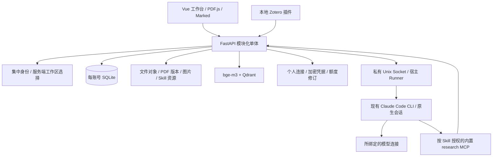
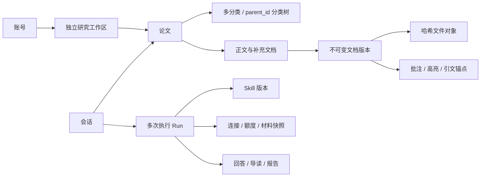

# Firework 项目总览与需求核对

核对日期：2026-11-22（Asia/Shanghai）。代码基线：`4abeb365e1c0af42f04733cb2060baa095325b12`，与本次只读核对的服务器仓库提交一致。原核对基线业务迁移至 **0019**，身份 schema **2**，Runner 协议 **7**，Zotero 插件 **0.1.4**。

本文对照当前代码、项目文档及本聊天中的用户需求。对话中提出过的设想不自动视为已交付；代码中存在模型、历史表、配置字段或同名 Skill，也不代表完整产品能力。本文提供一次核对快照（后续增量见 [实施计划](IMPLEMENTATION-PLAN.md)）；长期入口仍是 [架构](架构.md)、[当前状态](STATUS.md)、[使用指南](usage.md) 和 [后续计划](ROADMAP.md)。

> 后续增量：首批已发布迁移 0020、分类生命周期、历史导读及登录策略说明。本表其余内容保留原代码基线的核对时点；最新交付见 [当前状态](STATUS.md)，后续接口和验收见 [实施计划](IMPLEMENTATION-PLAN.md)。

## 1. 当前结论

Firework 已形成 **论文与文件管理 + 多标签阅读 + 可延续智能体会话 + 可插拔 Skills + 前沿发现审批 + Zotero 手动交换** 的研究工作台。核心组织已经从早期直接编排研究流程，变成平台管理实体与证据、现有 Claude Code 经 Runner 执行 Skill。

基础链路“界面 → 会话/Run → Runner/Claude Code → 授权工具 → 数据库/文件 → 结果展示”已实现，不需要重建。最近统一了首页入口和“任务与模板”面板，已不应继续作为待开发事项。

尚未闭合的主要链路是：

1. **执行配置**：个人 API 和额度已有，但模型目录、独立角色/执行方案、通用 MCP 管理、完整会话检查器仍缺失。
2. **研究质量**：能阅读、比较、审查和生成结构化导读，但没有完成全文、图表、OCR、官方代码与证据覆盖的统一材料链。
3. **研究积累**：论文、批注、导读、报告和会话各自持久化，但尚未汇聚成可审核、可撤销、跨任务召回的知识与长期记忆。
4. **Zotero 成果回流**：书目/分类/PDF 可手动双向交换；原生批注、阅读状态、导读/比较笔记和 Connector 增量监听尚未交付。

## 2. 文档地图与本次发现

### 2.1 现行文档职责

| 文档 | 应回答的问题 |
| --- | --- |
| [英文 README](../README.md)、[中文 README](../README.zh-CN.md) | 项目是什么、当前功能、安装入口与明确限制 |
| [文档入口](README.md) | 去哪里找到各专题的权威说明 |
| [本总览](PROJECT-AUDIT.md) | 历史需求与当前实现如何对应、哪些仍未闭合 |
| [架构](架构.md) | 当前组件、部署、账号边界、数据与执行流 |
| [使用指南](usage.md) | 如何完成导入、阅读、配置、追踪和交换 |
| [当前状态](STATUS.md) | 当前实现与验证边界，不堆叠发布日志 |
| [后续计划](ROADMAP.md) | 尚未实施的能力与验收方向 |
| [接口约定](API.md)、[路由清单](API-ROUTES.md) | 业务契约及注册 HTTP 方法/路径 |
| [Runner 配置](RUNNER-CONFIGURATION.md) | 当前连接、额度、快照与续聊限制 |
| [Skills](SKILLS.md) | 包结构、安装、版本、工具权限与导读协议 |
| [认证](AUTHENTICATION.md) | 身份、登录策略和独立研究工作区 |
| [环境](enviroment.md)、[开发](DEVELOPMENT.md) | 当前部署、安装升级、开发测试与发布 |
| [备份恢复](BACKUP-RESTORE.md) | 必须成套保留哪些数据，以及怎样恢复 |
| [智能体界面](AGENT-UI.md) | 会话/结果模式与管理层交互的实现范围 |
| [设计语言](DESIGN-SYSTEM.md) | 已落地的风格、首页和输入区交互规则 |
| [风格候选](UI-STYLE-OPTIONS.md) | 已选方案的参考依据；其他方案保留为历史决策材料 |

### 2.2 需要纠正的认知与维护问题

| 发现 | 依据及处理 |
| --- | --- |
| 状态页混有多批次测试数字，不能视为当前全量验证 | 本次更新状态页，统一说明最新一批前端 246 项是此前发布记录，本次未重跑业务测试 |
| 环境文档旧提交号已落后 | 本次服务器只读核对为 `4abeb36`，更新环境快照；包内 `0.1.0` 不作为部署版本依据 |
| 架构文档漏了最近首页/模板整合 | 本次补入显式首页导航、保留标签和任务/模板共用入口 |
| 认证能力误判已更正 | 前次仅读取底层本机默认值，漏看 [路由 account_profile](../app/users/router.py) 对已认证请求的覆盖，不能据此判断线上认证未实现。本批补充真实认证回归和登录开放策略显示；认证机制无需重写 |
| 能力声明容易被误读为能力验证 | `vision`、`context_window` 与配置预检不是视觉/1M 实测；配置成功不等于服务商兼容验证 |
| 历史知识表和向量索引容易被误读为长期记忆 | `notes`/`knowledge_map` 历史结构与 Qdrant 不提供审核、发布、召回、更新/撤销的完整知识产品闭环 |
| 动态 Skill 安装容易被误读为任意功能扩展 | 当前扩展提示与可读资源；没有自动安装依赖、运行任意脚本或接入外部 MCP 的权限 |

本表保留原核对时点；后续第一批已实现分类生命周期、历史导读和策略说明，见 [实施计划](IMPLEMENTATION-PLAN.md)。其余原核对结论仍按各自时点理解。旧设计内容通过 Git 历史保留，不恢复多份并行的“最终方案”。

## 3. 当前架构

### 3.1 组件与责任

- **Web**：Vue 3 + TypeScript + Vite + Pinia；Hash 路由。主页内部功能切换仍由 store 管理，并非每个模块都有独立路由。
- **应用**：FastAPI 按 router/service/repository 划分业务模块，仍是单个应用；不是多服务分布式平台。
- **管理与确定性处理**：认证、分类、文件哈希、版本、PDF 渲染/导出、索引、去重、引文定位和审批由平台执行。研究理解、比较、审查与追踪分析交给 Agent/Skill。无需把所有文件管理操作变成模型调用。
- **存储**：集中身份库；各账号独立业务 SQLite、文件和向量集合。共享模型权重不共享研究资料。
- **执行**：独立宿主 Runner 使用私有 Socket，建立按账号/连接修订隔离的 Claude 配置，固定 Skill、连接、额度和工具；只有管理员 legacy 路径保留旧宿主配置兼容。
- **运维**：app、qdrant、backup 在 Compose；Runner 是宿主 systemd 用户服务。整套应用和每账号 Runner 容器化均未完成。

实际入口见 [应用路由注册](../app/main.py)、[Web 路由](../frontend/src/router.ts)、[Runner CLI](../agent_runner/cli.py) 和 [Compose](../docker-compose.yml)。当前不支持直接增加 Web 副本：队列、调度、会话锁尚未外置。

### 3.2 核心实体关系

会话与论文为多对多关系，Agent 原生会话 ID 是平台会话的执行映射，不能代替论文 ID、文件版本或 Run ID。当前已有部分材料版本校验，但完整不可变材料清单与跨版本研究工作流仍需完善。

### 3.3 关键流程及付费边界

| 流程 | 当前执行路径 |
| --- | --- |
| 阅读 | 打开已有全文 → 恢复阅读状态/关联会话 → 用户发送 → Run → Runner → Skill → 回答持久化 |
| 导读与批注 | 任务与模板 → 自动批注 → 配置并确认 → context/material/submit → 结构校验与真实引文匹配 → 发布 AI 图层 → 可采纳为人工副本 |
| 前沿发现 | 主题/时间窗口 → 明确执行或已启用调度 → 来源检索 → 身份与内容去重 → 时间线报告 → 审批后入论文/项目库 |
| Zotero | 设备配对 → 本地选文献/分类或网页排队 → HTTPS 手动交换 → 来源/附件映射与幂等回执 |
| 文件导出 | 选择文件版本和有效批注 → 在副本中写标准批注 → 下载，不修改原件、不调用研究模型 |

打开论文、展开任务与模板、填入模板、读取已有结果、配置预检和 Zotero 手动交换不调用研究模型。常规导入链路可绑定 Agent 任务；不能笼统声称“所有导入零模型”。bge-m3 索引也有独立 CPU/存储成本。

## 4. 对话需求逐项核对

状态含义：**已实现**指有当前产品链路；**部分实现**指仅覆盖原需求的一部分；**未实现**指本次检查未发现完整接入链路；**待验证**指代码/配置存在但缺少相应实测证据。

| 历史需求 | 状态 | 当前实现与未闭合部分 | 主要证据 |
| --- | --- | --- | --- |
| 复用服务器已有 Agent，平台负责管理 | 已实现 | Claude Code + 私有 Runner；执行配置隔离；仍非任意多 Agent 后端切换 | [Runner](../agent_runner/)、[Agent 服务](../app/agent/service.py) |
| 最小跑通 Web、Agent、数据库、搜索 | 已实现 | 具备完整 Run 链路、持久化、库内及外部检索；真实服务商能力需另测 | [应用](../app/main.py)、[工具](../agent_runner/tools.py) |
| 首页工作台、左侧论文、点击品牌回首页 | 已实现 | 缺 PDF 提示补全文；显式首页覆盖恢复视图，保留标签/资料；导航标记消费后不影响后续刷新恢复 | [工作台](../frontend/src/views/WorkbenchView.vue)、[导航](../frontend/src/components/TopNav.vue) |
| 多论文标签、加号跟随标题、三栏拖动/收起 | 已实现 | 标签、页码、缩放、布局、关联会话和草稿恢复；阅读缓存有数量上限 | [标签](../frontend/src/components/PaperTabs.vue)、[阅读面板](../frontend/src/views/ReaderPane.vue) |
| 左侧章节、批注、高亮、翻译、信息 | 已实现 | 失败翻译可隐藏/移除；旧版本内容不错误定位到新 PDF；扫描件无 OCR | [阅读服务](../app/reader/service.py)、[侧栏](../frontend/src/components/reader/ReaderSidebar.vue) |
| 会话为任务，支持召回、分类和延续 | 已实现 | 多论文关联、分类、模板、搜索、归档、原生续聊、Run 历史；不等于跨任务语义记忆 | [会话](../app/sessions/)、[会话管理](../frontend/src/views/manage/SessionsManager.vue) |
| 新建任务可选已有或新增分类等 | 部分实现 | 有会话分类/模板/论文分类的创建与选择；不表示所有实体都有完整编辑、移动与删除 | [任务表单](../frontend/src/components/TaskDialog.vue)、[会话路由](../app/sessions/router.py) |
| 输入模板、图片、选区、Enter 发送 | 已实现 / 视觉待验证 | 统一“任务与模板”，阅读/批注先确认，提问先填入；图像理解取决于实际连接；输入/上传仍有数量上限 | [ChatPanel](../frontend/src/components/reader/ChatPanel.vue)、[GuideActions](../frontend/src/components/reader/GuideActions.vue) |
| 长结果可滚动并兼顾交互 | 已实现 | 记录独立滚动、底部输入、辅助区限高；结果/完整会话切换、上翻不强制跟随 | [ChatPanel](../frontend/src/components/reader/ChatPanel.vue) |
| 多渠道检索与添加论文 | 已实现 / 渠道有限 | PDF、arXiv、DOI、受限公开 HTTPS PDF URL 与 Zotero；不是任意站点登录抓取或完整 Connector | [导入来源](../app/imports/sources.py)、[导入](../app/imports/) |
| 图片、题目、作者单位、摘要卡片 | 已实现 / 元数据质量有限 | PDF 首页缩略图、作者/单位/摘要、编辑和候选来源提示；单位与摘要可能缺失，不能当作全部核实 | [论文服务](../app/papers/service.py)、[卡片](../frontend/src/views/manage/LibraryGrid.vue) |
| 子分类、层级展示与来源归属 | 已实现 / 生命周期未完成 | parent_id 分类树、后代筛选、来源分类隔离、同论文多分类；重命名/移动/删除分类仍缺 | [论文路由](../app/papers/router.py)、[库视图](../frontend/src/views/LibraryView.vue) |
| 删除论文、“更多”菜单遮挡 | 已实现 | Teleport 浮层菜单；回收站、恢复和活动任务保护；不永久清文件，不向 Zotero 传播删除 | [卡片](../frontend/src/views/manage/LibraryGrid.vue)、[迁移 0019](../app/migrations/0019_paper_trash.sql) |
| PDF、补充材料、版本与带批注下载 | 已实现首批 / 部分实现总体 | 不可变版本、默认正文、按版本查批注、原件/批注 PDF/Markdown 导出；任意版本三栏阅读、跨版本迁移与完整快照未闭合 | [文档服务](../app/documents/service.py)、[导出](../app/documents/export.py) |
| 明确触发 Skill 产出复合批注再渲染 | 已实现受限版本 | `paper-guide/v1`，总结/路线/重点/解释/引文，AI/人工分层；最多 6 页/10 重点，非全文视觉精读 | [导读](../app/reader/guides/)、[导读 Skill](../skills/paper_guide/) |
| 粗读省资源、精读高质量 | 部分实现 | 不同 Skill、可选额度与受限导读；缺可靠的分层材料策略、覆盖验收和完整精读产物链 | [能力目录](../app/agent/catalog.py)、[额度](../app/runner_config/budgets.py) |
| nature / kelip 等成熟科研 Skill 复用 | 部分实现 | Nature 前沿流程有适配来源资源；完整 kelip 六站、nature-reader/Card 尚未证明兼容 | [Skills](SKILLS.md)、[来源声明](../skills/frontier_monitor/NOTICE.md) |
| ZIP 动态技能、分类和版本管理 | 已实现受限版本 | ZIP 预检、资源、分类、版本、启停、审计；工具白名单不随包任意扩展，不能任意执行脚本 | [技能服务](../app/skills/service.py)、[包校验](../app/skills/package.py) |
| 领域、关键词、作者/团队、项目与定时报告 | 已实现基础 / 部分实现总体 | arXiv/Crossref/GitHub、主题、间隔调度、堆叠时间线、审批；作者/机构消歧、完整日历与质量评价待补 | [前沿](../app/frontier/)、[调度](../app/schedules/) |
| 发现结果与已有论文去重 | 已实现基础 | DOI/arXiv/repo 身份、内容指纹与审批再核对；相似题名是候选，非全语义去重保证 | [前沿身份](../app/frontier/identity.py)、[Zotero 服务](../app/integrations/zotero/service.py) |
| Markdown 统一采用 Marked | 已实现 | Marked + DOMPurify 的共享渲染；不执行任意 HTML | [共享 Markdown](../frontend/src/shared/markdown.ts) |
| 多账号、独立资料、关闭注册 | 已实现机制 / 开放受限 | 独立账号 DB/文件/向量/配置；默认仅 primary admin 可登录；不是共享协作 | [认证](../app/auth/)、[隔离说明](AUTHENTICATION.md) |
| 个人 base URL / Key / model 与 Web 配置 | 已实现受限版本 | Messages 兼容协议、加密凭据、按连接修订绑定；不直接支持所有 OpenAI API，也无单连接多模型目录 | [连接](../app/runner_config/connections.py)、[配置页](../frontend/src/views/RunnerConnectionsView.vue) |
| 视觉、1M、角色与单次用量管理 | 部分实现 / 能力待验证 | 能力声明、角色补充、轮次/单次输出/工具/时长/可选金额守卫；无独立角色资源、累计 token/账单硬限额 | [配置参考](RUNNER-CONFIGURATION.md) |
| 配置不影响宿主 Claude 的其他用途 | 已实现自定义连接隔离 / 容器未实现 | 自定义运行不继承宿主凭据；管理员 legacy 是兼容例外；进程环境隔离不等于 OS/容器隔离 | [Runner 连接环境](../agent_runner/connections.py) |
| MCP 可配置并与 Skill 管理统一 | 未实现目标配置层 | 有 13 个内置 research 工具；无通用外部 MCP 服务目录、凭据/连接/授权 Web 管理 | [工具](../agent_runner/tools.py)、[设置](../frontend/src/views/SettingsView.vue) |
| 会话检查与调试 | 部分实现 | Run 状态、诊断、工具、配置快照、用量和取消；独立检查器、事件回放、分支/迁移与脱敏调试包未实现 | [Agent](../app/agent/)、[会话管理](../frontend/src/views/manage/SessionsManager.vue) |
| Zotero → Firework 和反向同步 | 已实现手动书目/PDF闭环 | 分类/标签/正文及补充版本、映射去重、回执与重试；不是全量双向镜像同步 | [服务](../app/integrations/zotero/)、[插件](../plugins/zotero/) |
| Zotero 批注、导读、阅读与 Connector 共享 | 未实现目标闭环 | 无成果子笔记回流、原生批注/位置交换、选定分类自动监听；优先复用官方 Connector，而非重写 | [交换界面](../frontend/src/views/ZoteroView.vue)、[路线](ROADMAP.md) |
| 统一知识库、长期记忆与可追溯引用 | 部分实现证据 / 未实现知识记忆 | PDF 版本、引文锚点、Run/Skill 溯源已有；缺统一知识实体、审核发布、跨任务召回、引用失效与撤销传播 | [阅读](../app/reader/)、[导读](../app/reader/guides/)、[架构](架构.md) |

## 5. 未完成的框架设计：应复用什么

下表是**后续目标**，不是现存 API 或数据库表名。优先复用当前实体和鉴权，不另造一套会话、文件或执行引擎。

| 目标框架 | 当前可复用 | 待补的产品与数据契约 |
| --- | --- | --- |
| 执行方案中心 | connection、budget revisions、Skill registry、Run 快照 | 独立模型/角色目录，固定修订的方案，工具授权集，有效配置预览及新旧会话兼容规则 |
| 通用 MCP 管理 | research 工具白名单、任务令牌、账号工作区 | 外部服务类型/连接/凭据、发现与授权分离、健康与版本、Web 配置、隔离执行及审计 |
| 会话检查器 | conversations、agent_runs、原生会话映射、事件文件 | 持久化阶段/事件索引、脱敏导出、失败定位、受控分支、切连接的明确迁移与内容发送确认 |
| 分层阅读材料链 | file_objects、document_versions、paper_page、结构化导读 | Run 材料清单、页段/图表/公式/代码资产与覆盖、视觉/OCR 能力门槛、轻/深读质量标准 |
| 统一研究产物与知识 | 人工/AI 批注、guide、frontier report、Run answer | 产物修订与来源契约、候选知识审核/发布、撤销/更新、跨任务召回及引用呈现 |
| Zotero 研究成果桥 | 来源/附件映射、出站快照、租约、幂等回执 | 先做成果子笔记及回链；再选定分类增量监听；最后按文件哈希和坐标适配原生批注 |
| 可迁移部署 | app/Qdrant/backup Compose、Runner 私有协议、成套备份 | 通用路径/回调配置、固定 CLI、独立 Runner 容器、最小挂载/出口/资源、完整恢复演练 |

建议将新研究产物统一保留 `paper_id + document_version + source anchors + session/run + skill version + coverage + status` 等来源信息，再考虑知识抽取。不能把聊天摘要直接写入默认共享记忆，也不把未经批准的前沿候选当作正式知识。

## 6. 建议实施顺序与验收

以下为本次梳理后的建议顺序，不表示本次已开始功能开发，也不替代每批明确范围。

| 批次 | 工作范围 | 完成标准 |
| --- | --- | --- |
| A：可信状态与运行基线 | 修正认证能力描述；核对现有默认额度；整理部署路径和恢复说明 | Web 的“认证已实现/仅管理员开放”表述一致；未知用量不显示为零；明确旧 Skill 限额仍可能生效；独立环境可恢复数据并验证 Key 解密与会话映射 |
| B：日常论文管理补齐 | 分类重命名/移动/删除语义；文件版本状态与材料快照 | 树无环、不串来源，论文及历史批注不丢失；默认版本变更不篡改旧 Run 材料；有冲突与回退说明 |
| C：可配置执行与检查 | 角色/执行方案、模型能力验证、MCP 分阶段管理、会话检查器 | Web 可配置并预览；配置修订有兼容规则；发现服务不自动授权；可按 Run 定位材料、工具、限制与失败原因；最小真实探测需明确触发 |
| D：研究成果回流 | 导读/比较/报告的统一产物，Zotero 子笔记导出 | 源文件/页码/Run/Skill 和回链齐全；重复导出更新同成果；原生批注交换单独验收 |
| E：深读与长期积累 | 图表/OCR/代码材料链、完整科研 Skill、知识审核与召回 | 逐项证明实际覆盖；缺口可见；知识可发布/撤销，召回能回到证据且账号隔离 |
| F：部署与规模 | Runner 容器与通用安装；需求明确后再分布式队列/多副本 | 不依赖现有用户目录；宿主其他 Claude 调用不受影响；恢复与并发隔离实测；没有隐式付费重跑 |

成本原则：先完善高频管理与可信执行；Zotero 保留采集、书目引用和成熟生态，Firework 聚焦 Agent、研究过程和可追溯成果。暂不对齐完整 CSL/Translator、Zotero 云同步或多人协作，否则投入会显著扩大。

## 7. 验证事实与限制

- **本次实际检查**：当前 Git/目录/文档、路由注册、能力目录、关键服务和 UI 入口；服务器仓库提交、工作区状态与 Compose/systemd 进程状态。
- **本次服务器结果**：仓库提交 `4abeb36`；app、qdrant、backup 处于运行状态，qdrant 显示 healthy，Runner 为 active。进程运行不等于所有业务/API 或外部来源实时可用；本次没有重新执行整站浏览器验收或真实模型调用。
- **既有发布记录**：最近功能发布前端 **246 项测试**、类型检查/构建及无模型线上检查通过；既有论文/PDF/会话读取、匿名保护及模型任务数未增加的核验属于此前发布验证，不冒称本次重跑。
- **既有 Zotero 记录**：0.1.4 曾完成合成资料双向交换、重复接收与冷启动核验；不代表每个用户的真实库、附件插件组合或批注回流已验证。
- **待验证能力**：自定义服务商真实兼容性、视觉、1M、完整深读质量、生产全量灾难恢复，以及外部检索服务当下可用性。
- **文档检查**：本次检查文档本地链接、章节锚点和 Markdown 围栏；当前 API 清单与保存的 `4abeb36` 之前同路由基线比对，业务路由本次没有变更，不将静态清单比对称为实时服务验收。

服务器另有一项与本次无关的未跟踪文件，已保留；没有读取或提交运行凭据、研究资料与备份。

## 执行方案与外部接入增量（2026-11-22）

以上原审计保留核对时点。本次已实现版本化执行方案、配置模型目录与内置 MCP 管理，新增账号级安全外部论文接口和通用 Skill；详见 [Runner 配置](RUNNER-CONFIGURATION.md)、[外部接口设计](EXTERNAL-AGENT-API.md)。独立角色资源、多模型发现、外部 MCP 服务和完整会话检查器仍未实现。
