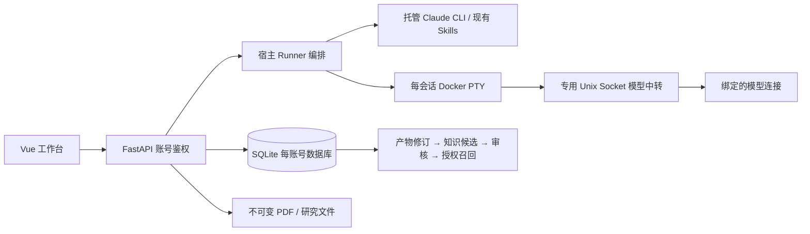

# M1 / M3 / M4 / M6 联合实现

更新：2026-11-23。对应迁移0024、0025，Runner协议11。功能基于现有账号隔离、连接快照和外部授权实现；不增加研究模型调用或费用账本。

## 功能与入口

| 批次 | 已实现 | 入口 |
| --- | --- | --- |
| M1 | 独立原生终端分支、PTY输入输出、游标重连、单窗口控制租约、停止/明确恢复、账号撤销检查、隔离文件下载/收录 | 智能体会话中的隔离原生终端 |
| M3 | 持久运行事件、按游标回放、配置与材料检查、脱敏调试包、历史转移预览和幂等分支 | 会话运行记录 → `/runs/:id`；分支 → `/sessions/:id` |
| M4 | 冻结PDF版本材料、工具实际阅读证据、不可变产物修订、文件附件、页码引文校验、版本阅读位置与索引、显式批注复制 | 用户菜单 → 研究产物与知识；论文文件与批注管理 |
| M6 | Skill候选提交、原文事实/推断/个人观点区分、审核发布/驳回/撤销、来源变化退出召回、授权文本召回 | 研究产物与知识 → 知识审核 / 已发布知识召回 |

打开页面、预览、保存产物、审核及召回均不会启动模型。已有结果只在点击“收录已有研究结果”时投影到产物库，按来源键去重；不会自动发布知识。新托管Run的非空结果自动保存为产物，失败/取消的结果标为部分完成。

## 架构与数据

- `native_terminals`：终端状态与进程代次；`conversations.execution_mode/parent_session_id`：独立执行模式、来源关系。
- `run_events`：追加事件及单调游标。正文可只读回放；终端记录输入字节数/摘要，不记录输入按键正文。
- `material_manifests`：授权PDF清单与有工具证据的实际阅读范围分开保存；无法证实的不推断。
- `research_artifacts/artifact_revisions/artifact_papers/artifact_files`：稳定产物身份、修订、论文及不可变附件关系。
- `research_files`：按SHA-256存储；相同内容去重，校验后下载，不允许可执行HTML/SVG。附件与正文版本管理分开。
- `version_reader_states/document_text_chunks`：阅读位置和文本索引按文件版本保存；切回已索引版本复用文本片段，重新生成检索向量。
- `annotation_migrations`：原批注到目标版本的显式复制映射。唯一引句匹配才生成新坐标；歧义、无文本手绘等不复制，原批注不变。
- `knowledge_items/knowledge_revisions/knowledge_sources/research_audit`：候选生命周期、固定来源修订、操作审计；来源产物变化后暂停召回。

原文事实发布需至少一条校验通过的引句。校验表示引句在指定PDF页存在，并不替代人工判断结论是否成立。旧引用固定文件版本，不跟随默认PDF变化。

## 原生终端边界

- Runner编排仍在宿主运行；只有原生CLI工作进程进入容器。本批不宣称整套服务容器化已完成。
- 容器无外网、根文件系统只读、移除全部Capabilities，不挂载Docker socket、账号数据库、宿主Home或真实API凭据。可写范围为该终端的工作目录和独立Claude状态目录；论文副本只读。
- 仅绑定模型端点经专用Unix socket中转，严格校验路径、模型及允许的`beta=true`参数。真实密钥留在Runner，容器只得到临时中转凭据。
- 首次CLI主题、临时凭据与目录信任提示由用户在终端处理；工具权限继续在原生终端确认。不是结构化权限卡片。
- 浏览器关闭不停止任务；20秒无心跳后其他窗口可接管。输入请求有幂等键，不自动重试未知结果。默认2小时终端时限，1GiB/10000文件软保护；容器有CPU、内存和进程数硬限制。磁盘软保护不等同文件系统硬配额。
- 当前采用鉴权HTTP轮询输出与POST输入（非WebSocket），每终端保留最近2MiB输出。Runner重启停止遗留容器并标记失败，不重放付费请求；用户明确恢复同一原生会话。
- 原生分支不复制旧聊天，不挂载已注册Skill包或外部MCP；本批提供原生Read/Edit/Bash和论文副本。托管聊天的现有Skill、MCP规则不变。原生分支和托管会话分离，避免争写同一原生日志。
- 原生终端生命周期也写入Run和事件；实际文件阅读范围没有原生工具证据时保持未知。工作文件可手动收录，知识始终经过审核。

## 接口

浏览器接口沿用同源Cookie和CSRF；账号数据库及文件路径由认证上下文选择，客户端不能指定工作区根目录。

- `/api/sessions/{id}/terminal-capabilities`、`terminal`、`terminal/input`、`terminal/resize`、`terminal/stop`：创建、输出、输入、尺寸与停止；写入校验代次和控制者ID。
- `/api/sessions/{id}/terminal/files`、`terminal/file`、`terminal/artifacts`：受控工作文件与收录。
- `/api/sessions/{id}/fork-preview`、`forks`：预览后确认；确认哈希绑定目标连接和历史。相同确认复用分支，不发送模型请求。
- `/api/agent/runs/{id}/timeline`、`materials`、`debug-bundle`：事件、材料和脱敏检查。调试包排除正文、原始终端输入、凭据和存储路径；超过1000条事件标记截断。
- `/api/research/artifacts`、`artifacts/{id}`、`artifacts/{id}/markdown`：产物查询、创建、CAS修订与导出。
- `/api/research/files`、`files/{hash}`：30MiB以内附件上传、校验与下载。
- `/api/research/knowledge`、`knowledge/{id}`、`knowledge/{id}/transition`、`knowledge/recall`：候选、修订、状态迁移和已发布知识召回。
- `/api/library/papers/{id}/annotation-migration-preview`、`annotation-migrations`、`document-versions/{version}/index`：迁移核验及历史文本索引。

外部接口前缀`/api/external/v1`新增`artifacts`、`knowledge/candidates`、`knowledge/recall`、`files`、`runs/{id}/timeline`。授权范围为`artifacts:read/write`、`knowledge:read/write`、`runs:read`，沿用账号/论文白名单、撤销、限流与审计。JSON写操作沿用Idempotency-Key；附件上传按内容哈希幂等。JSON仍限制64KiB，只有附件上传放宽到30MiB加表单开销。外部接口不提供知识发布、用户/凭据管理或模型执行。

便携客户端位于`plugins/agent-skill/firework-paper-ops/scripts/firework.py`，新增产物与知识候选命令。用户本地研究Skill可提交结果，平台不重写研究流程。

## 部署及联合验证

1. 停止新增任务并确认所有账号无执行中Run；备份数据库、PDF、附件、密钥、Skills和原生状态，保留旧镜像。
2. 同批升级Web和Runner到协议11，应用迁移0024/0025。迁移只新增表和列，不推断旧任务的实际阅读范围。
3. 原生镜像单独构建：`docker build -f ops/native/Dockerfile -t firework-native-runner:2.1.322 .`。
4. Runner配置`FIREWORK_NATIVE_ENABLED=1`、`FIREWORK_NATIVE_IMAGE`、`RESEARCH_CLAUDE_BINARY`和`FIREWORK_NATIVE_CLI_SHA256`。CLI必须固定真实二进制路径和校验值；未通过检查时功能不可用，不能回退到宿主无隔离执行。内部回调地址可配置`RESEARCH_API_BASE`。
5. 联合核对终端权限、重连/互斥/停止、模型中转、文件下载、Run事件、版本引文、产物修订、知识审核/撤销、外部白名单与零模型打开流程。

当前召回为中英文文本包含检索，不宣称语义长期记忆。原生终端不包含完整开发工具镜像或任意网络访问。M2外部MCP/本机Bridge与M5 Zotero成果回流仍按原计划后续实施；不将其计入本批验收。

验证记录：完整后端347通过、5项因测试环境缺少sqlite3 CLI跳过；随后控制/恢复相关15通过、5跳过。前端264通过，生产构建通过；226条路由清单一致。原生CLI 2.1.322在真实受限容器完成模拟模型收发；尚未进行自定义服务商的真实付费调用验收。
