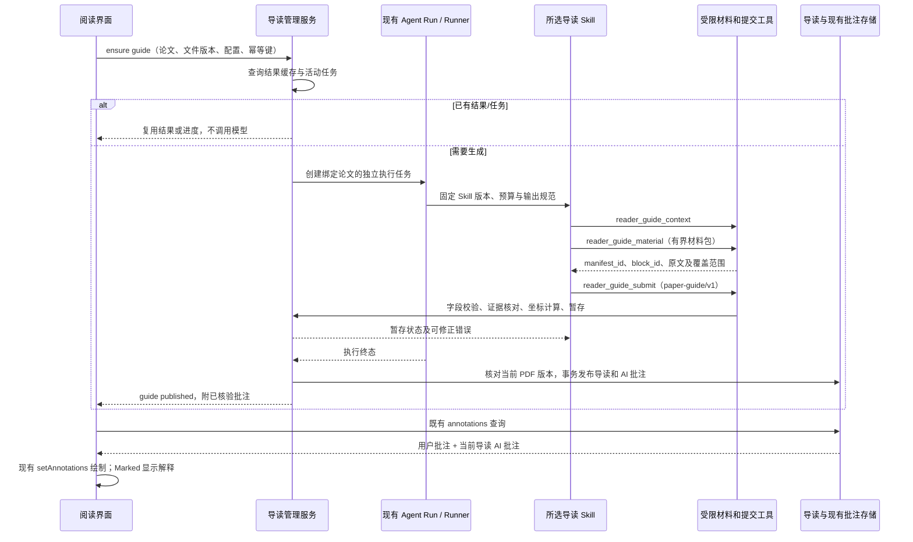

# Skill 驱动的导读与批注：字段契约、接口和复用设计

日期：2026-11-19。状态：文本材料 MVP 已实现；后续规划与当前能力须区分。

最新触发约束：仅在输入框建议中选择并确认后执行，POST 必须带 `confirmed:true`。打开论文、刷新、切换标签、导入或展示配置均不触发模型。当前实现映射及验收见《Skill导读与批注实现验收》。

本文收敛《自动导读与智能批注功能策划》：**Skill 产出结构化内容，平台将核验后的内容投影为现有批注，再交给现有阅读器渲染。** 不另写一套总结、重要性判断或解释算法。

## 1. 明确分工

| 部分 | 职责 |
| --- | --- |
| Skill | 判断论文重点、总结、阅读路线、为什么重要、解释及建议追问 |
| 现有 Agent / Runner | 执行 Skill、调用受限工具、保存运行状态、取消和用量 |
| 材料工具 | 从绑定的 PDF 版本提取真实材料、分配证据块 ID、提供材料范围 |
| 校验与投影服务 | 校验字段、证据和引用关系，计算坐标，事务发布，映射为批注 |
| 现有批注服务 | 查询、显示/隐藏、删除/撤销、个人批注维护 |
| 现有 PDF 引擎 | 按页和文件版本绘制高亮，响应点击与跳转 |
| Marked 统一层 | 显示总结、解释与导读 Markdown；不改变原始内容 |

修改或替换 Skill 即可改进“如何总结和解释”。只要输出符合 `paper-guide/v1`，前端无须理解具体使用的是哪个科研 Skill。

## 2. 统一输出契约

交付两个可复用附件：

- [paper-guide-v1.schema.json](contracts/paper-guide-v1.schema.json)：拟采用的 JSON Schema，字段白名单、类型、枚举与上限。
- [paper-guide-v1.example.json](contracts/paper-guide-v1.example.json)：接口示例。所有 DEMO 标识及引文都是示意，不具备真实证据，不能通过业务发布校验。

运行时契约由 `app/reader/guides/schemas.py` 的 Pydantic 严格模型执行，并生成 Runner 工具 JSON Schema。附件作为设计参考；当前文本 MVP 不接受 asset 图表锚点。业务层进一步核验材料身份、覆盖和真实引文。

### 2.1 结果结构

```text
paper-guide/v1
├── material_manifest_id    绑定本次实际提供的材料清单
├── summary                 问题 / 方法 / 贡献 / 边界，Markdown
├── reading_route[]         阅读步骤、阅读目的、重点 key 与证据块 ID
├── items[]                 Skill 生成的批注业务字段
│   ├── key                 同一次结果中的稳定局部标识
│   ├── category            问题、贡献、方法、定义、公式、图、实验、局限
│   ├── priority            essential / recommended / optional
│   ├── title
│   ├── why_important_md
│   ├── explanation_md
│   ├── claim_type          作者主张 / 实验报道 / Agent 解释 / 阅读问题
│   ├── anchors[]           真实证据块及原文，或平台提供的图表资产 ID
│   ├── follow_up_questions[]
│   └── uncertainties[]
├── coverage                材料范围声明，必须与工具记录核对
└── unknown_fields[]        缺失材料或不能确定的字段及原因
```

字段上限是输入保护，不代表必须生成到上限。基础模式默认建议 6–10 个重点，可少于该数量；不能为凑数制造重点。输出按预算限制篇幅，并且要形成完整合法 JSON，不能把截断的结果当作部分成功。

### 2.2 Skill 可以输出的锚点

| 锚点 | Skill 字段 | 平台处理 |
| --- | --- | --- |
| 精确文字 | `type=text, block_id, quote`，可选前后文 | 在指定块核对原文，唯一匹配后计算高亮坐标 |
| 整块解释 | `type=block, block_id` | 跳转到已知块；若该块无可靠区域，只提供页级提示 |
| 图表或公式 | `type=asset, asset_id` | 仅接受材料工具登记的资产和真实区域；能力不足时保留定位与缺口，不生成假图解 |

**不允许 Skill 输出**数据库主键、任意 `paper_id`、所有者、审批状态、PDF 矩形坐标、删除标志或任意文件路径。页码由平台根据证据块取得；论文、文件版本和任务身份由运行绑定确定。

跨页内容使用多个锚点；单个文本锚点必须在对应页的指定块内。重复引文不能仅凭“页上包含相同字符串”就认定位置正确。

### 2.3 模型内容与可信元数据分开

`priority`、重要性理由和解释属于 Skill 的分析结果，不是平台保证的论文质量评分。`claim_type` 明确区分作者主张与模型解释。

平台自己记录：`guide_id/item_id/annotation_id`、论文与文件版本、物理页、坐标、`run_id/skill_version_id/skill_hash`、实际工具材料记录、校验结果与生成时间。

Skill 的 `coverage` 只是声明，不能覆盖实际工具记录。例如没有图像输入和视觉能力时不能接受 `figures_read=true`；没有读代码工具记录时不能接受 `code_read=true`。界面优先写“已提供的材料/图像范围”，不把材料已发送当成模型已充分理解的证明。

## 3. 一次完整执行



导读生成使用独立执行会话，关联当前论文，避免后台内容污染用户正在输入的聊天草稿。用户的讨论会话继续复用已有会话体系；“解释这个重点”将重点 ID 与真实选区加入上下文。

## 4. 工具接口：给 Skill 的稳定能力

新增的只是三个受限工具，复用现有 stdio MCP 分发、内部令牌和 Run 绑定机制。

| 工具 | 输入 | 返回及限制 |
| --- | --- | --- |
| `reader_guide_context` | 空对象 | 当前任务、论文/文件版本、目标、预算、输出 Schema 版本、允许的材料范围 |
| `reader_guide_material` | 当前范围内的章节/页选择 | 有界材料包：manifest ID、material ID、block ID、原文、物理页；图像需真实视觉输入或对应资产读取工具 |
| `reader_guide_submit` | `paper-guide/v1` | 暂存 ID、逐项定位结果、错误及覆盖缺口；不能替用户采纳或写任意批注 |

工具通过平台注入的 `RESEARCH_RUN_ID` 识别任务；内部服务核对 Run 的 Skill、任务绑定、当前状态、论文关联及令牌。模型自己传入的任务 ID 不作为授权依据。

材料工具可复用 `paper_page`、`pages.read_page` 和已有文件哈希缓存，但新增文本块/资产清单。现有 UI 的最多三条选区上下文仍用于用户提问，不能把整篇论文材料硬塞进这三条选区。

提交工具先暂存，只有关联 Run 成功且业务校验通过才发布。连接失败、被取消或论文换版时，不把暂存结果当作已完成导读。

### 4.1 调用次数和预算适配

当前动态技能固定最多四次工具调用，预算档位为 `short/read`。不能只添加一份 SKILL.md 就声称自动获得足够材料或输出额度。

MVP 可采用 `context → 一次有界材料包 → submit`，加一次 `skill_resource` 恰好四次；材料不够时明确部分覆盖。若需要分批读取或修正重提，必须增加经过登记的 `guide` 执行策略，统一限定工具次数、材料字符、输出长度及预算，不从 ZIP 包任意接受预算。

`guide` 档位的具体值由一次最小真实验证校准。现有短任务输出额度不足以保证十个多字段批注完整输出，不能沿用后无条件承诺完整导读。

## 5. 对外 API：尽量复用现有入口

### 5.1 创建/复用导读

`POST /api/reader/papers/{paper_id}/guide-runs`

```json
{
  "file_version": "当前 PDF 的 64 位哈希",
  "skill_id": "paper_guide",
  "skill_version_id": 42,
  "mode": "overview",
  "config": {"reading_goal": "理解方法", "max_items": 8},
  "request_key": "客户端生成的幂等键"
}
```

- 缓存命中返回 200，含 `guide_id/cached=true/status`。
- 复用活动任务或创建新任务返回 202，含 `guide_task_id/agent_run_id/cached=false/status`。
- 语义任务键由服务端计算，与客户端重试键分开；即使两个标签生成不同请求键，也不能创建两次相同收费任务。
- 过期文件版本返回 409。缺材料、Skill 不可用、执行协议不匹配或超预算时给出明确错误，不自动换成另一个收费任务。
- 只有明确确认走这一接口；不存在首次打开、导入或定时自动生成的链路。

### 5.2 获取导读与批注

| 接口 | 复用/扩展方式 |
| --- | --- |
| `GET /api/reader/papers/{id}/guide` | 新增；返回当前导读结构、实际覆盖、状态与重点 |
| `GET /api/reader/papers/{id}/guides` | 新增；按文件/生成版本查看历史 |
| `GET /api/reader/papers/{id}/annotations` | 复用；增加可选 `origin=user/ai/all`、`guide_id` 和 `file_version` 筛选，返回既有批注形状及可选来源字段 |
| `PATCH /api/reader/annotations/{id}` | 复用删除/撤销、显示相关操作；AI 生成内容不被当作人工内容静默修改 |
| `POST /api/reader/guide-items/{id}/adopt` | 新增；生成个人批注副本，带 request_key，重复采纳复用同一副本 |
| `POST /api/agent/runs`、现有取消/状态接口 | 继续复用任务状态、进度、取消与用量，不新增第二个执行引擎 |
| 现有阅读位置接口 | 扩展 `tab=guide`；保留页码、缩放及会话恢复 |

批注查询默认保持既有返回结构。AI 只返回当前已发布、当前文件版本的有效图层；历史导读通过历史接口单独读取，不能将所有旧版高亮混进现有查询。

## 6. 投影为现有批注：不另做 PDF 绘制系统

### 6.1 建议存储选择

导读结构放在新增 `reader_guides/reader_guide_items` 表；已核验的可渲染 AI 标记仍进入 **`reader_annotations`**，增加来源与导读关联字段。这样复用现有查询、删除、刷新及 `engine.setAnnotations()`。

| Skill 输出 | 导读保存 | 既有批注投影 |
| --- | --- | --- |
| `category/priority` | 结构化保存，用于筛选与阅读顺序 | 追加只读元数据，不改变既有 `kind` 枚举 |
| `title/why_important_md/explanation_md` | 分字段保留，Marked 渲染 | `content` 为确定性组合的短说明；完整解释通过 guide_item_id 获取 |
| `text anchor` 且唯一定位 | 保存证据及真实页码/矩形 | `kind=highlight`，复用 quote、rects、color |
| 块/资产有可靠区域 | 保存区域来源和解释 | 可形成区域高亮，但必须标明区域来源；不能假装成真实文本选区 |
| 只有页级位置 | 保存 `location_status=page_only` | `kind=note`、`rects=[]`，可列表跳页；默认不画虚构高亮 |
| 无法核验的引文/资产 | 保留拒绝原因与待定位状态 | 不投影为原文高亮 |

现有 `Annotation` 要求 highlight 同时具有引文与矩形。MVP 首先投影可靠的文本高亮；图表区域若没有真实文本引文，先采用 note 和页边标记。后续若要区域批注，显式扩展区域类型及验证，不能填入伪引文绕过规则。

### 6.2 兼容的批注返回形状

```json
{
  "id": "平台分配的批注 UUID",
  "paper_id": 7,
  "file_version": "平台绑定的真实 PDF 哈希",
  "page": 3,
  "kind": "highlight",
  "quote": "已在原文中核验的短引文",
  "content": "为何重要及简短解释",
  "color": "#9ed8ff",
  "rects": [[0.1, 0.2, 0.5, 0.03]],
  "points": [],
  "origin": "ai",
  "guide_id": "平台分配",
  "guide_item_id": "平台分配",
  "location_status": "verified"
}
```

数值仅示意，不是有效论文批注。矩形必须由平台从当前 PDF 计算，不能原样接受此示例。

### 6.3 当前代码中必须补齐的地方

1. `validate_context()` 当前只做整页文本包含判断，允许 `page_captured`；人工选区可保留该行为，AI 自动高亮必须使用更严格的“指定块 + 唯一匹配 + 真实坐标”校验。
2. `annotate()` 当前每条写入后立即 commit。应拆出可复用校验与插入函数，手工入口保持原行为，AI 批量发布使用同一事务，避免半批结果泄漏。
3. `pdf-engine.ts` 当前只绘制矩形/笔迹，不会为 `rects=[]` 的 note 画页边图标。新增轻量页边标记与点击事件，不宣称原引擎已自动具备解释卡片。
4. `ReaderSidebar.vue` 增加来源筛选与导读页，AI 项的删除继续复用批注接口；修改 AI 内容通过采纳后的个人副本完成。
5. 解释正文统一调用 `renderMarkdown()`；不在批注代码中再维护一个 Markdown 解析器。

## 7. 状态、版本与权限

### 7.1 两类状态分开

- Agent 执行：复用 queued/running/succeeded/failed/cancelled。
- 导读产物：staging/validating/published/partial/rejected/stale。

JSON 不合法或 Schema 不兼容：拒绝整份提交，返回 422 及字段路径。来源跨任务、文件版本过期：拒绝提交。个别引文无法定位：可保留导读与页级解释，标注 partial，不画错误高亮。

发布前再次核对当前 PDF 哈希，导读版本和对应 AI 批注在一个事务中激活。上一份成功版本保留，失败不将它清空。

### 7.2 幂等键

```text
语义任务键 = 论文身份 + PDF哈希 + 模式 + 阅读目标哈希
             + Skill版本/内容哈希 + 输出契约版本

结果提交键 = guide_task_id + payload_hash
AI批注唯一键 = guide_id + item_key + anchor_key
采纳唯一键 = 当前用户 + guide_item_id
```

同任务相同提交返回原结果；同一任务在校验失败后允许有界修正，但发布后的结果不可被后来提交静默覆盖。刷新不重新显示用户删除的同版 AI 标记。

### 7.3 生成与用户编辑边界

普通 `POST /annotations` 不能接受客户端自行设置 `origin=ai` 或任意 `guide_id`。AI 来源只能由已授权的结果发布服务写入；用户采纳生成 `origin=user/ai_adopted` 的副本并保留来源链。

AI 删除/撤销可以复用现有 `deleted` 行为；用户修改的个人副本不因导读重新生成而被覆盖。重新生成是新产物版本，历史结果与用户显式隐藏状态保留。

## 8. Skill 包和版本复用

保留现有 SKILL.md、skill.json、参考资源、版本及启停机制。增加一个**平台侧兼容描述**，不要直接假定上游科研技能原生支持此格式：

```json
{
  "capability": "paper_guide",
  "mode": "background",
  "output_contract": "paper-guide/v1",
  "required_tools": ["reader_guide_context", "reader_guide_material", "reader_guide_submit"],
  "optional_capabilities": ["vision", "figures", "code_read"],
  "execution_profile": "guide"
}
```

平台校验工具已登记、依赖可读、执行模式适配、契约版本受支持后，才把该技能放进“自动导读 Skill”选择列表。包安装成功与可用于导读是两个状态。

Nature、kelip 等上游工作流通过薄适配 Skill 复用方法和资源，并输出统一契约；不靠前端按 Skill 名称分支。kelip 的站间互动保留在“交互精读”模式，后台导读不直接套用等待用户回复的流程。

改进解释方法可以只发布新的 Skill 版本；字段增加须遵循契约版本规则。未来 `paper-guide/v2` 由服务端适配，不让前端静默猜字段。旧任务固定旧 Skill 与契约版本，不能在恢复时改用最新版本重新计费。

## 9. 数据结构与代码落点

拟增加：

- `reader_guide_tasks`：语义任务键、请求键、论文/文件绑定、Skill 版本、Agent Run、状态、预算快照。
- `reader_material_manifests/blocks`：材料来源、物理页、文本、资产引用、坐标及材料哈希；与 PDF 哈希缓存共用底层文件能力。
- `reader_guides`：产物版本、结构化输出、覆盖、校验结果、发布时间。
- `reader_guide_items`：item_key、类型、优先级、解释、证据及与批注的关系。
- `reader_annotations`：新增 origin、guide_id、guide_item_id、derived_from 等可空字段，旧数据默认 user。

建议代码落点：

| 位置 | 改动 |
| --- | --- |
| `app/reader/guides/` | 导读任务、Schema 校验、材料、锚点定位与批注投影 |
| `app/reader/service.py/repository.py` | 抽取可复用的批注校验/插入，支持事务发布与来源筛选 |
| `app/agent/*` | 复用 create_run，增加导读 purpose/任务绑定及协议兼容检查 |
| `agent_runner/tools.py` | 注册三个受限工具，沿用 Run/内部令牌授权 |
| `app/skills/*` | 工具白名单、能力兼容检查及受控 guide 预算策略 |
| `frontend/src/api/reader.ts` | 增加导读 API，批注响应增加可选来源字段 |
| `useReaderOrchestrator.ts` | 导读状态、发布后刷新、跳转及会话追问编排 |
| `ReaderSidebar.vue` | 导读页、AI 来源筛选和采纳操作 |
| `pdf-engine.ts` | 复用矩形绘制，增加来源样式和页边 note 标记/点击 |
| `shared/markdown.ts` | 继续统一解析与清理，无新增解析底层 |

以当前最大迁移 `0012` 为基线，实施时另加增量迁移；不改写已应用的批注历史表定义。新表、来源字段先部署，功能通过兼容标记逐步开放。

## 10. 实施与验收

### 第一批：契约和最小闭环

固定一个 Skill、一个 PDF、少量文本重点。先用隔离材料验证 Schema、跨引用和坐标，再做一次最小真实调用：

**选 Skill → 材料包 → 结构化结果 → 严格校验 → 批注投影 → 原阅读器渲染。**

成功标准不是 Agent 输出 JSON，而是每个显示出来的重点都能落到正确原文，并展开对应解释。

### 第二批：明确触发与复用

已实现用户确认、结果缓存、语义幂等、失败移除/重试、旧 PDF 版本隔离及人工副本保护。每次新任务需要用户确认，打开论文不执行。版本历史 API 已提供，历史切换界面留待后续。

### 第三批：技能扩展和复杂材料

开放通过兼容验证的其他 Skills；补充图表、公式区域、扫描件和 kelip 交互精读。不能用未验证的坐标或图像能力充数。

必须覆盖的验收用例：

- 同 PDF 两标签同时打开只创建一次任务；同版结果重复提交不重复批注。
- 猜造 block_id、引用其他论文、过期文件版本和伪造矩形不能发布。
- 同页重复引文、多栏、旋转页、跨页段落不能错误高亮；不确定时降为待定位。
- Skill 输出未知字段、截断 JSON 或过大结果时显示明确错误，失败记录可移除。
- 导读被取消或更换 PDF 后，迟到结果不能激活到当前原文。
- 已删除 AI 批注刷新不复活；个人批注、采纳副本及旧会话不被重新生成覆盖。
- 展开解释、切页、隐藏图层和导出均不产生模型调用。
- 原有高亮、笔迹、译文、多标签、页码恢复与回车发送正常。
