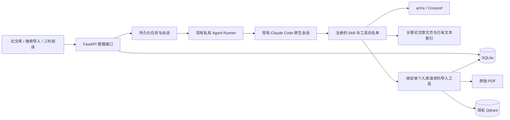

# 三栏论文阅读与多渠道导入：改造与验收

日期：2026-11-17。项目：服务器 `/home/f/research-assistant`。开发分支：`feat/three-pane-reader-imports`。

## 1. 本次交付

入口：[论文库](https://paper.matchesai.vip/?view=library)、[搜索与导入](https://paper.matchesai.vip/discover.html)、[阅读示例](https://paper.matchesai.vip/reader.html?paper_id=2&session_id=4)。继续使用原有访问认证。

按照 Zotero 的辅助面板与原文布局，以及 [Gloss](https://github.com/computersniper/gloss) 将 PDF、批注、对话分开的组织思路，在现有项目中独立实现。没有引入另一套智能体或另一份论文数据库。

- **左侧辅助阅读**：章节、批注、高亮、翻译、论文信息五个标签；目录和阅读条目可以定位原文页。
- **中间原文**：PDF.js 渲染真实 PDF，保留文字选择；支持分页、缩放、画笔、橡皮与高亮。
- **右侧智能体**：选择、创建和延续论文任务会话；原文选区可以解释、翻译、写批注或加入对话。加入对话后，点击发送才调用智能体。
- **论文添加**：本地 PDF 多选上传、arXiv ID/链接、DOI/doi.org 链接、公开 HTTPS PDF 直链。
- **论文检索**：arXiv 与 Crossref 两个来源，可以单独选择或一起检索；来源失败会明确显示。结果可直接入库并选择论文分类。
- **论文库**：延续首页预览、标题、作者、单位、简要摘要、多分类卡片；明确区分已有 PDF 和仅有书目信息，并为后者提供“补充 PDF”入口。

桌面效果：

手机宽度下切换“辅助／原文／智能体”，避免把三栏压在一起：

## 2. 平台与智能体的职责

平台负责会话、论文条目、文件、分类、选区、批注、译文缓存、阅读位置和运行状态的管理。研究处理请求由现有 Claude Code Runner 执行注册的 Skill；PDF 下载、解析和向量化是其调用的受限工具，不额外调用模型。

新增 `paper_discover`、`paper_import` 两个 Skill；阅读、比较、审查 Skill 增加按物理页读取原文的能力。每个 Skill 只向智能体暴露允许使用的工具，入库工具只能处理本轮绑定的请求编号。

管理会话 ID 与 Claude 原生会话 ID 继续映射保存。新建阅读页面不自动触发模型调用；已存在的任务通过原生会话继续，保持阅读和讨论上下文。

原有 `/legacy.html` 保留用于兼容；本次新增入口全部使用上述 Agent 路径。

## 3. 阅读数据与引用

| 数据 | 保存方式 |
|---|---|
| 原始文档 | 既有 `data/papers/{paper_id}.pdf` |
| 文档版本 | 原始 PDF 的 SHA-256 |
| 批注、高亮、笔迹 | `reader_annotations`，关联论文、会话、物理页、版本及归一化坐标 |
| 阅读位置 | `reader_states`，按会话和论文保存页码、缩放、左侧标签 |
| 翻译 | `reader_translations`，关联实际 Agent 运行结果 |
| 提问原文上下文 | `agent_runs.context_json`，保存论文、页码、文档版本和选区 |
| 导入过程 | `import_requests`，保存来源、目标分类、会话、运行、状态及错误 |

引用定位使用原始 PDF 的物理页号，不把旧文本块中的页号当成经过核对的引用。选区会对照该页文本检查；PDF.js 与 PyMuPDF 的连字、断词或阅读顺序不同导致无法匹配时，保留页和坐标，但不会标成文本匹配成功。

同一论文版本、同一物理页、同一选段的中文翻译会复用已有结果。不同页上相同文字分别缓存，以保留上下文差异。旧版本条目不会静默跳转到新版文件。

批注与高亮采用软删除，支持撤销。新建批注、切换标签、定位和阅读历史结果不消耗模型用量。

## 4. 搜索与导入流程

1. 搜索界面建立独立发现会话，智能体通过 `paper_search` 读取实际来源。
2. 结果卡保留题目、作者、摘要（来源提供时）、来源链接及 arXiv ID/DOI。
3. 用户选择分类，点击添加，形成独立导入会话和入库请求。
4. 智能体调用 `paper_import`；内部接口核对私有令牌、运行编号、会话和绑定请求后执行。
5. 全文保存、解析、索引完成后，界面提供阅读入口；只有 DOI 元数据时明确显示全文待补充。
6. 失败保留记录并允许手动重试，不自动重复模型调用。排队失败也会进入可重试状态。

去重使用实际标识或 PDF 内容哈希。对旧上传文件，只有识别到首页标准的旋转 arXiv 水印时才补齐 ID，不凭相似题目自动合并论文。已有 PDF 不会被补充上传静默覆盖。

限制：单个 PDF 不超过 30MB、300 页；界面一次最多选择 8 个文件。当前支持有文字层的未加密 PDF；扫描件 OCR 尚未接入。单次导入工具有 80 秒总时限，超时明确失败，保留可重试记录。

## 5. 主要接口与代码位置

| 接口 | 用途 |
|---|---|
| `GET /api/reader/papers/{id}` | 文档版本、目录、页数 |
| `GET /api/reader/papers/{id}/file` | 原始 PDF，支持 Range 请求 |
| `GET /api/reader/papers/{id}/pages/{page}` | 带物理页号与版本的原文文本 |
| `GET /api/reader/papers/{id}/annotations` | 持久化阅读条目 |
| `POST /api/reader/annotations` | 创建高亮、批注、笔迹 |
| `PATCH /api/reader/annotations/{id}` | 更新、软删除、撤销 |
| `GET/PUT /api/reader/papers/{id}/state` | 读取、保存阅读状态 |
| `POST /api/reader/translations` | 复用缓存或提交选段翻译 |
| `POST /api/imports/source` | arXiv、DOI、公开 PDF 来源入库 |
| `POST /api/imports/upload` | PDF 上传入库 |
| `GET /api/imports` | 导入记录列表 |
| `GET /api/imports/{id}` | 单次导入状态 |
| `POST /api/imports/{id}/retry` | 手动重试 |
| `POST /api/agent/runs` | 原有任务接口，增加原文上下文和任务用途 |

前端分为 `app/web/reader/{main,pdf-view,sidebar,chat,util}.js` 和独立的 `discovery.js`。后端阅读管理在 `app/api/reader.py`、原文证据在 `app/reader_store.py`；导入管理在 `app/api/imports_v2.py`、受限处理在 `app/import_service.py`、公开来源访问在 `app/paper_sources.py`。

PDF.js 6.5.438 的运行文件、字体、CMap 与 WASM 已放在项目内，保留许可证；阅读器运行不依赖外部 CDN。

## 6. 实际验收

- 全套自动测试：**176 项通过**；另有两项既有 Qdrant 测试环境警告。
- 本轮实测共 8 次智能体执行（含失败和修复重试）；CLI 报告输入 11,153、输出 1,305、缓存读取 4,736 tokens。接口自动测试未调用真实模型；这些统计不等同于网关账单。
- 浏览器实际检查：原文渲染与文字选择、高亮保存、选区批注、加入对话、笔迹保存、橡皮、历史译文、定位、刷新恢复页码及标签。
- 窄屏检查：390×844，原文和智能体区域可切换；桌面三栏正常显示。
- 原有阅读会话 #4 成功执行选段翻译，结果显示 `native_resume`；重复翻译复用原运行。
- 真实上传《Attention Is All You Need》：论文 #7，11 页，28 个文本块；原文件、索引、目录、物理页读取均已验证。
- Crossref 真实搜索：返回 Diffusion Policy 的会议版、期刊版及 Crossway Diffusion；来源链接和 DOI 保留。
- 从界面将 Crossway Diffusion 入库并归入“机器人策略学习”：论文 #8，明确显示“仅书目信息”，可从卡片进入补充 PDF。
- arXiv `2303.04137` 通过智能体重试成功关联已有论文 #2；识别原 PDF 的 arXiv 水印并复用全文。
- 测试覆盖：文件路径边界、私网和重定向拦截、会话论文范围、选区版本、坐标验证、缓存、上传请求幂等、导入授权、断点记录和队列失败。

搜索与导入实际页面：

真实验证中保留了一个未取得书目信息的 DOI 失败记录和一次 arXiv 联网失败记录，便于检查失败状态与重试行为，没有伪造成功状态。

## 7. 数据迁移、部署与备份

自动迁移：`0005_reader_and_imports.sql` 新增阅读、导入及上下文字段；`0006_translation_page_identity.sql` 保留原译文并将页码加入缓存标识。已有论文、分类、会话和原生对话文件继续使用。

改造前已保存代码和 SQLite 快照：`/home/f/research-assistant-change-backups/reader-20261117-172658/`；旧应用镜像保留为 `research-assistant-app:pre-reader-20261117`。

继续使用现有 Docker Compose 与用户级 Runner 服务，保留离线模型缓存配置。备份脚本在 SQLite、Qdrant、原生会话之外，增加原始论文 PDF 和待处理上传文件归档；默认保留 14 份。已实跑备份，并检查 PDF、待处理文件与原生会话归档；备份文件权限收紧为仅文件所有者可读写。回退必须匹配代码、数据库、PDF、向量和原生会话，不能用旧数据库覆盖本次新增阅读记录。

## 8. 已知边界与后续工作

- 本次真实验证时，arXiv 关键词检索接口受上游限流或连接失败影响；失败会显示，Crossref 与本地上传可继续使用。按 ID 获取元数据另有 arXiv 官网摘要页回退，不能保证外部服务持续可用。
- DOI 入库默认保存书目信息，不承诺获取收费全文；可随后上传合法取得的 PDF。
- 智能体目前读取文字和选区，尚未完成图表视觉理解、完整论文精读质量及审稿效果评估。
- OCR、BibTeX/RIS 批量导入、Zotero 同步、跨论文知识抽取和阅读策略优化留待后续扩展。

本轮先完成界面、原文、现有智能体、数据库、搜索和导入之间的可用流程。
