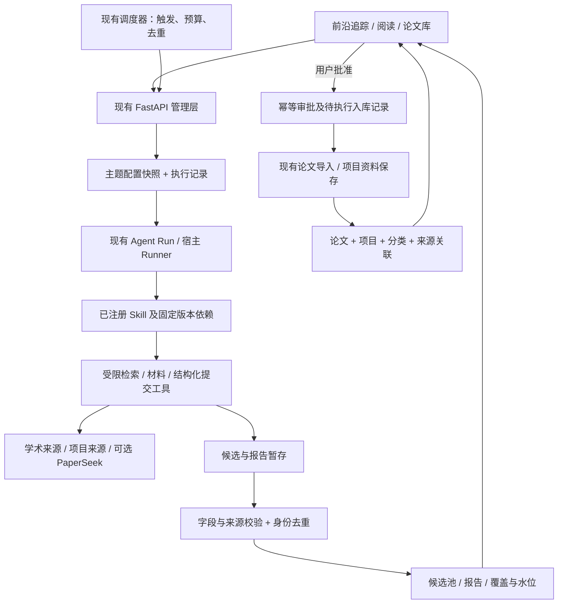

# 前沿追踪、技能复用与论文库导航设计方案

- 日期：2026-11-19
- 本次补充：报告采用堆叠时间线；发现结果与现有资料库及历史记录统一去重。
- 状态：目标设计基线；核心能力已实施，实际交付与未完成项以《前沿追踪实现与验收记录》为准，周期追踪仍需显式启用。
- 代码基线：服务器 `/home/f/research-assistant`，提交 `ff7d880`；本次只读确认工作区干净。
- 目标：增加论文库左侧导航，在“读论文”和“论文比较”之间增加“前沿追踪”；由现有智能体配合可复用 Skills 持续发现论文、开源项目并生成前沿报告，经用户批准后进入统一资料库。

## 一、依据与引用

### 1.1 当前代码依据

以下路径均相对于项目根目录。现状与新增设计分开描述，不能把规划当成已实现能力。

| 代码 | 已有能力 | 本次设计的影响 |
| --- | --- | --- |
| `frontend/src/components/TopNav.vue` | 读论文、论文比较、定时任务、论文库管理；用户菜单含技能库和设置 | 在读论文之后插入 `frontier` 导航 |
| `frontend/src/views/WorkbenchView.vue`、`components/SideNav.vue` | 工作台外壳及最近阅读、领域、会话导航 | 改为按模块选择侧栏，避免出现两套重复导航 |
| `frontend/src/views/LibraryView.vue`、`views/manage/LibraryGrid.vue` | 论文库与任务会话子页；图文卡片、紧凑列表、分类和阅读状态筛选 | 分类提升至常驻左栏；保留原有卡片与操作 |
| `app/schedules/service.py`、`repository.py`、`schemas.py` | 按小时间隔调度现有会话；默认暂停；每分钟检查到期任务 | 复用调度入口，补充追踪任务类型、运行记录、去重和恢复 |
| `app/agent/service.py`、`schemas.py`、`agent_runner/jobs.py` | 异步智能体运行、任务查询、取消、会话延续、用量记录 | 新业务继续交给现有 Runner，不另建模型调用系统 |
| `app/agent/catalog.py`、`skills/paper_discover/SKILL.md` | `paper_discover` 仅允许 `paper_search`；当前最多两次调用 | 不能直接宣称具有完整领域监控或项目搜索能力 |
| `agent_runner/tools.py`、`app/imports/sources.py` | 受限学术搜索，目前支持 arXiv、Crossref | 新增项目检索、时间范围与分页等受限工具能力 |
| `app/imports/service.py`、`router.py` | arXiv、DOI、公开 URL、PDF 上传、请求去重、重试；导入仍由 Agent 执行 | 批准后复用现有导入；明确区分批准、开始导入与完成导入 |
| `app/skills/*`、迁移 `0009`、`0010` | ZIP 技能包、分类、版本、启停与动态执行 | 复用注册库，增加依赖和运行模式适配 |
| `app/workbench/schemas.py` | `view` 只允许已有六类；阅读标签与布局持久化 | 前后端都要增加 `frontier`，兼容旧工作区状态 |
| `app/migrations/0004_sessions_and_library.sql`、`0007_workbench.sql` | 分类、会话关联、工作区、调度表 | 增量扩展，不重建论文与会话数据 |

延续既有《研究工作台一体化升级方案》和《架构.md》的原则：平台负责管理、调度、存储、展示与确定性校验；智能体负责搜索策略、内容理解、相关性判断、阅读与综合。

### 1.2 PaperSeek 开源参考

已阅读用户提供的 [PaperSeek 中文 README](https://github.com/paperseek/paperseek/blob/main/README.zh-CN.md)，及其官方 [检索流程](https://docs.paperseek.app/zh/guide/search)、[工作区架构](https://docs.paperseek.app/zh/developers/architecture)、[MCP 接口](https://docs.paperseek.app/zh/developers/mcp)。访问日期为本稿日期，链接指向可变化的上游版本；若引入代码或依赖，实施时记录确切版本与提交。

| 参考点 | 上游说明 | 本项目采用方式 |
| --- | --- | --- |
| 从问题出发 | 将研究问题转换为查询并迭代召回、排序 | 追踪主题允许自然语言目标，并保存每轮检索计划和命中情况 |
| 过程可见 | 区分设置、过程、结果，任务可持久保存 | 主题下提供“配置、运行、发现、报告”子页 |
| 证据范围 | 摘要综述不等于全文阅读；命中数、召回数、最终数不同 | 报告显示材料等级及三个数量，缺失信息不补写 |
| 结构化集成 | MCP 提供开始、状态、结果、取消等工具，结果可分页 | 作为可选搜索后端，经现有智能体的受限工具访问 |

上述四项来自相应官方文档。本方案新增的周期追踪、项目发现与批准入库是本项目设计，不声称 PaperSeek 已提供这些完整功能。

PaperSeek 的任务接口强调保存运行 ID、幂等提交和读取完整分页；连接结束不等于搜索取消，检索可能使用其配置的模型并产生费用。这些约束应进入适配器，而不是仅把网页接进来。[依据：PaperSeek MCP 文档](https://docs.paperseek.app/zh/developers/mcp)

本项目的实现选择：**优先借鉴组织方式，保留现有 Agent 主链路；PaperSeek 引擎接入列为可选增强。** 若接入，先由适配器探测已部署版本能力，再固定兼容版本，避免现有 Agent 与 PaperSeek 内部模型重复进行整套规划和评分。

### 1.3 已有技能参考与核实范围

用户所说 `natur-skill` 暂按 Nature 系列技能理解，`kelip-paper` 对应 `kelip-paper-reading`。已读取本机安装的以下技能说明，用于分析可复用流程；本次没有执行这些技能的科研任务：

- `nature-academic-search`：多源检索与引文核验，依赖其 manifest、工作流片段及对应工具。
- `nature-literature-pipeline`：发现、初筛、分级阅读与交付流程；具有独立的调度、推送和归档约定。
- `kelip-paper-reading`：六站交互式精读，包含材料准备、原图、公式、数据和代码对照。
- `paper-reading-batch`：复用 kelip 的自主批量阅读流程，不在站间等待。
- `nature-paper-card`：有固定证据结构的单篇研究卡，不是轻量摘要。
- `nature-reader`：全文中英对照及 source-map，不应降格为摘要功能。

本机技能来源为 `~/.agents/skills/` 与 `~/.codex/skills/`。只读检查服务器常见 `~/.claude/skills`、`~/.agents/skills`、`~/.codex/skills`，未发现对应 `SKILL.md`；这不证明其他目录或动态注册库中不存在。实施前应核对服务器技能注册记录、完整依赖、许可证和实际可调用工具，不能把本机已安装当成服务器已可用。

## 二、功能与交互设计

### 2.1 顶部导航与统一侧栏

顶部顺序固定为：

**读论文 → 前沿追踪 → 论文比较 → 定时任务 → 论文库管理**

用户、设置和技能库入口保持在既有用户菜单中。各模块共享一个外层侧栏插槽：

| 模块 | 左栏内容 | 中央主区域 |
| --- | --- | --- |
| 读论文 | 新建阅读、最近阅读、领域论文和会话 | 欢迎工作台或既有多标签三栏阅读器 |
| 前沿追踪 | 新建主题、全部主题、领域、待批准数、最近报告 | 主题配置、运行过程、候选及报告 |
| 论文库管理 | 全部资料、论文、开源项目、分类、阅读状态、来源 | 现有论文卡片或项目列表，以及资料详情 |

“论文库添加左边导航栏”按管理页面内的分类导航实现。阅读器内部的章节、批注、高亮、翻译、论文信息面板继续存在；它与管理导航职责不同。进入阅读时外层导航可收起，不挤压 PDF 和会话区。

侧栏宽度、收起状态按模块保存；桌面端可调节，窄屏使用抽屉，不能增加页面级横向滚动。切换模块不关闭阅读标签、不丢失输入草稿。

### 2.2 论文库左侧导航

```text
顶部：读论文 | 前沿追踪 | 论文比较 | 定时任务 | 论文库管理
┌──────────────────┬──────────────────────────────────────────┐
│ ＋ 添加资料       │ 论文库 · 机器人策略学习         搜索 / 筛选 │
│ 全部资料          │ [论文] [开源项目] [相关任务]                │
│ 论文 / 开源项目   │ 图 + 标题 + 作者单位 + 简要摘要              │
│ 按领域            │ 来源主题 / 全文状态 / 阅读状态 / 分类         │
│   基础模型        │                                          │
│   机器人策略学习  │ 多选：分类、创建比较、导出等                 │
│ ＋ 新增分类       │                                          │
│ 阅读状态          │                                          │
│ 有全文 / 缺全文   │                                          │
│ 来自前沿追踪      │                                          │
└──────────────────┴──────────────────────────────────────────┘
```

- 分类沿用 `paper_collections`；MVP 维持平级分类，不把树形视觉误做成已有父子模型。
- 同一资料可属于多个分类。分类与全文状态、阅读状态、搜索词组合筛选；左栏选中项与筛选标签同步，可一键清除。
- 分类菜单支持选择已有和内联新增；更名应同步所有视图。未分类、各分类计数由后端查询，不能用当前加载的第一页推算。
- “来自前沿追踪”筛选显示来源主题与首次批准时间。待批准发现尚未进入资料库，点击其计数跳转前沿追踪。
- 论文仍显示原图/首页缩略图、标题、作者单位、简要摘要；缺图和缺单位有明确占位。
- 点击论文：有 PDF 进入原文阅读并恢复会话及位置；无 PDF 进入补充全文入口。项目打开项目详情，不进入空白 PDF 阅读器。
- 原有任务会话管理保留，通过“相关任务/任务会话”入口访问，不混成论文分类。

### 2.3 前沿追踪工作台

```text
┌──────────────────┬──────────────────────────────────────────┐
│ ＋ 新建追踪主题   │ VLA 与机器人策略                  已启用   │
│ 全部主题          │ 最近执行 / 下次执行 / 待批准 / 用量          │
│ 待批准 12         │ [概览] [发现] [报告] [运行记录] [配置]      │
│ 最近报告          │                                          │
│ 按领域            │ 新论文 6 / 新项目 2 / 更新 3 / 来源异常 1    │
│   VLA             │ [立即执行] [暂停] [编辑配置]                │
│   世界模型        │                                          │
│ 已暂停            │ 候选卡片：证据、相关原因、变化、批准/忽略     │
└──────────────────┴──────────────────────────────────────────┘
```

主题是长期关注对象；运行记录是某一次执行；会话是围绕主题或报告继续讨论的上下文。三者分别有 ID，不用会话 ID 代替追踪配置或报告版本。

### 2.4 新建追踪主题

| 信息 | 配置及默认值 |
| --- | --- |
| 主题名称 | 必填；例如“VLA 机器人策略前沿” |
| 研究目标 | 可填自然语言问题，作为智能体判断相关性的主要依据 |
| 领域 | 可选已有、新建或暂不分类；至少提供领域、问题、关键词、作者、团队之一作为搜索线索 |
| 关键词 | 可选，支持中英文别名、包含/排除词；默认任一词召回，提供“全部匹配”等高级选项 |
| 团队/机构 | 可选名称、别名、机构主页或 GitHub 组织；字符串提示与确认的实体标识分开 |
| 作者 | 可选姓名、ORCID、学术主页、平台作者 ID；同名需要确认，无法确认标为疑似 |
| 追踪对象 | 论文、开源项目，可多选 |
| 数据源 | 只展示当前 Runner 实际可用来源；未配置连接的标“需配置” |
| 时间范围 | 首次回看默认近 30 天，可改；随后增量检查并保留重叠窗口 |
| 周期 | MVP 按小时间隔，默认 24 小时；每日固定时刻、周报时刻属于后续时区调度增强 |
| 执行策略 | 低成本发现为默认；本轮候选上限、工具次数、时长与预算可调整 |
| 使用技能 | 自动推荐或选已有技能；可从技能库安装/上传并完成验证后再选 |
| 入库分类 | 允许选已有或新建，作为批准时建议值，不自动入库 |
| 启用 | 新建默认暂停；“试运行一次”与“启用周期运行”分开 |

配置组合规则必须可解释：跨“研究目标、关键词、作者、团队”默认扩大召回，再由 Agent 标记相关程度；高级模式可选“仅指定作者/团队”。硬过滤仅使用来源实际支持且已确认的实体 ID，其他条件是软匹配，不伪装成严格过滤。

改变关键词、作者、来源或技能版本会生成配置新版本；正在运行的任务继续使用提交时快照，下轮使用新配置。是否重新扫描历史由用户选择，不能静默重跑全部历史。

### 2.5 持续追踪与发现内容

每轮以来源成功检查水位为起点，叠加可配置的重叠时间窗；同时保存来源游标、检索式、分页截断和失败信息。

- 新论文：标题、作者、单位、日期、标识、摘要、原始链接、相关原因和证据等级。
- 新项目：仓库名称、所有者、说明、许可证、官方/第三方关系、README 证据、最近 release 或 commit 时间。
- 已知内容变化：论文版本、正式发表、官方代码发布、项目 release、归档状态等。Star 数可作为辅助信息，但不作为论文质量或项目可靠性证明。
- 排名由 Agent 输出相关理由；平台只校验字段、证据 ID 与分数范围，不另写一套内容评分逻辑。
- 同一内容跨主题出现时共享资料身份，保留各主题的匹配理由；同一主题重复出现仅更新出现记录。
- 已忽略条目不因下一轮重复召回再次进入待办；重大新版本形成“更新待处理”，不抹掉原决定。

“持续”指启用后按周期检查，而非无限常驻的智能体循环。每轮有边界，完成后退出；页面刷新和查看历史不会触发模型执行。

### 2.6 前沿报告：堆叠时间线

每轮发现与摘要报告默认在同一次 Agent 执行中完成，不自动给每篇候选再运行精读。周期汇总报告可独立启用，成本单独显示。

#### 展示方式

报告页默认采用**纵向堆叠时间线**：按日期分组，每次报告为一个时间节点和可展开卡片，最新在上；历史报告持续向下堆叠，支持按主题、时间范围及“有新增/有更新/来源异常”筛选。进入单主题只看该主题，全部主题视图可合并展示并保留主题标识。

```text
前沿报告                    [全部主题 ▾] [时间范围] [只看变化]
│
● 11 月 19 日 09:00 · VLA 机器人策略
│ ┌─────────────────────────────────────────────────┐
│ │ 新增论文 3 · 新项目 1 · 已有资料更新 2 · 待批准 4 │
│ │ 本期变化摘要 / 来源覆盖 / 材料等级      [展开]    │
│ │ 新发现：题目 + 简述 + 相关原因 + 批准入口        │
│ │ 已有更新：代码发布 / 新版本 → 查看库内原条目     │
│ │ 重复无变化 12 条（已折叠，仅作覆盖记录）         │
│ └─────────────────────────────────────────────────┘
● 11 月 18 日 09:00 · VLA 机器人策略        [展开历史]
│ 本期无新增或实质更新 · 已检查来源 3/3
● 11 月 17 日 09:00 · 世界模型             [展开历史]
```

- 每张卡片展示执行时间、主题、覆盖区间、来源健康状态和去重后的变化数；最近一条默认展开，历史默认折叠，可独立展开多条对照。
- 时间轴以平台报告发布时刻排序，保存 UTC，按用户时区显示；论文发表日、项目更新日和首次发现日单独标注，迟发现旧论文不能伪装成刚发表。
- 重新生成同一报告在原节点内切换版本，不新造一个周期节点；新周期才新增节点。未完成运行留在运行记录，失败或部分完成显示明确状态，不能包装为成功报告。
- 完全重复且无变化的条目不重复铺满卡片，默认折叠为“已知无变化 N 条”；可展开核对。连续无变化报告可以按日期折叠汇总，但每次实际检查记录仍可查看。
- “已读/未读”只表示报告浏览状态，与候选批准、入库及论文阅读完成状态分开。批准后历史卡片实时显示“已入库”，正文与引用快照保持不变。
- 游标分页加载更早节点；新报告到达时提示“有新报告”，用户点击后载入，不打断正在阅读的位置。展开状态、筛选、滚动位置按用户工作区恢复。

#### 报告内容

报告包含：

1. 主题、配置版本、检查时间窗与来源覆盖。
2. 本期变化：新增论文、新项目、已知项目/论文的关键更新。
3. 按研究问题组织的简要趋势和关联，区分事实与 Agent 推断。
4. 推荐进一步阅读/比较的条目及理由。
5. 来源引用、数据缺失、失败来源、分页或预算截断说明。
6. 下期待验证问题；“无新增”和“没查到/检查失败”区分展示。

每个结论链接到本期候选快照、实际工具证据及原始 URL；论文全文材料另带 `paper_id/file_version/page` 锚点。仅有摘要时标“摘要级判断”；项目介绍不等于代码审计。

报告保存不可变版本。重新生成产生新版本，不覆盖旧引用；旧报告中的批准按钮实时读取最新审批状态。支持 Markdown 导出和在关联会话继续追问。外部推送另行配置，MVP 只提供站内更新。

### 2.7 批准入库

候选不是论文库正式资料。每条支持“批准入库、忽略、稍后处理、查看来源”，支持批量批准并逐项返回结果。

批准对话框允许：

- 选择/新建分类；确认标题和论文/项目身份。
- 发现已存在资料时关联或补充来源，避免新建副本。
- 论文选择“仅保存书目”或“保存并补充全文”；项目选择“保存项目资料”。
- 对论文与仓库分别批准；批准论文不意味着连带批准所有相关仓库。

审批状态与导入状态分开：

- 审批：`pending → approved / ignored`；用户可显式重新打开已忽略条目。
- 入库：`not_started → queued → importing → completed / failed`。
- 仅保存书目后为“已入库·缺全文”；全文失败不撤销已有书目，更不能显示“全文已取得”。
- 批准请求带幂等键及候选版本；重复点击返回同一次操作。并发决定冲突返回 409，并要求刷新。
- 批量批准可部分成功；失败项保留错误和重试入口，不能整批显示成功。
- 智能体只可写候选与报告，不具备自我批准权限。正式入库操作由用户批准所产生的服务端请求授权。

开源项目采用独立实体，与论文共同出现在“论文库管理”的资料导航下。项目保存 owner/repo、规范链接、简介、许可证快照与关联论文；不能塞进 `papers` 假装是一篇无 PDF 论文。论文—项目关系允许一对多、多对多，标明官方关系的证据或“未核实”。

### 2.8 与已有资料统一去重

**去重覆盖所有入库渠道**：已有手动上传、DOI/arXiv/URL 导入、批准入库的论文与项目，以及所有追踪主题的待批准、已忽略、已入库历史。不能只与本轮结果或当前主题去重。正式库仍是已入库状态的权威来源，不能仅依赖候选池中的旧状态判断。

| 匹配结果 | 发现列表与时间线显示 | 允许的动作 |
| --- | --- | --- |
| 全局从未出现的新资料 | 新发现，进入当前主题的待批准池 | 批准入库、忽略、稍后处理 |
| 正式库已存在且无实质变化 | 已在库，默认折叠，不计新增、不重复待批准 | 打开原条目、查看来源；分类关联按需确认 |
| 历史待批准候选再次出现 | 关联原候选及本主题命中记录，不创建第二份全局资料 | 沿用原入库进度；主题的相关性判断可分别管理 |
| 已忽略候选无变化 | 在作出忽略决定的主题中继续隐藏，不反复提醒 | 显式恢复；其他主题的相关性决定相互独立 |
| 已有资料出现实质更新 | 已有更新，列出变化与对应旧条目；不计新增资料 | 查看差异、批准补充资料或关联项目 |
| 仅疑似重复、身份不充分 | 疑似重复，展示可能匹配的库内条目和原因 | 人工确认关联或保留独立，未消歧不能直接新增副本 |

#### 识别顺序

1. 论文先规范化 DOI、arXiv 基础 ID（版本号另存）及已有导入标识；PDF 哈希命中可确认相同文件，URL 参数归一仅作为辅助。正式发表与预印本需可靠交叉证据，不能仅凭题名合并。
2. 开源项目优先使用来源稳定仓库 ID，其次规范 owner/repo 和重定向别名；同一仓库改名仍是同一项目，fork 默认独立。
3. 无可靠标识时，用规范标题、作者、年份等筛出疑似匹配；相似度只作提示，Agent 判断附证据，平台不做不可逆的自动模糊合并。
4. 论文、项目分别识别：论文与其代码仓库是有关联的两个实体，不互相去重成一个。

#### 实质更新与去重时机

- 比较业务字段与版本指纹：论文新版本/正式发表、官方代码新增、重要 release 等可进入“已有更新”；检索时间、排序、临时分数、Star 小幅波动不构成新发现。
- 第一次上线先从已有 `papers`、已存在的项目和导入完成记录建立身份映射；缺标识保留待核实，不更改原阅读记录、批注、分类或会话。
- 每轮搜索后先调用平台去重/暂存工具，取得“全新、已有候选、已在库、已更新、疑似重复”标签及权威资料 ID，再由同一 Agent 汇总报告；不能先让模型写满重复内容再由前端隐藏。
- 去重和已知快照可在 Agent 输入中按需查询，避免重复粗读、下载与评分；只有新内容或实质变化才进入后续理解步骤。最终报告依然只依据实际工具证据。
- 批准提交时再次在事务中核对正式库身份、活跃导入请求及唯一索引，覆盖“追踪期间用户手工入库”或两个主题同时批准的竞态；已有则关联原条目，已有导入则复用其进度。
- 关联新主题不自动改动已有分类、摘要、PDF 或批注；更新这些正式资料需独立确认。新项目仍按项目独立批准，不能借“已有论文更新”绕过入库批准。
- 历史报告不重写：当候选后来手动入库，动态操作区显示“已在库”，取消重复批准入口，并保留当时的发现快照。

#### 数量口径

报告分别显示来源命中数、实际召回数、去重后实体数、新增资料数、已有资料更新数、已知无变化数和疑似重复数。跨主题汇总按资料身份和更新事件去重；分主题命中数不直接相加作为全局新增。分页/预算截断继续显示覆盖不足。

## 三、技能复用与目标架构

### 3.1 技能优先的能力映射

| 用户任务 | 优先复用技能/流程 | 模式与边界 |
| --- | --- | --- |
| 一次性发现论文 | `nature-academic-search`，现有 `paper_discover` 作兼容回退 | 以实际可用来源执行，保留查询与来源；不默认深读 |
| 周期领域发现 | `nature-literature-pipeline` 的发现、初筛、证据分级和报告规则 | 托管到平台调度；关闭其独立 cron、外部推送和直接正式归档 |
| 低成本粗读 | 现有 `paper_read` 的明确初筛模板，或 pipeline 的摘要级筛选步骤 | 说明只读了哪些材料；不能把 `nature-reader` 或完整 Paper Card 偷改成短摘要 |
| 交互精读 | `kelip-paper-reading` | 六站推进、原图、例子；每站进度在会话中恢复 |
| 自主批量精读/读后比较 | `paper-reading-batch` 依赖 kelip | 独立高成本任务，明确范围，不作为追踪默认动作 |
| 结构化研究卡 | `nature-paper-card` | 保留其完整证据契约；缺材料明确部分完成 |
| 全文翻译对照 | `nature-reader` | 独立任务，保留图表公式与 source-map，复用已提取材料 |
| 开源项目发现 | 新增薄 Skill，复用受限项目检索工具；可引用 pipeline 报告模板 | 当前上述技能不能直接代表已有 GitHub 发现能力 |
| PaperSeek 搜索 | 可选 PaperSeek Skill/工具适配 | 前沿追踪调用现有 Agent，再访问可选后端；不绕过任务与成本记录 |

优先复用工作流与资源包，不把所有技能指令拼成一个超长提示词。一次任务选择一个主 Skill；需要多阶段时由明确的能力配置串联，并为每段保留来源和版本。

### 3.2 三层接入，避免“ZIP 上传即完整可运行”的误解

1. **任务模板**：名称、起步要求和参数，仅填入输入框，不等于技能实现。
2. **Skill 包**：流程、manifest、参考片段、脚本声明、依赖。保留相对资源结构与许可证，注册不可变版本及包摘要。
3. **Runner 工具/适配器**：真实搜索、受限文件访问、材料准备、图像读取、结构化结果提交。只有服务端登记并开放的工具才可调用。

现有 Runner 关闭通用工具，动态包也不能自行扩大工具权限。Nature 技能需要的 MCP、跨包共享资源、kelip 的材料脚本、PDF 导出和视觉能力都要逐项适配；只上传 `SKILL.md` 不足以完成迁入。

建议扩展技能兼容元数据：

```json
{
  "capability": "frontier_discover",
  "entry_skill": "nature-literature-pipeline",
  "mode": "background",
  "dependencies": [{"skill_id": "nature-academic-search", "version_id": "固定版本"}],
  "required_tools": ["paper_search", "project_search", "frontier_stage"],
  "optional_tools": ["paperseek_search"],
  "requires_vision": false,
  "output_schema": "frontier-result/v1"
}
```

该 JSON 为拟新增的平台注册配置，不声称是上游现有 manifest 格式。工具、预算、存储范围以平台登记值为准，不信任 ZIP 自报权限。不能在包内存凭据。

安装状态需区分：包校验通过、依赖齐全、工具可用、模型能力满足、最小试运行通过。缺依赖显示具体原因。背景模式不能直接使用需站间回复的 kelip；用户精读时仍保留互动，不篡改原技能。

kelip 图表材料复用已有 PDF 与文件哈希缓存；图像需实际视觉能力。脚本能力通过固定的材料准备工具开放，限定输入与输出目录，不执行论文仓库代码。Nature 的 manifest、静态/动态片段和 `nature-shared` 等实际依赖完整解析，避免迁入后相对引用失效。

### 3.3 目标架构



管理层可做 SQL 检索、唯一性判断、格式校验、预算与权限控制；内容理解和趋势综合由智能体完成。无需新增独立 Agent 引擎，也不把本来可确定执行的计数、导航与存储操作交给模型。

### 3.4 可选 PaperSeek 集成边界

先实现统一 `DiscoveryProvider` 适配契约：能力探测、开始/查询/取消、分页结果、来源证据、用量与错误。原生受限搜索作为默认实现，PaperSeek 是可选实现。

- 保存 `provider_run_id`，在重启后查询已有任务；相同提交使用幂等键，不重开远端检索。
- 只映射实际来源及其筛选能力；空结果、警告、取消和失败单独映射。
- Agent 取消时转发取消，并确认后端任务最终状态；连接中断不能直接视作远端停止。
- 遍历分页直到结束或配置上限，截断必须写入覆盖说明。
- 若 PaperSeek 已完成规划与排序，外层 Agent 以差异汇总和报告为主，不再完整重复评分。
- 若无法获取 PaperSeek 内部费用，显示“外部费用未提供”；不能计为零，也不能声称当前 Runner 预算可硬限制外部模型费用。没有可接受外部成本控制时，不启用定时模式。
- 不直接读取或共享其数据库。通过受控接口映射到本平台的候选；上游代码复用时保留其 Apache-2.0 声明并核对实际第三方许可。

### 3.5 会话、记忆与恢复

- 每个主题一个主讨论会话；每次自动执行使用独立执行会话/Run，并关联主题，避免无限续聊导致上下文膨胀。
- 运行输入包含配置快照、已知身份摘要、上期报告摘要、水位和本轮范围；历史全量按需读取。
- 打开报告可进入该报告的讨论会话，支持继续追问，不更改既有报告版本。
- 追踪记忆保存已见资料、人工批准/忽略偏好和成功检查水位；它们属于可查询业务事实。
- Agent 对用户偏好的推测先作为建议；是否写入全局长期记忆沿用显式管理流程，不把每日临时判断自动提升为事实。
- 精读站次、已覆盖页码、材料版本和产物保留在阅读任务记录中；换 Skill 产生新任务或明确分支，不静默改变原会话的工作方式。

## 四、接口、数据模型与运行约束

以下均为拟新增/扩展契约，尚不存在于当前服务。

### 4.1 API 规划

| 接口 | 用途及关键约束 |
| --- | --- |
| `GET/POST /api/frontier/topics` | 列表/新建，创建默认暂停 |
| `GET/PATCH /api/frontier/topics/{id}` | 详情/编辑，携带 revision 防止覆盖他人编辑 |
| `POST /api/frontier/topics/{id}/runs` | 执行一次，含 request_key、范围；返回追踪执行 ID 和 Agent Run ID |
| `POST /api/frontier/runs/{id}/cancel` | 请求取消，复用 Agent 取消与可选后端取消 |
| `GET /api/frontier/topics/{id}/runs` | 分页运行历史与覆盖、费用、错误 |
| `GET /api/frontier/candidates` | 按主题、类型、领域、状态、时间筛选及游标分页 |
| `POST /api/frontier/candidates/{id}/decision` | 批准/忽略/重新打开，带候选版本、分类、入库模式与幂等键 |
| `POST /api/frontier/decisions/batch` | 有界批量处理，逐项返回成功、冲突或失败 |
| `GET /api/frontier/topics/{id}/reports` | 单主题时间线；按发布时间与 ID 的稳定游标向前分页 |
| `GET /api/frontier/reports` | 全主题时间线，主题/日期/变化类型筛选；版本归入同一节点 |
| `PATCH /api/frontier/reports/{id}/read-state` | 用户报告已读标记；不触发模型或批准操作 |
| `GET /api/frontier/reports/{id}` | 不可变报告与证据、关联会话 |
| `POST /api/internal/frontier/runs/{id}/stage` | 仅绑定当前 Run 的工具可用；先暂存并返回全局去重结果，再提交基于去重结果的报告 |
| `GET /api/projects`、`GET /api/projects/{id}` | 正式项目资料及关联论文；分类关联复用现有分类实体 |
| `GET /api/library/facets` | 分类/类型/阅读状态/全文状态计数，带筛选范围 |

沿用既有 `/api/workbench/schedules`，增加可空的 `kind/frontier_topic_id`；现有会话任务保持 `kind=session`。追踪启停与“定时任务”页面操作同一条调度记录，不能建立两份各自运行的周期设置。

主题配置在服务端按 ID 加载，不能将整套配置拼进现有上限 3000 字的 prompt。需要扩展 Run 元数据/内部运行上下文，并同步应用与宿主 Runner 协议。新 `purpose=frontier` 也需扩展当前正则白名单及测试。

### 4.2 数据模型

| 表/实体 | 关键字段及约束 |
| --- | --- |
| `frontier_topics` | id、title、status、current_revision、conversation_id、schedule_id、created_at、updated_at |
| `frontier_topic_versions` | topic_id、revision、config_json、skill_version_id、dependency_snapshot_json、budget_json；联合唯一 |
| `frontier_runs` | id、topic_id、revision、agent_run_id、execution_conversation_id、trigger、slot_key、window_start/end、status、provider_run_id、coverage_json、usage_json、error |
| `frontier_source_cursors` | topic_id、source、query_revision、watermark/cursor、last_complete_at；失败来源不推进 |
| `discovery_entities` | id、type=paper/project、canonical_key、normalized_identifiers_json、latest_snapshot_id；类型与规范键唯一 |
| `discovery_identity_aliases` | entity_id、scheme、normalized_value；同类可靠标识唯一，支持 DOI/arXiv/repo ID 关联 |
| `discovery_library_links` | entity_id、paper_id 或 project_id；目标类型校验，实体与正式资料关联各自唯一；覆盖已有资料的回填 |
| `discovery_snapshots` | entity_id、content_hash、metadata_json、evidence_json、observed_at；不变快照 |
| `frontier_topic_items` | topic_id、entity_id、first_seen、last_seen、latest_change、decision_state、decision_revision、approved_snapshot_id；联合唯一 |
| `frontier_run_items` | run_id、entity_id、snapshot_id、reason、relevance、change_type；本轮发现与报告输入固定 |
| `frontier_reports` | id、topic_id、run_id、version、body_md、citation_map_json、artifact_status、published_at、created_at；报告正文不覆盖，同轮版本共用时间线节点 |
| `frontier_report_read_states` | actor_id、report_node_id、last_read_version、read_at；与工作区展开/滚动状态分开 |
| `frontier_decisions` | topic_id、entity_id、snapshot_id、action、actor_id、category_ids、mode、request_key、created_at；审计与幂等 |
| `frontier_ingestions` | decision_id、state、import_request_id、paper_id、project_id、error；决定与实际落库解耦 |
| `projects` | id、provider、provider_repo_id、canonical_url、owner、name、description、license、metadata_version |
| `project_collection_items` | project_id、collection_id；同一分类可以包含论文和项目 |
| `paper_project_links` | paper_id、project_id、relation、evidence_snapshot_id；官方关系需证据 |

调度表增加任务类型；技能注册库扩展兼容配置和依赖关系，优先复用现有版本表。证据载荷与产物按 `data/frontier/{run_id}/` 保存，DB 保存摘要、哈希及引用；不把巨大原始响应塞到列表 API。

论文去重优先 DOI、arXiv 基础 ID；跨 ID 合并需可靠交叉标识。项目优先 provider 的稳定仓库 ID，URL 规范化为 owner/repo，处理 `.git`、大小写及重定向。仅标题相似时提示可能重复，不自动合并。

### 4.3 Skill 结构化输出

建议采用 `frontier-result/v1`，包括：

```json
{
  "schema": "frontier-result/v1",
  "run_id": "由平台绑定，不由技能任意指定",
  "coverage": [{"source": "arxiv", "status": "complete", "truncated": false}],
  "items": [{
    "type": "paper",
    "identifiers": {"arxiv_id": "示意标识"},
    "title": "示意标题",
    "source_record_ids": ["tool-record-1"],
    "evidence_level": "abstract",
    "relevance_reason": "与指定主题的关系",
    "suggested_categories": ["现有分类名或建议新分类名"]
  }],
  "report": {"markdown": "本轮简报", "citations": [{"key": "S1", "source_record_id": "tool-record-1"}]}
}
```

示例不是生产数据。`source_record_id` 必须对应本轮实际工具记录；模型不能伪造来源。身份字段缺失可保留待核实候选，但不能自动批准、合并或宣称官方。

LLM 文本回答成功不等于业务成功。运行需经历“执行 → 结构校验 → 候选落库 → 报告完成”；格式失败标 `output_invalid`，保留原产物并给出诊断，不显示“发现 0 条”。默认先做无模型格式校验，额外模型修复需受本轮预算控制，不无限重试。

### 4.4 调度、成本与失败恢复

- MVP 复用现有小时调度，仅扩展分派。现有先推进 `next_at` 的做法能抑制重放，但不足以证明可靠交付；新增持久分派记录、时段唯一键与恢复核对。
- 唯一键至少包含 `topic_id + config_revision + due_slot`。事务内占领时段，再以固定 request_key 调用现有 Run 接口；提交状态不明时按该键查询，不盲目重提。
- 若现有队列满或同主题在执行，记录延后/跳过原因；有限退避，不每分钟发起新模型任务。
- 运行中重启以已保存的 Agent Run ID/后端 ID 恢复观察；无法确认执行状态时标待核对，不宣称跨服务调用具备无条件 exactly-once。
- 来源成功且遍历完成才推进对应水位。分页被预算截断则保留后续游标，不将覆盖窗口标完整；失败来源下轮补查。
- 区分 `succeeded / partial / failed / cancelled / output_invalid / skipped_budget`。部分来源失败可产出部分报告，并说明缺口。
- 单次、每日和主题累计预算；平台基于配置上限及待执行预算做预留，终态释放/结算。用量缺失显示未知，不推算为零。
- 沿用现有短任务与阅读任务档位，先以极小候选集合验证。正式预算由实际工具和模型用量校准，不直接把短任务两次调用上限当成完整追踪能力。
- 暂停阻止后续调度；停止当前运行需要单独取消。刷新页面、选择 Skill、浏览历史、批准仅保存书目均不应隐式触发额外研究分析。

### 4.5 权限与材料边界

继续沿用当前部署的身份边界和内部 Run 工具授权。当前本地用户标识不能等同于已实现多用户权限系统；未来支持多用户时，主题、候选决定、会话、资料与产物都必须增加所有者过滤。

公开论文/README 中的指令只作为资料，不得提升为工具授权。检索工具限定公开 HTTPS 来源和响应上限；不能让 Skill 自行安装工具、执行项目代码、设置系统 cron、推送到外部群聊或把候选写入正式库。新增脚本工具须明确资源和文件范围，不开放任意 Shell。

## 五、实现规划与验收

### 5.1 分阶段交付

| 阶段 | 工作项 | 可交付结果与退出条件 |
| --- | --- | --- |
| P0-A：导航与契约 | 增加前沿导航、模块侧栏、库筛选状态、API/数据迁移草案；技能清单与工具探测 | 可浏览设计占位及配置；不自动调用模型；旧阅读工作区可恢复 |
| P0-B：最小追踪 | 单主题、一个实际学术来源及一个项目来源，现有 Runner 执行，全局资料去重、候选暂存及堆叠时间线简报 | 最小真实调用一次成功，证据能核对；项目能力未完成时明确禁用相关开关，不能假验收 |
| P0-C：批准闭环 | 单条/批量决定、幂等落库、书目模式、项目实体、分类与来源链路 | 论文与项目分别经批准入库；重复批准不新增副本；缺全文走补充入口 |
| P0-D：周期运行 | 复用调度、时段去重、状态恢复、来源水位、预算与失败提示 | 第二轮不重复制造候选；失败与截断不漏标；支持暂停/取消 |
| P1：成熟技能接入 | 完整迁入 Nature 发现流程与 kelip 交互精读；依赖、视觉及材料工具适配 | 技能能选、能执行、能恢复，产物与范围符合原技能规范 |
| P1：报告与聚合 | 历史报告、周期汇总、跨主题去重、差异更新、项目关联与导出 | 旧报告引用稳定，批准状态实时，已忽略项不反复冒出 |
| P2：可选生态增强 | PaperSeek 后端、引用扩展、固定时刻/周周期、站外推送、更细粒度知识关联 | 单独启用、成本可说明、能力可探测；不阻塞基础闭环 |

每阶段先使用工具固定样本和模拟输出跑通接口，再做一次最小真实 Agent 验证；通过后不为截图、刷新或反复检查重复收费。批量深读与全文翻译有单独入口及预算。

### 5.2 预计代码落点

- 前端：扩展 `TopNav.vue`、`WorkbenchView.vue`、`stores/workbench.ts`、`api/types.ts`；新增 `FrontierView.vue`、主题配置、候选卡片、报告及模块侧栏组件；改造 `LibraryView.vue/LibraryGrid.vue` 的筛选数据流。
- 后端：新增 `app/frontier/{router,schemas,service,repository}.py`、`app/projects/*`；扩展 `app/schedules/*`、Agent 运行上下文、导入服务的书目落库入口。
- Runner：增加受限项目搜索、候选提交、技能资源/材料适配；如启用 PaperSeek，新增 Provider 适配，升级共享协议并显式校验兼容性。
- 存储：在当前 `0011` 之后增加迁移，部署时以实际最大迁移编号为准；回填现有资料身份与关联，记录疑似重复供人工处理；不修改已应用历史迁移。
- 技能：迁入完整技能资源及依赖，固定摘要和来源；薄适配层只处理平台输入输出、执行模式与权限映射，避免复制维护两份科研方法。

### 5.3 数据迁移与发布

1. 备份 SQLite 与相关数据文件；记录发布前应用及 Runner 协议版本。
2. 新表与可空字段先上线，现有定时任务默认 `kind=session`，不擅自转换为追踪任务。
3. 配置 `frontier` 工作区枚举和旧状态兼容；库侧栏筛选状态单独命名，避免覆盖阅读布局。
4. 安装并验证技能及工具依赖，先保持主题暂停；运行固定样本，再做一轮最小真实验证。
5. 同步部署应用与 Runner 的兼容版本；旧 Runner 不支持追踪时禁用执行并明确提示。
6. 小范围启用一个主题，检查下一时段与批准闭环后再扩大；回退关闭追踪入口与分派，保留候选、审批及报告数据。

### 5.4 验收标准

| 场景 | 必须达到的结果 |
| --- | --- |
| 顶部导航 | 前沿追踪准确位于读论文与论文比较之间；刷新可恢复所选模块 |
| 论文库侧栏 | 分类及数量准确；与搜索、状态组合；新增分类能立即选择，无重复外层侧栏 |
| 阅读回归 | PDF 工具栏仍仅在 PDF 栏上方；多标签、拖动布局、回车发送、草稿及阅读位置保持正常 |
| 配置 | 领域/关键词/团队/作者可选，至少一种搜索线索；新增默认暂停；只选已可用来源与技能 |
| 真实发现 | 每个候选都有可定位工具证据；团队/作者同名与官方代码关系不乱判 |
| 项目管理 | 项目经批准进入独立项目实体并可关联论文，不制造伪论文或空白阅读器 |
| 无结果/失败 | 来源成功无新增与超时、限流、截断、输出错误分别显示 |
| 审批 | 未批准时正式库不变；批准可以选/新建分类；双击/并发/重试不重复入库 |
| 全文 | 仅书目允许入库；无 PDF 不启动空白阅读；全文失败可重试且保留审批与书目 |
| 增量追踪 | 二次执行不重复候选；忽略状态保留；重大版本更新独立提示 |
| 定时恢复 | 同时段唯一；进程重启与网络超时不盲目重开已有 Agent/Provider 任务 |
| 报告 | 每条结论有来源；摘要/全文等级准确；旧版本不覆盖；部分失败有覆盖说明 |
| 堆叠时间线 | 最新在上、日期分组、独立展开、游标加载；同轮重生成仅切换版本；刷新恢复滚动与展开，新到报告不强制跳顶 |
| 与已有库去重 | 原有上传/导入论文在首次追踪时即识别为已在库；不计新增、无重复批准入口、不再创建论文副本 |
| 去重竞态 | 发现后手工入库、两主题并发批准、导入未完成时再批准均复用原资料/导入记录；相似标题的不同论文不误合并 |
| 更新识别 | 同 arXiv 新版本和仓库 release 归入已有更新；时间戳与 Star 变化不制造新资料；新仓库单独批准 |
| 技能兼容 | 缺依赖/视觉/工具时明确不可运行；kelip 在交互模式逐站恢复；后台任务不等待站间确认 |
| 成本 | 空闲、切页、刷新不调用模型；每次执行记录用量，未知费用如实显示；可选后端费用单列 |
| 可选 PaperSeek | 实测能力探测、分页、取消及幂等恢复后才能启用；未接入不影响原生追踪 |

测试以调度与审批一致性、引用溯源、技能兼容和 UI 行为为主。真实模型测试只用于验证最小链路，不将持续高成本调用纳入普通回归测试。

### 5.5 首个完整可用版本的范围

先完成：**论文库左栏 + 前沿追踪入口 + 可配置主题 + 实际论文/项目发现 + 与已有库统一去重 + 堆叠时间线简报 + 批准入库 + 小时间隔持续执行**。优先复用 Nature 的发现规则和现有 Agent，并为 kelip 的交互精读保留完整适配位置；PaperSeek 先借鉴任务和证据组织，后按成本与接口验证结果决定是否启用引擎。

不把上游安装完成、Agent 回复完成、候选批准或任务提交成功分别等同于功能完成；以可核查的发现、可恢复的运行和正式入库结果验收。
