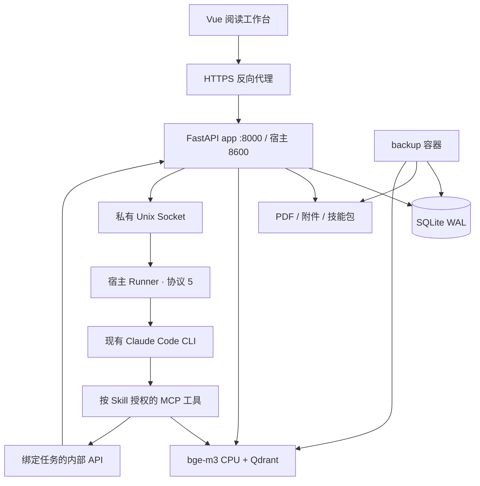
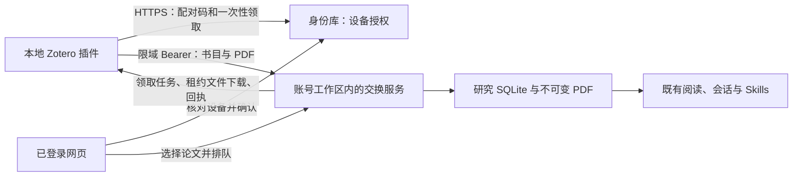

# Firework 系统架构

更新：2026-11-20；依据当前源码、已注册 OpenAPI 和部署配置。业务迁移 0016、身份 schema 2、Runner 协议 5。

## 1. 职责与部署

平台负责资料、工作区、会话映射、任务、证据、审批及持久化。研究判断交给已有 Claude Code，通过可注册 Skill 执行。账号认证与工作区选择在业务路由前执行，详情见 [认证架构](AUTHENTICATION.md)。当前业务路由不使用旧版独立 LLM Gateway；遗留目录或表存在不表示仍参与业务执行。

Compose 有 app、qdrant、backup 三个服务；Runner 是宿主用户级 systemd 服务，读取已有 Claude 配置，不在应用镜像中另外保存模型密钥。账号使用独立 SQLite、文件目录、向量集合和原生会话，管理员保留原有空间；当前按单 Web worker、单 Runner 设计；Runner 默认并发 2，不支持直接增加 Web 副本来获得一致的队列或调度。

## 2. 代码目录与入口

| 位置 | 职责 |
| --- | --- |
| `frontend/src/views/WorkbenchView.vue`、`ReaderPane.vue` | 起始工作台与三栏阅读宿主 |
| `frontend/src/components/reader/` | 侧栏、工具栏、讨论输入、导读与解释 |
| `frontend/src/reader/` | PDF 引擎、阅读编排、导读状态与布局 |
| `frontend/src/shared/markdown.ts` | Marked 解析、DOMPurify 清理与统一显示 |
| `app/main.py` | 注册当前业务路由、启动 RAG/任务协调、提供 SPA |
| `app/core/` | 配置、数据库迁移、统一错误 |
| `app/papers/`、`app/imports/`、`app/ingest/` | 资料库、来源导入、PDF 解析与向量化 |
| `app/reader/`、`app/reader/guides/` | 批注、译文、位置、导读材料校验与发布 |
| `app/sessions/`、`app/workbench/` | 会话/模板/分类、工作区、草稿、附件 |
| `app/agent/`、`agent_runner/` | 持久任务 API、私有执行、事件、额度、取消和工具 |
| `app/skills/`、`skills/` | 动态注册与内置 Skill 资源 |
| `app/frontier/`、`app/schedules/` | 前沿发现、全局身份、报告、审批与间隔调度 |
| `app/auth/`、`app/core/workspaces.py` | 身份、认证、会话与账号工作区隔离 |
| `app/users/`、`app/storage/` | 本地用户资料、头像及文件存储 |
| `app/migrations/`、`tests/`、`ops/` | 增量迁移、验证与运维 |

前端 Vue 3 / TypeScript / Pinia / Vue Router，经 Vite 构建到镜像 `app/web`；PDF.js 资源保留于 `app/web/vendor`。旧 `reader.html`、`manage.html` 等页面已退役。后端 FastAPI/Pydantic，PDF 处理使用 PyMuPDF。

## 3. 核心数据模型

| 领域 | 当前表 | 关系与用途 |
| --- | --- | --- |
| 文件与版本 | file_objects、paper_documents、document_versions | 按账号内容去重、正文/补充材料、不可变版本和默认正文 |
| 论文与检索 | papers、paper_collections、paper_collection_items、chunks_meta | 论文身份、PDF 路径、分类、阅读状态、向量块映射 |
| 会话 | conversations、conversation_papers、task_templates、session_categories | 业务会话绑定多论文与原生会话 ID，选择模板/Skill |
| 运行 | agent_runs | 请求键、Skill 版本/哈希、状态、答案、工具与用量 |
| 阅读 | reader_states、reader_annotations、reader_translations | 按会话/论文恢复位置，按文件版本保存选区、批注与译文 |
| 工作区 | workspace_states、reader_drafts、image_attachments | 标签、布局、当前论文、未发送内容及会话附件 |
| 技能 | skills、skill_versions、skill_imports、skill_registry_state | 安装来源、版本、资源位置、预检与注册修订 |
| 技能组织 | skill_categories、skill_category_items、skill_tags、skill_tag_items、skill_audit | 分类、标签与变更审计 |
| 导读 | reader_guide_tasks、reader_guide_blocks、reader_guide_items、reader_guide_adoptions | 独立执行、真实材料、结构化重点、幂等采纳 |
| 前沿主题 | frontier_topics、frontier_topic_versions、frontier_runs | 主题配置版本、时间窗、执行与覆盖 |
| 前沿身份/审批 | frontier_entities、frontier_aliases、frontier_items、frontier_evidence、frontier_decisions | 跨主题去重、候选状态、来源证据和审批 |
| 前沿报告/项目 | frontier_reports、frontier_report_reads、frontier_cursors、frontier_pages、projects、project_collection_items | 时间线版本、已读、分页水位、独立项目库 |
| 调度与用户 | research_schedules、user_profile、user_preferences | 间隔任务和单用户设置 |

SQLite 使用 WAL、外键与迁移记录；当前迁移 `0001`–`0016`，由连接初始化按序应用，不改写已应用的 SQL。`notes`、`llm_usage`、`knowledge_map` 等历史表仍可存在；其存在不表示当前已完成统一知识库或长期记忆产品。

## 4. 关键流程

### 阅读与会话

选论文 → 检查 PDF → 恢复标签/位置/会话 → 展示原文。没有 PDF 则提示补充全文。选择论文或恢复阅读不会自动发起导读。

用户发送 → `POST /api/agent/runs` 返回 202 → SQLite 保存 Run → 私有 Runner 运行 CLI 与指定 Skill → 受限工具读取关联资料 → 事件/答案/用量落库 → 浏览器通过 SSE 或查询更新。会话保留原生 ID；终止任务不会自动创建新付费任务。

### Skill 导读与批注

输入框建议 → 用户选择配置 → 明确确认 → 校验 PDF 哈希/Skill 版本/语义幂等 → 创建独立执行会话与 Run → context → material → submit → 暂存 → Run 成功后事务发布。

Skill 输出 `paper-guide/v1`，含总结、路线、重点、理由、解释、锚点、覆盖与未知字段；不能生成数据库主键或矩形。平台在真实 PDF 指定文本块中唯一匹配短引文，计算字形坐标，投影为现有 reader_annotations。无法匹配或整块说明保留页级笔记；混合证据分别显示。

AI 层 `origin=ai`，采纳副本 `origin=ai_adopted`，人工默认 `user`。删除/恢复不重跑模型，采纳幂等；旧文件版本不叠加到新 PDF，失败不覆盖已成功结果。默认 6 页、6 个重点，最多可选 6 页、10 个重点；当前仅文字材料。

### 前沿追踪

主题配置 → 手动执行或已启用调度 → frontier_monitor Skill → 来源检索 → 全局资料身份与既有库去重 → 证据快照 → 引用校验 → 发布完整/部分时间线报告 → 用户批准/忽略/恢复。

论文与项目是不同实体；批准时事务再次核对身份，避免并发重复入库。报告讨论使用独立普通会话，避免复用已结束后台 Run 的内部工具。来源分页/截断如实记录，不将小样本声明为穷尽发现。追踪复用现有调度，不另建外部定时器。

## 5. Skills、额度与接口边界

内置能力定义于 `app/agent/catalog.py`；上传包通过注册表获得固定版本和工具白名单，不能直接执行任意脚本。普通动态技能按 short/read 档位且最多 4 次工具调用；导读选择器另校验三个导读工具和输出额度。详见 [技能开发](SKILLS.md)。

| 内置档位 | 回合 / 输出 token | 工具次数 | 超时 / 预算配置 |
| --- | --- | --- | --- |
| chat / 库检索 / 发现 | 6 / 1024 | 0 / 2 / 2 | 120 秒 / $0.10 |
| paper_import | 6 / 2048 | 1 | 180 秒 / $0.20 |
| paper_read / review / compare | 30 / 8192 | 4 | 无硬超时 / $1.00 |
| paper_guide | 12 / 6000 | 6 | 240 秒 / $0.20 |
| frontier_monitor | 12 / 4096 | 10 | 240 秒 / $0.20 |

预算是执行器参数与护栏，CLI 费用为估算，不是外部供应商核实账单。当前没有所有任务统一的总金额账本。

公网通过 HTTPS 提供应用网页登录，旧 Basic Auth 已关闭。应用接入独立身份库、会话 Cookie、CSRF 和账号隔离；公开注册关闭，当前只允许 primary admin 登录。内部 API 要求私有令牌、Run 与任务绑定；工具只访问授权论文或资源。Markdown 统一清理，Marked 不自动提供公式排版或代码高亮。

## 6. 存储与当前边界

原始 PDF、导入暂存、附件、动态技能、原生会话在 `data/`；SQLite 与文件成套备份，向量以 Qdrant 快照恢复。原生会话延续、资料检索和长期记忆是不同能力：前两者已有，统一知识条目/记忆审核/跨任务召回仍待实施。

已实现多账号身份、管理员元数据管理及私有空间；当前不承诺：共享库/角色协作、多 Web 副本、重启后无损断点续跑、分布式 exactly-once、OCR/图像导读、完整 kelip/Nature 全文材料链、跨主题总预算或站外消息推送。详见 [状态](STATUS.md) 与 [后续计划](ROADMAP.md)。

身份和认证审计集中于 data/auth/accounts.db；研究数据库按账号独立。登录状态不接受客户端指定 workspace，私有 Runner 按受信任上下文路由；共用模型权重、系统 Skill 和执行配额，不共用私有研究数据。认证备份与工作区备份必须成套。

## 文件版本与导出

`app/documents/` 管理文件注册、版本、默认切换和 PDF 导出；迁移为 0014。原论文 ID、PDF、批注 ID 和文件哈希保留；应用及账号运行时启动时注册已有 PDF，新导入文件也可幂等注册。文件存为账号目录 `papers/blob-{sha256}.pdf`，同账号相同内容复用；旧文件副本不自动删除。

默认切换先解析和生成嵌入，再替换索引与默认引用。向量替换使用补偿快照，SQL 失败时恢复旧索引；外部向量服务持续不可达时仍可能需要人工修复，不能等同于跨系统分布式事务。切换期间阻止新运行，有在途运行时拒绝切换。会话的论文关联记录当前材料哈希，旧材料会话不能静默继续使用新版；完整运行材料清单和多版本并行检索仍属后续阶段。

批注沿用原数据库和文件哈希，增加可空的 document_version_id；已知文件按真实哈希关联，未知历史哈希保留未解析状态。导出读取选中版本及有效批注快照，经 PyMuPDF 写入副本，正确变换旋转页面坐标；每账号最多两个并发 PDF 导出。文件下载受现有认证和账号工作区约束，下载前检查原件哈希，不生成模型任务。

## Zotero 手动交换（当前 P0/P1）

定位：Zotero 负责成熟的文献采集、书目整理和写作引用；Firework 负责基于现有 Agent/Skills 的阅读、比较、追踪和证据产出。优先复用文献管理基础能力，避免建设新的 CSL 引用引擎、采集 Translator 生态或完整桌面同步协议。批注、任务、会话仍由 Firework 管理，不把这些研究状态压成 Zotero 书目字段。

实现由三层组成：`plugins/zotero/` 是本地启动式插件，使用 Zotero JavaScript API 和系统凭据服务；`app/integrations/zotero/` 提供配对、确定性书目交换和传输队列；`frontend/src/views/ZoteroView.vue` 提供设备核对授权、撤销、选文发送和失败重试。网页不会直接读取本地 Zotero 数据库，服务端不访问 localhost:23119，也不要求关闭本地接口授权或修改 Zotero Connector。

身份库 schema 2 保存短期配对记录和设备令牌哈希。配对码有效 10 分钟，设备凭据有效 30 天；同账号、同插件实例重新配对沿用设备编号并替换凭据，因此无 DOI 条目也保留来源关系。凭据只授权 `/api/zotero/device/*`，不能调用账号管理、通用论文查询或付费 Agent 执行接口；设备只能领取网页为它选择的导出文件。账号停用、密码改变、连接撤销或到期都会拒绝旧凭据。工作区由服务端的设备所属账号确定，客户端不能指定其他账号目录。

业务迁移 0016 为分类增加 `parent_id` 与同父名称唯一约束，保留原有分类 ID 和论文归属；父分类列表与数量包含后代。新增 `zotero_links`（设备/库/条目→论文、来源快照和元数据基线）、`zotero_attachment_links`（本地附件→文档/版本/哈希）、`paper_tags`（来源标签）与 `zotero_exports`（固定材料快照、幂等请求键、租约和回执）。来源标签、分类采用增量加入；删除或移动不跨端传播。当前网页使用共享分类树组件逻辑，首页和论文库均按父子关系显示、缩进并展开/收起；支持创建子分类和父分类筛选，尚未实现重命名、移动与删除。

入站复用 DOI/arXiv 规范化、现有文档注册与哈希存储；无标识时可用预先提交的正文 SHA-256 精确匹配单一已有论文，多候选需人工处理。优先使用稳定来源键，其次精确 DOI/arXiv；无标识不按相似标题自动合并。既有未关联书目保留本地内容；关联之后若 Firework 书目版本已被人工编辑，返回 409，要求核对，保留双方。PDF 上传前检查来源键和哈希，成功上传复用不可变版本；仅首次正文直接成为可阅读版本，不等待全文嵌入；后续文件变化不会切换当前阅读材料。来源条目后续补充 DOI/arXiv 时更新同一论文的空缺标识，与其他既有论文冲突则暂停。补充材料保留独立文档，扫描件不假装获得 OCR。

出站只接受当前账号论文库中被明确选中的论文，最多每批 30 篇、每篇 30 个可用 PDF 版本。插件由用户选择目标库/分类，再领取任务；只读库拒绝写入。已映射条目优先复用，未映射时按精确 DOI 复用，并保留既有书目字段；新条目写基本题名、作者、摘要、标识及标签。PDF 校验内容哈希后作为普通 Zotero 附件保存；Firework 的文件版本模型不等同于 Zotero 的版本模型。分类来源映射返回原库时不重复嵌套。任务租约 15 分钟，过期可重新领取；失败需网页重试。本地私有恢复记录保存预分配条目键及已创建附件，回执丢失或中途中断可续接，避免重复创建。插件实例或目标库变化时拒绝复用另一账号的待办。

手动传输调用研究模型为 0；上传只校验和保存文件、准备首次阅读，不运行重型向量嵌入。文件管理显示 `fulltext_indexed`，用户可明确点击“建立全文检索索引”；当前默认版本尚无索引时可复用默认切换接口补建，PDF 阅读与选区问答不等待索引。文件校验和解析仍有 CPU/存储成本。原始 PDF 中本来存在的批注随原文件保留；Firework 自身批注、自动导读、笔记和会话未在此批导出到 Zotero。原生批注、阅读位置双向同步、Connector 事件自动监听、Zotero 云 Web API 同步和复杂元数据冲突合并均未实现。

参考公共接口：[Zotero JavaScript API](https://www.zotero.org/support/dev/client_coding/javascript_api)、[Local API](https://www.zotero.org/support/dev/web_api/v3/local_api)、[开发兼容说明](https://www.zotero.org/support/dev/zotero_8_for_developers)、[官方启动插件示例](https://github.com/zotero/make-it-red)。本批还核对了本机 Zotero 10.0.6 安装包公开实现中的菜单、HTTP、附件和凭据 API；接口核对及模拟测试不等于已经在真实研究库中安装并完成端到端验收。

### Zotero 首轮流程修复（0.1.2）

- 同一设备、同一论文和相同材料快照的未完成出站任务复用一个队列项。迁移 0016 的 `zotero_export_request_keys` 保存每次请求键到任务的别名，完成后重复原请求仍返回原结果。领取时刷新来源关联，避免排队时尚无映射、首次接收后又创建副本。
- 已有 Zotero 条目接收时保留本地分类；映射到其他文献库的任务拒绝跨库复制并明确要求切回。新条目按来源路径存于选择的目标分类之下，无来源路径才直接归目标；目标与首层同名时不重复套层。出站路径剥除已知设备来源包装目录，不把设备编号当作研究分类。
- 同一论文内，相同 PDF 的不同本地附件键关联已有文档/版本。入站先提交正文哈希，允许无 DOI/arXiv 的相同 PDF 复用已有论文；模糊标题或不同版本文件不能据此自动合并。源文件拥有多个既有论文候选时暂停，保留历史资料。
- PDF/子笔记选择解析至父文献并按文献 ID 去重；新发送只处理本次选择，旧失败队列由明确的重试操作处理；重新启动后的 sending 标为可重试失败。页面与插件分别标明两个传输方向，配对状态不冒称客户端在线。
- 分类改名、移动和删除仍不构成完整镜像同步。既有人工分类与不同来源的同名目录不自动合并，历史疑似重复或额外归属不直接清除。

启动恢复仅处理来源附件映射明确、文件哈希正确、没有既有 PDF 路径/默认版/索引的首次正文；按原导入意图激活阅读，不运行嵌入，不合并论文，不覆盖既有阅读材料。
