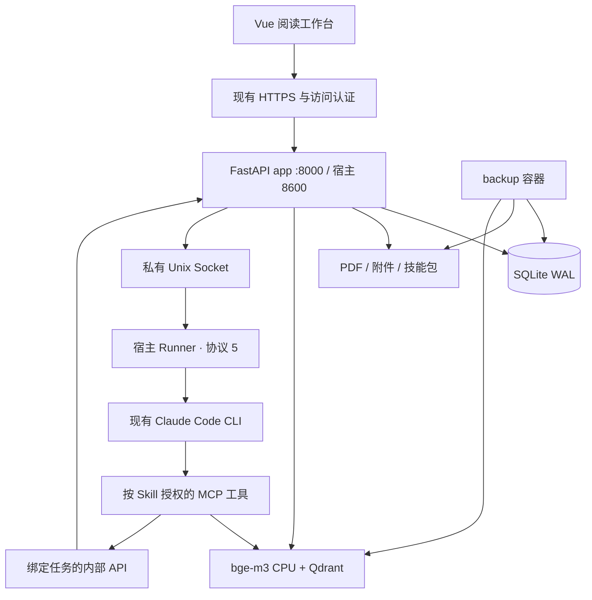

# 系统架构

更新：2026-11-19；依据认证改造基于 `e25954e`、已注册 OpenAPI 和当前部署状态。旧架构见 [归档](archive/2026-11-19-before-handbook/README.md)。

## 1. 职责与部署

平台负责资料、工作区、会话映射、任务、证据、审批及持久化。研究判断交给已有 Claude Code，通过可注册 Skill 执行。账号认证与工作区选择在业务路由前执行，详情见 [认证架构](AUTHENTICATION.md)。当前业务路由不使用旧版独立 LLM Gateway；遗留目录或表存在不表示仍参与业务执行。

Compose 有 app、qdrant、backup 三个服务；Runner 是宿主用户级 systemd 服务，读取已有 Claude 配置，不在应用镜像中另外保存模型密钥。账号使用独立 SQLite、文件目录、向量集合和原生会话，管理员保留原有空间；当前按单 Web worker、单 Runner 设计；Runner 默认并发 2，不支持直接增加 Web 副本来获得一致的队列或调度。

## 2. 代码目录与入口

| 位置 | 职责 |
| --- | --- |
| `frontend/src/views/WorkbenchView.vue`、`ReaderPane.vue` | 起始工作台与三栏阅读宿主 |
| `frontend/src/components/reader/` | 侧栏、工具栏、讨论输入、导读与解释 |
| `frontend/src/reader/` | PDF 引擎、阅读编排、导读状态与布局 |
| `frontend/src/shared/markdown.ts` | Marked 解析、DOMPurify 清理与统一显示 |
| `app/main.py` | 注册当前业务路由、启动 RAG/任务协调、提供 SPA |
| `app/core/` | 配置、数据库迁移、统一错误 |
| `app/papers/`、`app/imports/`、`app/ingest/` | 资料库、来源导入、PDF 解析与向量化 |
| `app/reader/`、`app/reader/guides/` | 批注、译文、位置、导读材料校验与发布 |
| `app/sessions/`、`app/workbench/` | 会话/模板/分类、工作区、草稿、附件 |
| `app/agent/`、`agent_runner/` | 持久任务 API、私有执行、事件、额度、取消和工具 |
| `app/skills/`、`skills/` | 动态注册与内置 Skill 资源 |
| `app/frontier/`、`app/schedules/` | 前沿发现、全局身份、报告、审批与间隔调度 |
| `app/auth/`、`app/core/workspaces.py` | 身份、认证、会话与账号工作区隔离 |
| `app/users/`、`app/storage/` | 本地用户资料、头像及文件存储 |
| `app/migrations/`、`tests/`、`ops/` | 增量迁移、验证与运维 |

前端 Vue 3 / TypeScript / Pinia / Vue Router，经 Vite 构建到镜像 `app/web`；PDF.js 资源保留于 `app/web/vendor`。旧 `reader.html`、`manage.html` 等页面已退役。后端 FastAPI/Pydantic，PDF 处理使用 PyMuPDF。

## 3. 核心数据模型

| 领域 | 当前表 | 关系与用途 |
| --- | --- | --- |
| 论文与检索 | papers、paper_collections、paper_collection_items、chunks_meta | 论文身份、PDF 路径、分类、阅读状态、向量块映射 |
| 会话 | conversations、conversation_papers、task_templates、session_categories | 业务会话绑定多论文与原生会话 ID，选择模板/Skill |
| 运行 | agent_runs | 请求键、Skill 版本/哈希、状态、答案、工具与用量 |
| 阅读 | reader_states、reader_annotations、reader_translations | 按会话/论文恢复位置，按文件版本保存选区、批注与译文 |
| 工作区 | workspace_states、reader_drafts、image_attachments | 标签、布局、当前论文、未发送内容及会话附件 |
| 技能 | skills、skill_versions、skill_imports、skill_registry_state | 安装来源、版本、资源位置、预检与注册修订 |
| 技能组织 | skill_categories、skill_category_items、skill_tags、skill_tag_items、skill_audit | 分类、标签与变更审计 |
| 导读 | reader_guide_tasks、reader_guide_blocks、reader_guide_items、reader_guide_adoptions | 独立执行、真实材料、结构化重点、幂等采纳 |
| 前沿主题 | frontier_topics、frontier_topic_versions、frontier_runs | 主题配置版本、时间窗、执行与覆盖 |
| 前沿身份/审批 | frontier_entities、frontier_aliases、frontier_items、frontier_evidence、frontier_decisions | 跨主题去重、候选状态、来源证据和审批 |
| 前沿报告/项目 | frontier_reports、frontier_report_reads、frontier_cursors、frontier_pages、projects、project_collection_items | 时间线版本、已读、分页水位、独立项目库 |
| 调度与用户 | research_schedules、user_profile、user_preferences | 间隔任务和单用户设置 |

SQLite 使用 WAL、外键与迁移记录；当前迁移 `0001`–`0013`，由连接初始化按序应用，不改写已应用的 SQL。`notes`、`llm_usage`、`knowledge_map` 等历史表仍可存在；其存在不表示当前已完成统一知识库或长期记忆产品。

## 4. 关键流程

### 阅读与会话

选论文 → 检查 PDF → 恢复标签/位置/会话 → 展示原文。没有 PDF 则提示补充全文。选择论文或恢复阅读不会自动发起导读。

用户发送 → `POST /api/agent/runs` 返回 202 → SQLite 保存 Run → 私有 Runner 运行 CLI 与指定 Skill → 受限工具读取关联资料 → 事件/答案/用量落库 → 浏览器通过 SSE 或查询更新。会话保留原生 ID；终止任务不会自动创建新付费任务。

### Skill 导读与批注

输入框建议 → 用户选择配置 → 明确确认 → 校验 PDF 哈希/Skill 版本/语义幂等 → 创建独立执行会话与 Run → context → material → submit → 暂存 → Run 成功后事务发布。

Skill 输出 `paper-guide/v1`，含总结、路线、重点、理由、解释、锚点、覆盖与未知字段；不能生成数据库主键或矩形。平台在真实 PDF 指定文本块中唯一匹配短引文，计算字形坐标，投影为现有 reader_annotations。无法匹配或整块说明保留页级笔记；混合证据分别显示。

AI 层 `origin=ai`，采纳副本 `origin=ai_adopted`，人工默认 `user`。删除/恢复不重跑模型，采纳幂等；旧文件版本不叠加到新 PDF，失败不覆盖已成功结果。默认 6 页、6 个重点，最多可选 6 页、10 个重点；当前仅文字材料。

### 前沿追踪

主题配置 → 手动执行或已启用调度 → frontier_monitor Skill → 来源检索 → 全局资料身份与既有库去重 → 证据快照 → 引用校验 → 发布完整/部分时间线报告 → 用户批准/忽略/恢复。

论文与项目是不同实体；批准时事务再次核对身份，避免并发重复入库。报告讨论使用独立普通会话，避免复用已结束后台 Run 的内部工具。来源分页/截断如实记录，不将小样本声明为穷尽发现。追踪复用现有调度，不另建外部定时器。

## 5. Skills、额度与接口边界

内置能力定义于 `app/agent/catalog.py`；上传包通过注册表获得固定版本和工具白名单，不能直接执行任意脚本。普通动态技能按 short/read 档位且最多 4 次工具调用；导读选择器另校验三个导读工具和输出额度。详见 [技能开发](SKILLS.md)。

| 内置档位 | 回合 / 输出 token | 工具次数 | 超时 / 预算配置 |
| --- | --- | --- | --- |
| chat / 库检索 / 发现 | 6 / 1024 | 0 / 2 / 2 | 120 秒 / $0.10 |
| paper_import | 6 / 2048 | 1 | 180 秒 / $0.20 |
| paper_read / review / compare | 30 / 8192 | 4 | 无硬超时 / $1.00 |
| paper_guide | 12 / 6000 | 6 | 240 秒 / $0.20 |
| frontier_monitor | 12 / 4096 | 10 | 240 秒 / $0.20 |

预算是执行器参数与护栏，CLI 费用为估算，不是外部供应商核实账单。当前没有所有任务统一的总金额账本。

公网沿用已有访问认证，应用已接入独立身份库、会话 Cookie、CSRF 和账号隔离；公开注册关闭，当前只允许 primary admin 登录。内部 API 要求私有令牌、Run 与任务绑定；工具只访问授权论文或资源。Markdown 统一清理，Marked 不自动提供公式排版或代码高亮。

## 6. 存储与当前边界

原始 PDF、导入暂存、附件、动态技能、原生会话在 `data/`；SQLite 与文件成套备份，向量以 Qdrant 快照恢复。原生会话延续、资料检索和长期记忆是不同能力：前两者已有，统一知识条目/记忆审核/跨任务召回仍待实施。

已实现多账号身份、管理员元数据管理及私有空间；当前不承诺：共享库/角色协作、多 Web 副本、重启后无损断点续跑、分布式 exactly-once、OCR/图像导读、完整 kelip/Nature 全文材料链、跨主题总预算或站外消息推送。详见 [状态](STATUS.md) 与 [后续计划](ROADMAP.md)。

身份和认证审计集中于 data/auth/accounts.db；研究数据库按账号独立。登录状态不接受客户端指定 workspace，私有 Runner 按受信任上下文路由；共用模型权重、系统 Skill 和执行配额，不共用私有研究数据。认证备份与工作区备份必须成套。
