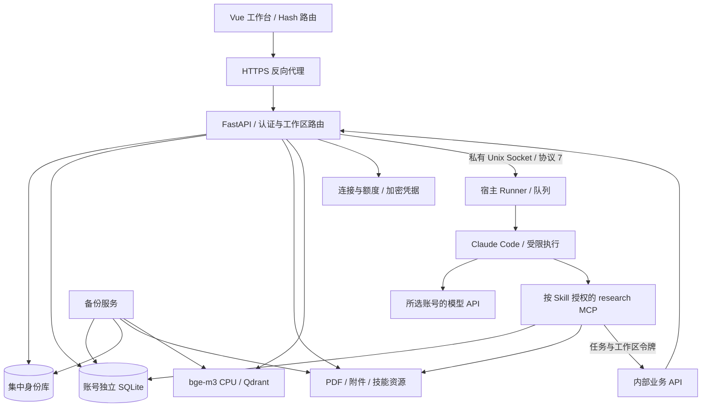
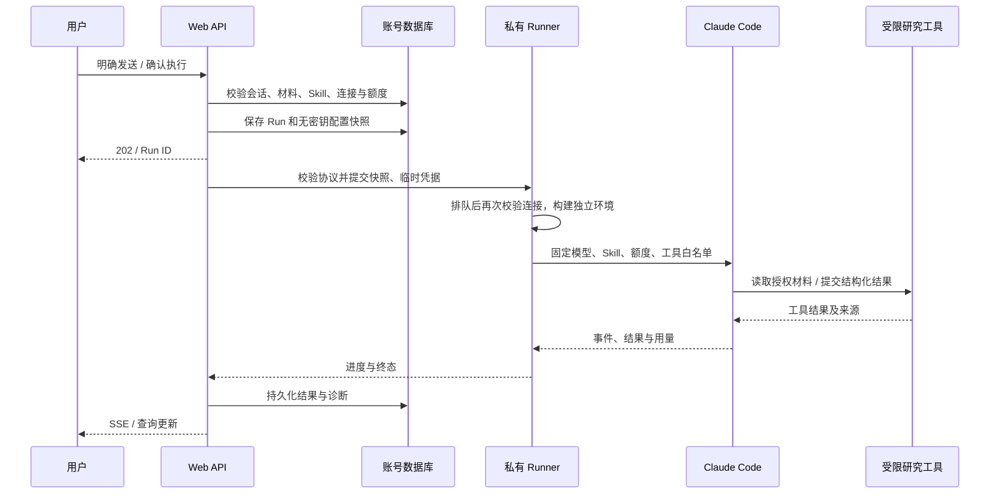

# Firework 系统架构

更新：2026-11-21。依据当前注册路由、业务代码、迁移和部署配置整理；代码版本以 Git 为准。业务迁移 `0001–0019`、身份库 schema 2、Runner 协议 **7**。本文描述已实现系统，未实现功能集中在 [后续计划](ROADMAP.md)。

## 1. 产品职责

Firework 是以论文为材料、以会话为任务上下文的研究工作台。

- 平台管理论文、分类、文件版本、会话、任务、证据、审批、配置和展示。
- Claude Code 执行研究任务，通过固定版本的 Skill 使用经过授权的工具。
- 浏览器打开论文、查看既有批注、编辑模板和预检配置不会自动调用研究模型。
- 导入、发送讨论、确认导读、执行追踪或已启用的调度可以创建模型任务。PDF 解析和向量索引还有独立的 CPU、存储成本。

会话延续、向量检索和长期记忆是不同能力。前两者已实现；统一知识条目、跨任务记忆审核与召回尚未实现。

## 2. 部署与技术栈



| 层次 | 当前实现 |
| --- | --- |
| Web | Vue 3、TypeScript、Vite、Pinia、Vue Router |
| 阅读与文档显示 | PDF.js；Marked 解析 Markdown，DOMPurify 清理 HTML |
| 应用 | Python 3.12+、FastAPI、Pydantic、PyMuPDF |
| 业务存储 | SQLite WAL、文件系统、顺序 SQL 迁移 |
| 检索 | bge-m3 CPU 嵌入与 Qdrant；资料库查询也有不依赖向量的元数据路径 |
| 智能体 | 宿主 Claude Code CLI、私有 Runner、内置 research MCP |
| 部署 | Compose 的 app、qdrant、backup；宿主用户级 systemd Runner；HTTPS 反向代理 |

应用容器内端口 8000，当前宿主端口 8600。Runner 不在 app 容器中，通过共享数据目录中的 Socket 接入。研究工具的内部 HTTP 回调目前使用宿主 `127.0.0.1:8600`，修改端口需要同步适配。新机器必须调整仓库中保留的部署路径、网卡绑定和服务模板，见 [环境与部署](enviroment.md)。

系统按单 Web worker、单宿主 Runner 设计。Runner 默认并发 2；各账号独立 JobEngine 共用并发与队列总上限。队列、会话协调和调度没有外置为分布式服务，不能直接增加 Web 副本。

## 3. Web 组织与页面路由

首页是阅读起始工作台，顶层功能依次为读论文、前沿追踪、论文比较、定时任务、论文库管理。工作台内部视图由持久化 store 管理；以下独立入口使用 Hash 路由。

| 地址 | 用途 |
| --- | --- |
| `/#/` | 工作台及内部功能切换 |
| `/#/reader/:paperId` | 阅读深链，可带 `session_id` |
| `/#/login`、`/#/register` | 登录、关闭状态的注册页 |
| `/#/accounts` | 管理员账号管理 |
| `/#/integrations/zotero` | 配对、设备和双向交换队列 |
| `/#/settings/runner/connections` | 个人模型连接 |
| `/#/settings/runner/budgets` | 个人额度预设与默认设置 |

右栏采用有界高度的纵向布局：标题/状态、独立记录滚动区、限高辅助设置区和底部输入区。会话详情放入记录区，避免其展开挤占结果高度；回答块不参与纵向压缩。跟随滚动依据内容更新前的用户位置，新内容和窗口变化不打断上翻阅读；回到最新按钮定位在记录区，不依赖固定的输入区高度。

阅读标签位于三栏上方。左侧显示导读、目录、批注、高亮、译文和论文信息；中央为 PDF 及其工具栏；右侧为关联会话。标签、位置、布局和草稿可恢复。没有 PDF 时提供补充全文入口，不进入空白的智能体阅读页。

[router.ts](../frontend/src/router.ts) 使用 `createWebHashHistory`；[navigation.ts](../frontend/src/shared/navigation.ts) 负责旧链接转换和登录返回白名单。API、文件、SSE 与插件下载继续使用普通路径。`/#/settings`、独立模型目录、执行方案和 Run 检查器路由当前未注册；不能把规划地址当作现行入口。

## 4. 模块与代码边界

| 代码 | 职责 |
| --- | --- |
| [app/main.py](../app/main.py) | 路由注册、生命周期、应用静态资源与 SPA 兜底 |
| [app/auth/](../app/auth/) | 身份库、Cookie、CSRF、账号状态、设备授权 |
| [app/core/](../app/core/) | Settings、数据库迁移、工作区上下文、错误 |
| [app/papers/](../app/papers/)、[app/documents/](../app/documents/) | 论文与分类、文件对象、文档版本、下载与批注导出 |
| [app/imports/](../app/imports/)、[app/ingest/](../app/ingest/) | 来源导入、解析与索引；导入绑定 Agent 任务 |
| [app/reader/](../app/reader/) | 阅读位置、批注、译文和结构化导读 |
| [app/sessions/](../app/sessions/)、[app/workbench/](../app/workbench/) | 会话、模板、任务分类、标签、布局、草稿和图片 |
| [app/agent/](../app/agent/) | Run 校验、快照、幂等、调度到 Runner、查询和取消 |
| [app/runner_config/](../app/runner_config/) | 连接、加密凭据、额度与本地预检 |
| [agent_runner/](../agent_runner/) | 私有执行接口、进程队列、CLI 环境、事件、工具代理 |
| [app/skills/](../app/skills/)、[skills/](../skills/) | ZIP 预检、注册与不可变版本、内置提示和资源 |
| [app/frontier/](../app/frontier/)、[app/schedules/](../app/schedules/) | 领域主题、发现、去重、报告、审批和间隔调度 |
| [app/integrations/zotero/](../app/integrations/zotero/)、[plugins/zotero/](../plugins/zotero/) | 服务端交换契约与 Zotero 本地插件 |
| [frontend/src/](../frontend/src/) | 页面、阅读组件、API 封装、状态与 Markdown 显示 |
| [ops/](../ops/)、[tests/](../tests/) | 部署、备份恢复、隔离验证 |

`app/main.py` 注册的路由才是业务入口。旧代码目录、历史表或退役 HTML 的存在不代表功能已接入。

## 5. 数据与账号隔离

### 存储布局

```text
data/
  auth/accounts.db                  集中身份、网页登录会话、设备授权
  auth/runner-master.key            管理员工作区默认的连接加密主密钥
  app.db                            管理员原有研究数据库
  papers/                           PDF 文件对象
  attachments/                      会话图片
  skills/                           私有技能原包与展开资源
  agent/
    runner.sock                     主 Runner 私有接口
    claude-config/                  管理员 legacy 原生配置
    connections/{id}-{revision}/claude-config/
    sessions/                       原生会话工作目录
    runs/                           事件与运行结果
  accounts/{workspaceKey}/           独立账号：app.db、auth/、papers/、agent/ 等
  hf/                               共享嵌入模型缓存
  qdrant/                           向量服务数据
```

账号工作区由服务端认证确定，客户端提交的账号 ID 或工作区头不能切换研究空间。管理员原有向量集合为 `chunks`，独立账号为 `chunks_{workspaceKey}`；公共模型权重与系统技能代码共享，私有资料不共享。这是同一可信主机上的应用隔离，尚非每账号容器隔离。

### 主要数据模型

| 领域 | 主要表或字段 | 关键关系 |
| --- | --- | --- |
| 论文与分类 | papers、paper_collections、paper_collection_items | 分类 parent_id 表示树；父分类筛选包含后代，论文数量去重 |
| 文件与版本 | file_objects、paper_documents、document_versions | 论文有正文/补充文档，文档有不可变版本；论文选择默认正文版本 |
| 会话 | conversations、conversation_papers、task_templates、session_categories | 会话关联多论文、固定 Skill、原生会话 ID 与连接快照 |
| Run | agent_runs | 请求键、状态、Skill 版本/哈希、执行策略快照、答案、工具与用量 |
| 阅读状态 | reader_states、reader_annotations、reader_translations | 位置及文件版本关联的批注、选区和译文 |
| 工作区 | workspace_states、reader_drafts、image_attachments | 打开标签、布局、会话草稿与附件 |
| Skills | skills、skill_versions、skill_imports、skill_categories、skill_audit 等 | 原包、固定版本、分类、标签、启停和审计 |
| 导读 | reader_guide_tasks、reader_guide_blocks、reader_guide_items、reader_guide_adoptions | 材料快照、重点、引文证据及个人采纳副本 |
| 前沿 | frontier_topics、frontier_runs、frontier_entities、frontier_items、frontier_evidence、frontier_reports 等 | 主题版本、发现身份、证据、时间线报告和审批 |
| 项目与调度 | projects、project_collection_items、research_schedules | 开源项目独立管理，调度引用研究任务 |
| Zotero | zotero_links、zotero_attachment_links、zotero_exports、zotero_export_request_keys | 来源映射、附件哈希、出站快照、租约和幂等回执 |
| 额度 | runner_budgets、runner_budget_revisions、runner_budget_settings | 额度版本与账号默认；Run 固定提交时数值 |
| 连接 | runner_connections、runner_connection_settings、conversations.runner_connection_json | 连接当前修订、加密凭据、账号默认和会话绑定 |

身份库独立于研究数据库。业务迁移由 [app/core/db.py](../app/core/db.py) 按 [app/migrations/](../app/migrations/) 顺序应用，已应用迁移不应改写。历史 `notes`、`knowledge_map` 等表不等同于已完成知识管理产品。

## 6. 智能体执行与会话



1. `request_key` 保证同一输入请求不重复创建任务；同键不同输入返回冲突。
2. 同一会话限制并发运行。Skill 版本、材料版本和连接绑定都参与继续执行校验。
3. 已有会话保持绑定连接，账号默认变化只影响新会话。连接修订或停用后拒绝旧修订继续执行，需要新会话；当前不保存可继续调用的历史连接凭据版本。
4. CLI 原生记录存在时续接；缺失记录而会话已标记可续接时明确失败，不静默丢弃上下文。
5. 取消、服务重启和限额失败均不自动创建新的付费任务。CLI 金额/轮次中断与超时可保存已收到的部分文本，未完成文本不冒充完成结果。
6. 内部导入、导读、追踪接口还校验 Run、任务和材料绑定。普通 Skill 不能仅声明工具名便获得任意操作权限。

## 7. 模型连接、角色与额度

个人连接支持 Anthropic Messages 兼容地址、单个准确模型名称、x-api-key/Bearer 二选一、视觉/上下文声明和角色补充要求。当前不是自动发现模型目录，也没有 OpenAI 协议转换；真实图片能力、1M 支持和计费必须另行验证。

凭据采用 AES-GCM 加密，Web 执行时解密，经私有 Socket 临时交给 Runner。自定义运行不读取宿主 Claude 配置，不继承宿主模型覆盖；原生配置目录按工作区、连接和修订隔离。MCP 子进程清除模型鉴权变量。密钥不返回网页、不进入无密钥快照、argv 或正常事件/结果记录；已知当前 Key 会在持久化进度和结果前替换。完整 stderr 调试包尚未实现。

只有原管理员保留 legacy 宿主配置兼容。其他账号必须配置自己的 API；连接不可用时不会回退管理员凭据。默认拒绝非公网 HTTPS 目的地，私有主机需维护者明确允许；这不等同于容器级出口隔离。

额度优先级为：**本次显式选择 → 账号默认 → Skill 原策略**。轮次、单次输出 token、工具次数、执行时长和可选 CLI 金额守卫分别限制；不改变工具权限。快速、标准、深度预设关闭金额守卫但保留其他限制。原账号默认仍可沿用含 $0.10/$0.20 等上限的 Skill 策略，需显式保存新默认。

CLI 金额为估算，不能作为服务商账单硬限额；单次输出上限也不是累计 token 限额。配置预检不调用模型。完整参数及 API 见 [Runner 配置](RUNNER-CONFIGURATION.md)。

## 8. 论文、导读与前沿流程

### 论文与文件

论文身份、分类、文件对象和版本分开管理。相同账号按 SHA-256 复用文件，文档版本不可覆盖；新版本需明确设为默认。默认切换更新索引与阅读材料绑定，并保护在途任务和旧材料会话。SQL 与向量替换有补偿逻辑，不构成跨系统分布式事务。

导出读取指定文件版本与有效批注，用 PyMuPDF 在副本写入标准批注；原件不变。支持原件、带批注 PDF、批注 Markdown。不同版本不会自动迁移批注。

迁移 0019 为 `papers` 增加 `deleted_at`，删除采用回收站，不进行文件和向量物理回收。库列表、分类数量、最近阅读与智能体库搜索（含文本摘录）排除回收站条目；恢复沿用相同 ID 和资料关系。加载工作区时过滤回收站标签，旧会话保留只读查阅能力，新任务必须先恢复论文。Zotero 的来源映射和去重记录保留，不传播远端删除，后续重复导入不自动解除回收站状态。

### 结构化导读

用户确认 → 独立 Skill 任务 → `context → material → submit` → 平台校验 `paper-guide/v1` → 暂存 → Run 成功后发布完整或部分导读。

Skill 输出总结、路线、重点、理由、解释及引用，不输出数据库主键和矩形坐标。平台在真实 PDF 材料中唯一匹配引文，再计算高亮位置；无法唯一定位时保留页级笔记。AI 产物与人工批注分层，采纳产生个人副本，更新导读不覆盖个人批注。

当前导读只用文字材料，最多选择 6 页、10 个重点，默认 6 个重点；不支持自动 OCR、图像或代码材料链。失败 Run 的中间结构化提交不直接发布为有效导读。

### 前沿追踪

主题版本 → 用户执行或间隔调度 → frontier_monitor → arXiv/Crossref/GitHub 来源 → 当前工作区跨主题及既有库去重 → 引用与覆盖校验 → 堆叠时间线报告 → 用户审批入库。

论文与项目分开保存，批准时事务再次核对身份。失败、截断、部分覆盖如实记录。主题默认暂停；当前为间隔调度，不是任意 Cron 或完整日历调度。

## 9. Skills、MCP 与 Zotero

智能体界面的显示层复用现有 Session/Run：右栏完整会话和结果模式只改变展示，会话列表在既有搜索结果内按运行状态筛选与排序，不新增任务或变更权限。配置管理复用账号隔离的连接、额度与技能服务。参考及实现边界见 [智能体界面与管理](AGENT-UI.md)。

当前有 10 个内置 Skill、13 个研究工具。内置能力来自 [catalog.py](../app/agent/catalog.py)，动态 Skill 复用注册版本与权限校验。ZIP 扩展提示和可读资源，安装不执行任意脚本，也不自动安装外部 MCP 服务。外部科研 Skill 只有经材料链、工具和产物适配后才可视为可用，不能因同名包安装成功就声称完整兼容。见 [Skills 开发](SKILLS.md)。

Zotero 插件当前为 **0.1.4**，声明兼容 Zotero **10.0.6–10.x**。本地插件主动连接 Firework HTTPS，通过网页确认配对获得限域设备凭据，不开放本地监听端口。支持手动双向书目、分类路径、标签和 PDF 交换；来源键、精确 DOI/arXiv、文件哈希、租约与回执用于去重和恢复。分类与标签增量加入，删除/移动不跨端镜像传播。配对不代表客户端在线。

Zotero 手动交换不调用研究模型；首次 PDF 可先阅读，全文索引由用户明确触发。Firework 原生批注、导读、会话和阅读位置尚未回流；Connector 自动监听、云同步、完整 CSL/Translator 生态也未实现。

## 10. 认证、备份与运行边界

公开注册关闭，默认仅 primary admin 登录；创建普通账号或将其启用不自动解除这一部署限制。生产使用 HTTPS、服务端会话 Cookie、CSRF 和受控来源；PDF、附件、SSE 与配置接口同样受账号隔离保护。设备令牌只用于限定 Zotero 接口。详见 [认证说明](AUTHENTICATION.md)。

备份必须成套包含身份、账号数据库、PDF、附件、技能、原生会话、连接主密钥及向量快照。默认管理员主密钥有独立归档，账号密钥随账号归档；外部挂载主密钥需单独备份。恢复时缺失连接主密钥会拒绝相应恢复；文件存在和长度检查不能代替实际解密验证。见 [备份恢复](BACKUP-RESTORE.md)。

当前未提供：统一知识库/长期记忆、完整全文科研 Skill 材料链、独立角色与执行方案、通用 MCP 配置中心、完整会话分支/调试包、累计费用硬账本、多 Web 副本、Runner 容器化或自动无损断点续跑。版本化设计与尚未实现的目标不列为当前功能。
