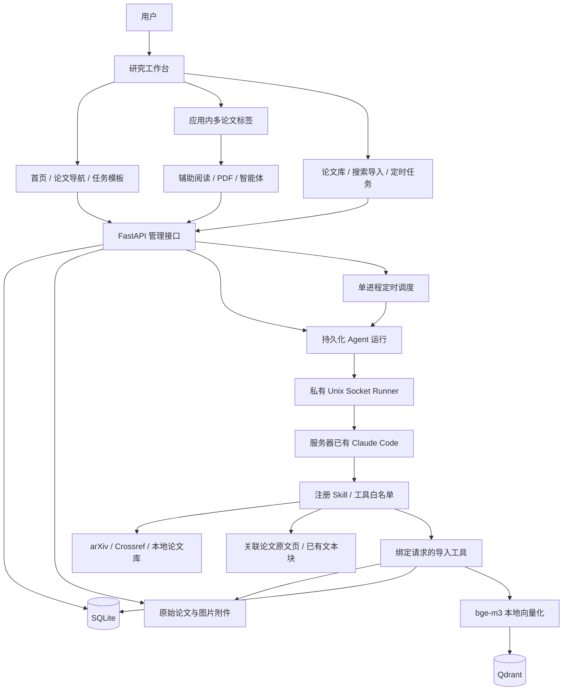
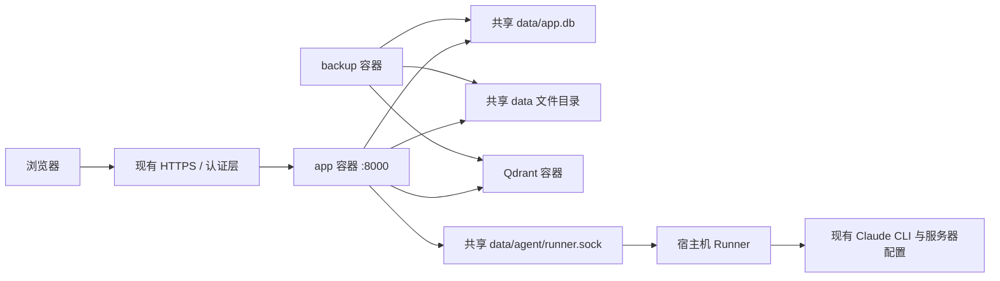
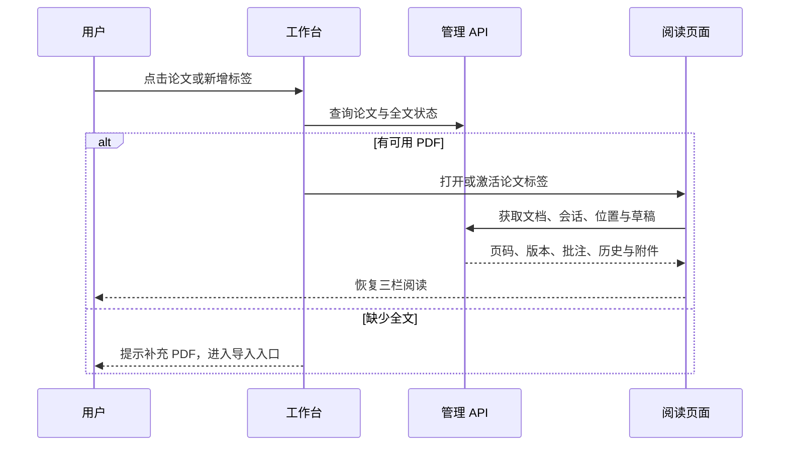
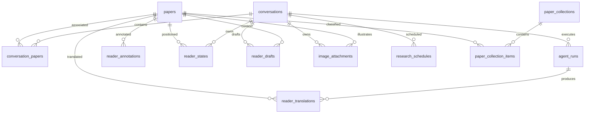

# 研知科研助手：整体架构

更新时间：2026-11-17。

本文描述当前代码中的架构、已接通的流程及边界。最终综合检查已按用户要求停止，尚未确认的事项列在《任务设计和实现的流程与未实现.md》中，不视为已经验收。

## 1. 产品目标与职责

系统提供论文发现、导入、分类、阅读、比较、任务会话和定时任务管理。

核心原则：**平台管理研究材料和任务状态，研究处理复用服务器已有智能体，通过 Skill 扩展。**

平台负责论文条目、原始文件、分类、会话映射、论文标签、布局、草稿、批注、译文缓存、附件和运行记录。现有 Claude Code 负责理解与处理任务；受限工具负责检索、原文读取、下载、解析和向量化。

当前新版主流程遵循该原则。历史 `/legacy.html` 及部分旧 API 仍保留直接调用 LLM Gateway 的兼容实现，尚未全部迁移；后续不应继续在旧路径增加新研究能力。

## 2. 总体结构



## 3. 技术栈与部署

| 层次 | 当前实现 |
|---|---|
| Web | 原生 JavaScript ES Modules、HTML、CSS |
| PDF | 项目内置 PDF.js 6.5.438；Canvas、文字层和 SVG 批注覆盖层 |
| API | Python 3.12、FastAPI、Pydantic、HTTPX |
| 关系数据 | SQLite，WAL，迁移脚本自动执行 |
| PDF 解析 | PyMuPDF |
| 向量检索 | Qdrant；bge-m3 在 CPU 上生成向量 |
| 智能体 | 现有 Claude Code CLI；私有 Runner 调用 |
| 部署 | Docker Compose 管理 app、qdrant、backup；用户级 systemd 管理 Runner |
| 访问 | 沿用已有 HTTPS 入口与访问认证 |

现有服务按单 Web worker、单 Runner 使用。多进程、多副本调度和并发队列一致性尚未完成。

### 部署拓扑



app 对宿主机提供 `8600` 端口；公共访问继续经过现有认证入口。模型凭据仅从宿主机 Claude 配置读取，不返回前端，不写入项目文档或 Git。

## 4. 页面与前端组织

### 4.1 首页

入口为 `app/web/index.html`，由 `app/web/workbench/app.js` 驱动。

- 顶部：读论文、论文比较、定时任务、论文库管理。
- 左侧：新建阅读、搜索导入、最近阅读、领域分类。
- 中央：阅读引导、起步要求、常用模板。
- “开始阅读”先选择或导入论文，不直接进入没有材料的智能体阅读会话。
- 独立研究讨论保留为明确入口。

### 4.2 多论文标签

标签保存在工作区状态中，每个标签关联 `paper_id` 与 `session_id`。

- 已打开的论文复用原标签。
- 关闭标签只关闭视图，不删除论文、会话或批注。
- 打开列表和当前标签保存到 SQLite；浏览器以本地工作区编号恢复相同工作区。
- 每篇论文的阅读位置和会话草稿独立保存。
- 当前实现最多保留 20 个打开标签、3 个已加载阅读视图；释放视图前请求子页面保存。
- 比较任务允许多个论文标签显式关联同一个比较会话。

工作区目前按浏览器工作区编号隔离，不等同于已实现登录用户级的跨设备同步。

### 4.3 三栏阅读

`reader.html` 作为阅读子页面，嵌入标签工作区。

| 区域 | 功能 |
|---|---|
| 左侧 | 章节、批注、高亮、翻译、论文信息 |
| 中间 | 真实 PDF、页码、缩放、选区、画笔与橡皮 |
| 右侧 | 当前任务会话、提问模板、图片附件、原文上下文、执行结果 |

两条分隔线支持拖动及键盘调整，左右面板可以收起。布局偏好保存到工作区；窄屏沿用分区切换方式。

直接访问旧阅读地址会进入新版工作台。没有全文的条目提示补充 PDF，不新建空白阅读会话。

### 4.4 任务窗口

`workbench/ui.js` 提供复用的任务窗口：

- 选择已有会话，或新建会话。
- 选择已有模板，或就地新建模板。
- 选择已有会话分类，或就地新增。
- 选择已有论文领域，或就地新增。
- 选择已有论文，或在窗口内导入、上传和补充全文。
- 新增分类和模板时保留原窗口内容，并选中新建项。

论文库管理页面复用 `manage.html`；`workbench/bridge.js` 将嵌入页面的论文点击交回工作台，避免在子页面里重复嵌套整个应用。

## 5. 智能体与 Skills

### 5.1 会话与运行

- `conversations.id`：平台任务会话编号。
- `native_session_id`：Claude 原生会话 UUID。
- `agent_runs.id`：单次执行编号。
- `request_key`：单次执行的幂等键，防止网络重试重复提交。

首次执行建立原生会话，后续通过 `--resume` 延续。原生文件缺失时不静默重建上下文。

### 5.2 注册能力

| Skill | 主要工具 |
|---|---|
| `chat` | 无研究工具，保存独立讨论 |
| `search_library` | `library_search` |
| `search_arxiv` | `arxiv_search` |
| `paper_discover` | `paper_search`，选择 arXiv 或 Crossref |
| `paper_import` | 仅处理本轮绑定的 `paper_import` 请求 |
| `paper_read` | `paper_read`、`paper_page`、`library_search` |
| `paper_review` | 同类原文读取工具，配合审查 Skill |
| `paper_compare` | 读取显式关联的多篇论文 |

注册表位于 `app/agent_catalog.py`，具体说明位于 `skills/<skill>/SKILL.md`。工具服务只暴露当前 Skill 允许的工具，限制调用次数和论文范围。

### 5.3 模型配置

Runner 复用宿主机 `~/.claude/settings.json` 中的配置。模型选择优先采用显式 `RESEARCH_AGENT_MODEL`，否则跟随现有 `ANTHROPIC_MODEL` 或默认模型配置。图片请求可用 `RESEARCH_AGENT_VISION_MODEL` 单独覆盖。

原服务固定旧模型名的问题已修复；移除了服务文件中的旧固定值，并保存了服务文件备份。

当前已做一次成功的最小图片识别：现有配置下，上传的纯色测试图片被识别为“红色”。这只证明图片传输、原生会话与当前模型的基础识图流程接通，不代表已经评估复杂论文图表理解质量。

### 5.4 执行约束

沿用单并发、受限工具、120 秒 Runner 超时、6 个执行回合和 1024 输出 token 的限制。CLI 费用估算与实际网关账单不能等同。

新增任务、切换标签、阅读 PDF、保存批注、查看历史及复用译文缓存，不触发模型调用。

## 6. 关键业务流程

### 6.1 打开论文



### 6.2 原文提问和图片

1. 选中原文，保存论文编号、文档版本、物理页和归一化坐标。
2. 可选择模板，或上传 PNG/JPEG 图片；图片绑定当前论文与会话。
3. 草稿保存到数据库，附件文件保存在 `data/attachments/`。
4. 用户点击发送，创建持久化 `agent_runs`。
5. Runner 验证附件所属会话和论文，以原生多模态消息交给现有 CLI。
6. 图片输入采用 `stream-json`，对应输出也使用流式格式并读取最终 `result` 事件。
7. 保存结果、用量和附件引用；失败后可“重新编辑”，不自动重复调用。

图片目前限制为每轮最多 3 张、单张 5MB、最多 1600 万像素、最长边 8192。附件文件属主与宿主机运行用户对齐，文件权限为 `600`、目录为 `700`。

### 6.3 翻译

1. 根据论文版本、物理页、选段与目标语言查找缓存。
2. 已成功的相同选段复用结果。
3. 无结果或失败时，由用户明确提交新执行。
4. 翻译记录单独支持软删除和撤销，失败记录同样可删除、重试。
5. 删除翻译展示记录不会删除原始 Agent 执行历史，也不代表取消正在执行的模型请求。

### 6.4 导入

入口支持本地 PDF、arXiv、DOI 与公开 HTTPS PDF 直链。

管理接口保存请求与分类，智能体调用绑定的导入工具，完成下载、解析、保存、向量化和会话关联。DOI 可能仅取得书目信息，界面明确标注全文未添加。

相同标识或 PDF 内容哈希复用已有条目；旧上传文件可根据首页标准 arXiv 水印补齐标识。相似题目不自动合并。

### 6.5 定时任务

定时任务引用现有会话与提示词，按小时设置间隔，默认暂停。启用后由单进程调度循环提交到同一 Agent 运行路径；也可手动执行一次。

提交前推进下次时间，避免重启重放。会话忙碌、归档或队列不可用时不会自动密集重试。完整到点执行、时区体验、任务错误展示、多副本调度仍需后续验收或增强。

## 7. 数据模型



| 数据表 | 职责 |
|---|---|
| `papers` | 标题、作者、单位、摘要、DOI、arXiv ID、文件信息 |
| `paper_collections` / `paper_collection_items` | 论文多分类 |
| `task_templates` / `session_categories` | 可扩展任务模板和会话分类 |
| `conversations` / `conversation_papers` | 任务与原生会话映射、关联材料 |
| `agent_runs` | 提示词、状态、原文上下文、附件编号、结果、工具记录和用量 |
| `reader_annotations` | 批注、高亮、笔迹及软删除 |
| `reader_states` | 会话与论文对应的页码、缩放和辅助标签 |
| `reader_translations` | 译文缓存、对应运行、软删除状态 |
| `import_requests` | 来源、导入任务、执行状态与结果 |
| `workspace_states` | 浏览器工作区的打开标签、活动论文、模块和布局 |
| `reader_drafts` | 每篇论文与会话的未发送文字、选区和附件 |
| `image_attachments` | 附件元数据与会话、论文归属 |
| `research_schedules` | 间隔、启停、下次执行时间、最近提交的运行编号 |
| `chunks_meta` | 已有原文文本块与向量索引映射 |

已有 `notes` 等历史知识管理数据继续保留；新版批注尚未自动生成统一的知识条目或参与向量检索。

## 8. 接口分组

| 路径 | 用途 |
|---|---|
| `/api/library/*` | 论文卡片、元数据和分类 |
| `/api/sessions/*` | 任务、分类、模板与执行历史 |
| `/api/agent/status` | Runner 状态与限制 |
| `/api/agent/runs` | 创建和查看智能体执行 |
| `/api/reader/papers/{id}` | 文档、目录、版本和页数 |
| `/api/reader/papers/{id}/file` | 原始 PDF，支持 Range |
| `/api/reader/papers/{id}/pages/{page}` | 物理页文本 |
| `/api/reader/annotations/*` | 批注、高亮、笔迹管理 |
| `/api/reader/translations` | 缓存或提交翻译 |
| `/api/reader/translations/{id}` | PATCH 删除／恢复译文条目 |
| `/api/imports/*` | 来源提交、上传、状态与重试 |
| `/api/workbench/states/{id}` | 工作区标签与布局 |
| `/api/workbench/recent` | 最近阅读记录 |
| `/api/workbench/drafts/{sid}/{pid}` | 会话与论文草稿 |
| `/api/workbench/images` | 图片上传 |
| `/api/workbench/images/{id}` | 图片读取 |
| `/api/workbench/schedules/*` | 定时任务管理和手动执行 |

内部导入接口另校验私有令牌、当前运行编号和绑定任务；不能由前端自行执行任意文件或网络操作。

## 9. 文件与备份

```text
data/
  app.db
  papers/                 原始 PDF
  imports/                待处理上传
  attachments/            图片附件
  hf/                     本地模型缓存
  agent/
    runner.sock
    internal-token
    sessions/             原生任务工作目录
    claude-config/        本项目原生会话存储
    runs/                 受限工具执行记录
```

备份包含 SQLite 在线备份、Qdrant 快照、PDF、待处理文件、图片附件和原生会话归档，沿用默认 14 份保留策略。新图片目录已加入脚本，但本轮最终备份演练按用户要求未继续执行。

回退需要匹配代码、数据库、原文文件、向量和原生会话；不能直接覆盖新数据库而丢失新增会话和草稿。

## 10. 迁移与边界

本轮新增 `0007_workbench.sql`：工作区、草稿、附件、定时任务，以及翻译软删除和运行附件字段。既有 `0005`、`0006` 继续保留，避免重写已应用迁移。

已知边界：单用户部署、单进程调度、有限标签加载数；缺少复杂图表理解评估、OCR、完整知识抽取、跨设备工作区同步、任务窗口的完整事务与网络幂等、附件清理和多副本运行支持。

未完成事项和接续实现顺序见《任务设计和实现的流程与未实现.md》。
