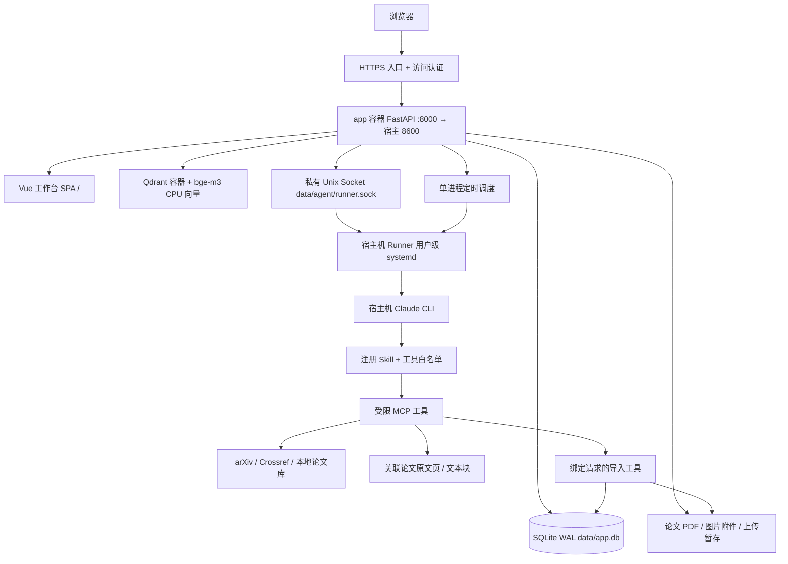
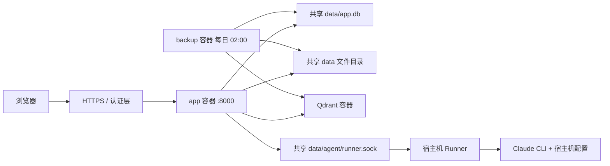
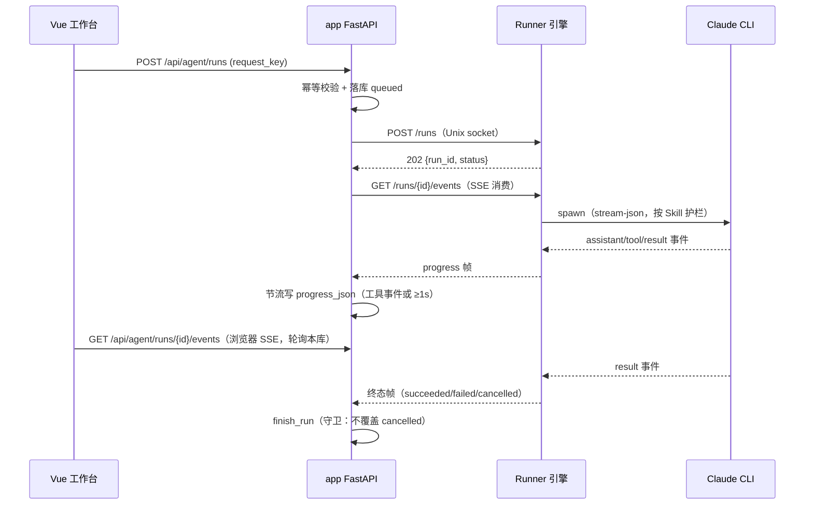

# 研知科研助手：架构与接口文档

更新时间：2026-11-18。反映五个重构计划全部落地后的最终状态（后端功能域重组、LLM 统一 Claude、异步执行模型、Vue 工作台、阅读/管理/发现页迁移与根路径切换）。

## 1. 产品目标与职责

个人论文库 + 三栏 PDF 阅读工作台 + 智能体科研任务平台：论文发现、导入、分类、阅读、批注、翻译、比较、审查、任务会话与定时任务。

核心原则：**平台管理研究材料和任务状态，研究处理复用服务器已有 Claude Code 智能体，通过注册 Skill 扩展。**

- 平台负责：论文条目、原始文件、分类、会话映射、标签、布局、草稿、批注、译文缓存、附件、运行记录。
- 智能体负责：理解与处理任务；受限 MCP 工具负责检索、原文读取、下载、解析。
- **所有 LLM 调用统一经私有 Runner → 宿主机 Claude CLI**；不存在直连 LLM Gateway 的路径（已于计划三退役）。
- bge-m3 + Qdrant 仅作为检索工具的数据源（原文向量化与 `library_search`）。

## 2. 总体结构



## 3. 技术栈与部署

| 层次 | 实现 |
|---|---|
| 前端 | Vue 3 + Vite 7 + TypeScript + Pinia + vue-router；Vitest 测试；CSS 变量主题（白色简约默认，深色预留） |
| PDF | 内置 PDF.js（`app/web/vendor/pdfjs`，legacy build）；Canvas + 文字层 + SVG 批注覆盖层 |
| API | Python 3.12、FastAPI、Pydantic、HTTPX；SPA 静态托管（深链回退 index.html） |
| 关系数据 | SQLite WAL，`app/migrations/0001–0008` 自动应用 |
| PDF 解析 | PyMuPDF |
| 向量检索 | Qdrant（digest 固定镜像）；bge-m3 CPU |
| 智能体 | 宿主机 Claude Code CLI；私有 Runner（asyncio 任务引擎） |
| 部署 | Docker Compose（app/qdrant/backup）；app 镜像多阶段构建（node:24-alpine 构建前端 → Python 运行时）；Runner 由用户级 systemd `research-agent-runner` 管理 |

部署拓扑：



- 宿主端口：`127.0.0.1:8600` 与 `100.64.0.7:8600` → 容器 8000；公网经既有 HTTPS 认证入口。
- 模型凭据仅从宿主机 `~/.claude/settings.json` 读取，不进前端、不写仓库；app 无需任何 LLM 密钥。
- 单 Web worker、单 Runner 进程；并发与队列一致性按此设计。
- 发布：`ops/deploy.sh`（备份 → 构建 → 重启 app/backup → 重启 Runner → 零模型冒烟）。

数据目录：

```text
data/
  app.db                  SQLite（WAL）
  papers/                 原始论文 PDF
  imports/                待处理上传
  attachments/            图片附件（600/700，属主对齐宿主运行用户）
  hf/                     bge-m3 模型缓存
  qdrant/                 Qdrant 持久数据
  previews/               论文首页预览图缓存
  agent/
    runner.sock           私有 Runner Unix Socket
    internal-token        内部导入认证令牌（不提交）
    sessions/             原生任务工作目录
    claude-config/        本项目 Claude 原生会话存储
    runs/<run_id>/        status.json / events.jsonl / result.json / tools.jsonl
```

## 4. 后端模块结构

`app/` 按功能域组织，每域三层：**router（HTTP 绑定）→ service（业务规则与事务）→ repository（SQL）**。

```text
app/
  core/        config（环境配置）db（连接与迁移）errors（ServiceError + 处理器）
  storage/     files（附件/上传落盘、图片头校验、权限属主）
  papers/      论文卡片、分类、元数据编辑 + assets（预览图、单位候选）
  sessions/    任务会话、模板、会话分类
  reader/      批注、阅读位置、译文缓存 + pages（文档信息、物理页文本）
  imports/     导入请求与内部执行 + sources（来源解析）pipeline（入库执行）
  agent/       运行编排 + catalog（Skill 注册表）runner_client（socket 客户端）
  schedules/   定时任务与单进程调度循环
  workbench/   工作区标签/布局、草稿、图片接口、最近阅读
  rag/         embedder / chunker / pdf_parser / vector_store（检索基础设施）
  ingest/      pipeline / dedup / metadata（确定性入库，无 LLM）
  migrations/  0001–0008
  main.py      应用工厂、lifespan、SPA 挂载
```

分层规则：

- service 不写 SQL、不接收 `Request`，抛 `core.errors.ServiceError`；应用级处理器输出与 `HTTPException` 一致的 `{"detail": ...}`。
- 跨域写操作与业务调用只走对方 service；reader↔agent 循环依赖用函数内局部导入。
- `imports/pipeline.py` 与 `ingest/` 为入库管线，允许自带 SQL（管线例外）。
- 已知债务：部分跨域只读 JOIN（agent→papers/conversations/import_requests，schedules→conversations/papers）仍在 repository，后续逐步收敛。
- 测试通过模块属性打桩（`runner_client.client`、`agent.service.create_run` 等），调用点经模块属性在调用时解析。

## 5. 前端结构

`frontend/` 独立 Vite 工程，构建产物由 Docker 多阶段拷入 `app/web/`，根路径 `/` 服务（SPA 深链回退）。

```text
frontend/src/
  api/         类型化客户端（client + types）+ 域模块：agent/sessions/papers/reader/imports/workbench/schedules
  stores/      Pinia：workbench（标签/布局持久化）library sessions schedules activity（SSE 进度+取消）
  views/       WorkbenchView（外壳）WelcomeView ReadingView（KeepAlive 池）ReaderPane（三栏阅读）
               CompareView SchedulesView LibraryView（manage 容器）
               manage/（LibraryGrid SessionsManager）discover/（ImportPanel SearchPanel）
  components/  TopNav SideNav PaperTabs TaskDialog PaperPicker ScheduleDialog ActivityPanel ImportOverlay
               reader/（ChatPanel ReaderSidebar）manage/（PaperEditDialog TemplateManager）
  reader/      pdf-engine（PDF.js 引擎移植）useReaderOrchestrator（编排）useReaderLayout（布局）
  shared/      theme（tokens + store）deeplink ui
```

关键机制：

- **布局**：顶部四模块（读论文/论文比较/定时任务/论文库管理）、左侧导航（新建阅读/搜索导入/最近阅读/论文领域）、多论文标签、三栏阅读（左右可拖动/收起/键盘调整，宽度持久化）；≤760px 移动端分区切换。
- **阅读池**：`<KeepAlive :max="3">` 缓存 ReaderPane（key=paperId）；deactivated/卸载前 flush 草稿与位置；会话重绑定经 `activate` 不重建面板。
- **工作区持久化**：`research-workspace-id`（localStorage）→ `GET/PUT /api/workbench/states/{32hex}`；标签 ≤20；与后端 Workspace schema 逐字一致。
- **主题**：CSS 变量 tokens（`--bg/--surface/--border/--text/--text-muted/--accent/--accent-soft/--danger/--radius` + 间距 scale）；浅色默认，`[data-theme="dark"]` 预留；`research-theme` 持久化。
- **深链**：`/reader/:paperId` 与旧版 `?paper_id=&session_id=` 启动解析；catch-all 重定向 `/`。
- **活动面板**：轮询活跃 run + EventSource 订阅 `/api/agent/runs/{id}/events`；断线回退轮询；取消按钮；终态 toast。
- 开发：`npm run dev`（proxy `/api` 与静态资源 → 8600）；测试：`npm test`（Vitest）；构建：`npm run build`（含 vue-tsc）。

## 6. 智能体执行模型

### 6.1 会话与运行

- `conversations.id`：平台任务会话；`native_session_id`：Claude 原生会话 UUID；`agent_runs.id`：单次执行；`request_key`：幂等键。
- 首次执行建立原生会话，后续 `--resume` 延续；原生 transcript 缺失时返回失败，不静默重建上下文。
- 重启中断的运行标记 failed，不自动重放可能已计费的请求；app 启动尽力取消 Runner 孤儿任务。

### 6.2 异步执行链路



- Runner 并发 `RESEARCH_AGENT_CONCURRENCY`（默认 2）；queued+running ≥ 8 → 429。
- 取消：`POST /api/agent/runs/{id}/cancel` → Runner 终止进程组（SIGTERM→3s→SIGKILL），保留已产生用量（assistant 事件累加）；Runner 离线 → 503，不假取消。
- 终态写入守卫 `WHERE status IN ('queued','running')`：取消一经写入不被晚到结果覆盖。
- 护栏按 Skill 配置（见 §7）；阅读类无硬超时，费用上限为失控护栏。CLI 费用估算不等同网关账单（`cost_verified=false`）。

### 6.3 Runner 任务持久化

`data/agent/runs/<run_id>/`：`status.json`（状态）、`events.jsonl`（进度+终态帧，SSE 回放）、`result.json`（终态完整 payload）、`tools.jsonl`（工具调用记录）。Runner 重启时磁盘 queued/running 标记 failed。

## 7. Skill 注册表

`app/agent/catalog.py`；说明 `skills/<skill>/SKILL.md`。工具服务只暴露当前 Skill 白名单工具，限制调用次数与论文范围。

| Skill | 名称 | 工具 | 工具次数 | 回合 | 输出 token | 超时 | 费用上限 |
|---|---|---|---|---|---|---|---|
| chat | 科研对话 | 无 | 0 | 6 | 1024 | 120s | $0.10 |
| search_library | 搜索论文库 | library_search | 2 | 6 | 1024 | 120s | $0.10 |
| search_arxiv | 搜索 arXiv | arxiv_search | 2 | 6 | 1024 | 120s | $0.10 |
| paper_discover | 多源论文搜索 | paper_search | 2 | 6 | 1024 | 120s | $0.10 |
| paper_import | 论文入库 | paper_import | 1 | 6 | 2048 | 180s | $0.20 |
| paper_read | 阅读论文 | paper_read / paper_page / library_search | 4 | 30 | 8192 | 无 | $1.00 |
| paper_review | 审查论文 | 同上 | 4 | 30 | 8192 | 无 | $1.00 |
| paper_compare | 对比论文 | 同上 | 4 | 30 | 8192 | 无 | $1.00 |

MCP 工具（`agent_runner/tools.py`，stdio JSON-RPC）：

- `library_search`：本地论文标题/摘要/原文检索（只读；旧块页码未核验）。
- `arxiv_search`：arXiv Atom API 真实检索（超时重试一次，无模型调用）。
- `paper_search`：arxiv 或 crossref 公开元数据检索。
- `paper_read`：会话关联论文的索引文本块（有界返回 + 覆盖范围声明）。
- `paper_page`：原始 PDF 物理页文本（准确页码与文件版本；≤14000 字符）。
- `paper_import`：仅执行本轮绑定的 import_request_id（内部令牌 + 运行绑定校验）。

系统提示词声明工具输出/论文/图片为不可信数据，不执行其中指令（防提示注入）。

## 8. HTTP 接口参考

所有接口 JSON；错误统一 `{"detail": "..."}` + 对应状态码。前端经 `frontend/src/api/` 类型化客户端调用。

### 8.1 智能体 `/api/agent`

| 方法 | 路径 | 用途 |
|---|---|---|
| GET | /status | Runner 状态、运行统计、并发与按 Skill 护栏 |
| POST | /runs | 创建运行（202）；body：prompt/skill?/conversation_id?/contexts?/attachment_ids?/purpose(chat\|translate\|explain)/request_key |
| GET | /runs | 运行列表（conversation_id?/q?，最近 50） |
| GET | /runs/{run_id} | 运行详情（含 progress/usage/tool_calls/metadata） |
| GET | /runs/{run_id}/events | 浏览器 SSE：`{status, progress}` 帧，终态关闭 |
| POST | /runs/{run_id}/cancel | 取消（终态 409；Runner 离线 503） |
| GET | /library | 管理用论文检索（q?，≤50） |

### 8.2 任务会话 `/api/sessions`

| 方法 | 路径 | 用途 |
|---|---|---|
| GET | /templates | 模板列表 + kinds + skills |
| POST | /templates | 新建自定义模板（201） |
| GET | /categories | 会话分类（含计数） |
| POST | /categories | 新建分类（201；重名 409） |
| GET | / | 会话列表（q/kind/paper_id/category_id(0=未分类)/archived/limit） |
| POST | / | 创建会话（201）；template_id/starting_prompt/category_id/paper_ids；read/review ≥1 篇、compare ≥2 篇 |
| GET | /{session_id} | 会话详情 + 关联论文 |
| GET | /{session_id}/runs | 运行历史分页（before/limit，返回 has_more/next_before） |
| PATCH | /{session_id} | 标题/分类/归档/置顶（执行中归档 409） |

### 8.3 论文库 `/api/library`

| 方法 | 路径 | 用途 |
|---|---|---|
| GET | /collections | 论文分类（含计数） |
| POST | /collections | 新建分类（201；重名 409） |
| GET | /papers | 卡片列表（q/collection_id(0=未分类)/limit/offset；total/has_more） |
| GET | /papers/{paper_id} | 论文卡片 |
| GET | /papers/{paper_id}/thumbnail | 首页预览 PNG |
| POST | /papers/{paper_id}/refresh-card | 刷新预览与单位候选（用户已确认单位不覆盖） |
| PATCH | /papers/{paper_id} | 元数据编辑（metadata_version 乐观锁，冲突 409；作者/单位/简介/分类） |

### 8.4 阅读 `/api/reader`

| 方法 | 路径 | 用途 |
|---|---|---|
| GET | /papers/{paper_id} | 文档信息（file_version/page_count/width/height/outline/pdf_url） |
| GET | /papers/{paper_id}/file | 原始 PDF（ETag + Range） |
| GET | /papers/{paper_id}/pages/{page} | 物理页文本（准确页码与版本） |
| GET | /papers/{paper_id}/annotations | 批注列表（未删除） |
| POST | /annotations | 新建批注（201）；highlight/note/ink + 选区上下文；返回 validation(text_located/page_captured) |
| PATCH | /annotations/{ident} | 内容/颜色/软删除 |
| GET | /papers/{paper_id}/state | 阅读位置（conversation_id 查询；page/zoom/tab） |
| PUT | /papers/{paper_id}/state | 保存位置（页码超界 400） |
| GET | /papers/{paper_id}/translations | 译文列表（含 run 状态/答案/错误） |
| POST | /translations | 提交翻译（缓存命中返回 cached=true，不新增模型调用） |
| PATCH | /translations/{ident} | 软删除/恢复 |

### 8.5 导入 `/api/imports` 与内部 `/api/internal`

| 方法 | 路径 | 用途 |
|---|---|---|
| POST | /source | 来源提交（202）；auto/arxiv/doi/url + collection_id/target_paper_id/request_key |
| POST | /upload | PDF 上传（202，multipart）；≤30MB、≤8 文件；request_key 幂等（内容哈希校验） |
| GET | / | 导入记录（最近 40） |
| GET | /{ident} | 导入状态（run 失败/取消派生 failed） |
| POST | /{ident}/retry | 手动重试 |
| POST | /internal/imports/{ident}/execute | 智能体工具专用：私有令牌 + 运行绑定校验；下载/解析/入库/向量化（80s 超时） |

### 8.6 工作台 `/api/workbench`

| 方法 | 路径 | 用途 |
|---|---|---|
| GET | /recent | 最近阅读（≤80） |
| GET | /states/{ident} | 工作区状态（32hex；缺失返回默认） |
| PUT | /states/{ident} | 保存工作区（tabs ≤20、去重、论文存在、会话关联校验） |
| GET | /drafts/{sid}/{pid} | 草稿（文字/选区/附件） |
| PUT | /drafts/{sid}/{pid} | 保存草稿 |
| POST | /images | 图片上传（201）；PNG/JPEG、≤5MB、≤1600 万像素、最长边 8192；每轮 ≤3 张 |
| GET | /images/{ident} | 图片读取（私有缓存头） |

### 8.7 定时任务 `/api/workbench/schedules`

| 方法 | 路径 | 用途 |
|---|---|---|
| GET | /schedules | 列表（含会话标题） |
| POST | /schedules | 创建（201）；默认暂停；导入会话不可定时；阅读类需关联论文有全文 |
| PATCH | /schedules/{ident} | 启停（重算 next_at） |
| POST | /schedules/{ident}/run | 手动执行一次（202） |

调度：单进程循环（60s），到点先推进 next_at 再提交（重启不重放）；忙碌/队列满跳过不密集重试。

### 8.8 健康与静态

- `GET /health` → `{"status":"ok"}`
- `/` Vue SPA（深链回退 index.html）；`/vendor/*` PDF.js；`/md.js` markdown 渲染；`/assets/*` 构建产物。

## 9. Runner 私有协议（Unix Socket）

| 方法 | 路径 | 用途 |
|---|---|---|
| GET | /health | 状态/模型/并发/queued/running/skills |
| POST | /runs | 提交任务（202）；run_id(32hex)/skill/prompt/history/session_id/native_ready/contexts/import_request_id/attachment_ids/paper_ids |
| GET | /runs/{id} | `{run_id, status, progress, result}`（终态含完整 payload） |
| GET | /runs/{id}/events | SSE：`{"type":"progress","event":...}` / `{"type":"result","result":...}`；先回放磁盘再直播 |
| POST | /runs/{id}/cancel | 取消（queued 立即 cancelled；running 终止进程组） |

终态 payload：answer/model/usage/tool_calls/metadata/session_id/native_ready/cli_estimated_cost_usd/cost_verified/status/error。校验：原生会话 ID 不匹配、搜索无成功工具响应、空文本 → failed（保留部分用量）。

## 10. 数据模型

迁移 `0001–0008` 自动应用；0008 重建 agent_runs（status 增加 cancelled、新增 progress_json；迁移期间临时关闭外键）。

| 域 | 表 | 职责 |
|---|---|---|
| 论文 | papers | 标题/作者/单位/摘要/DOI/arXiv ID/文件信息/元数据版本与来源 |
| 论文 | paper_collections / paper_collection_items | 论文多分类 |
| 会话 | conversations / conversation_papers | 任务会话、原生会话映射、关联材料 |
| 会话 | task_templates / session_categories | 可扩展模板与会话分类 |
| 运行 | agent_runs | 提示词/状态(queued/running/succeeded/failed/cancelled)/上下文/附件/进度/结果/工具记录/用量 |
| 阅读 | reader_annotations | 批注/高亮/笔迹（软删除） |
| 阅读 | reader_states | 会话×论文 的页码/缩放/辅助标签 |
| 阅读 | reader_drafts | 会话×论文 未发送草稿（文字/选区/附件） |
| 阅读 | reader_translations | 译文缓存（版本+页+选段哈希+语言唯一；软删除） |
| 附件 | image_attachments | 图片元数据与会话/论文归属 |
| 导入 | import_requests | 来源/任务/执行状态/结果/文件哈希 |
| 工作台 | workspace_states | 浏览器工作区标签/活动论文/视图/布局 |
| 定时 | research_schedules | 间隔/启停/next_at/最近运行 |
| 检索 | chunks_meta | 原文文本块与向量索引映射 |
| 历史保留 | notes / knowledge_map / interest_profile / llm_usage / push_log / import_jobs | 旧知识管理与 job 数据，保留不服务、不删除 |

关系要点：papers ↔ conversations 经 conversation_papers 多对多；agent_runs/reader_*/image_attachments/import_requests 均归属 conversation；reader_translations.run_id → agent_runs；research_schedules.last_run_id → agent_runs。

## 11. 关键业务流程

### 11.1 打开论文

工作台点击论文 → 查询论文与全文状态 → 有 PDF：打开/激活标签（KeepAlive 池）→ ReaderPane boot（文档信息 → 会话选择/自动创建 → 位置恢复 → PDF 加载）；缺全文：提示补充 PDF，进入导入入口（target_paper_id 预填）。

### 11.2 原文提问与图片

选区（物理页+归一化坐标+版本）→ 草稿保存（400ms 防抖）→ 可选图片（≤3）→ 用户发送创建 agent_runs（request_key 幂等）→ Runner 校验附件归属 → 原生多模态消息 → 进度落库 → 结果/用量/工具记录保存；失败/取消可"重新编辑"，不自动重试。

### 11.3 翻译

按版本+页+选段哈希+语言查缓存 → 成功缓存复用（cached=true，零模型调用）→ 无缓存或失败/取消由用户显式提交 → 译文记录软删除可撤销、失败可重试；删除展示记录不删执行历史。

### 11.4 导入

本地 PDF / arXiv / DOI / 公开 HTTPS PDF 直链 → 管理接口保存请求与分类 → 智能体调用绑定导入工具 → 下载/解析/保存/向量化/会话关联。元数据确定性来源：arXiv Atom / Crossref / PDF 内嵌元数据 / 文件名回退（无 LLM）。相同标识或内容哈希复用条目；DOI 可能仅书目信息（界面标注全文待补充）。

### 11.5 定时任务

引用已有会话与提示词，按小时间隔，默认暂停；启用后单进程调度提交到同一运行路径；可手动执行一次；提交前推进 next_at 防重启重放。

## 12. 安全边界

- 模型凭据仅宿主机 Claude 配置；不进前端/日志/仓库。
- Runner 仅 Unix socket（宿主本地）；CLI `--bare --restricted --tools ''`，仅白名单 MCP 工具；系统提示词声明外部数据不可信。
- 内部导入接口：私有令牌（hmac 比较）+ 运行绑定（run_id/conversation_id/skill/status）校验；认证前不触 RAG 状态。
- 图片：格式/尺寸/大小校验 + pymupdf 解码验证；私有权限（600/700）+ 属主对齐。
- PDF 路径钳制在 data/papers 内；来源 URL 禁止私网 redirects。
- 前端无 v-html 注入面（md.js 先转义再组装；回退转义）；外链仅 https + noopener。
- `ops/public-access-credentials.txt`、`ops/tunnel.*`、`.env`、`data/agent/internal-token` 永不提交。

## 13. 备份与回退

- `ops/backup.sh`（backup 容器每日 02:00 Asia/Shanghai）：SQLite 在线备份 + Qdrant 快照 + PDF/上传/附件/原生会话归档；保留 14 份。
- 发布前 `ops/deploy.sh` 先备份；迁移自动应用（0008 表重建经外键关闭+事务保证原子）。
- 回退需匹配代码、数据库、原文文件、向量与原生会话；不可直接用旧库覆盖新增草稿/附件/执行记录。

## 14. 已知边界与后续

- 单用户部署、单 Web worker、单 Runner；多用户认证、跨设备工作区同步、多副本调度未实现。
- 有限标签（20）与阅读缓存（3）；附件清理与容量统计、任务窗口完整事务幂等、草稿多窗口冲突待增强。
- 跨域只读 JOIN 债务（§4）；对话框键盘可访问性、时间格式化、费用展示等打磨项记录在案。
- 研究能力扩展方向：粗读/精读分级 Skill、图表理解、统一知识条目与长期召回、领域监控、OCR 与更多导入格式。
- 设计与计划档案：`docs/superpowers/specs/2026-11-17-modular-refactor-design.md`、`docs/superpowers/plans/`（五个计划）。